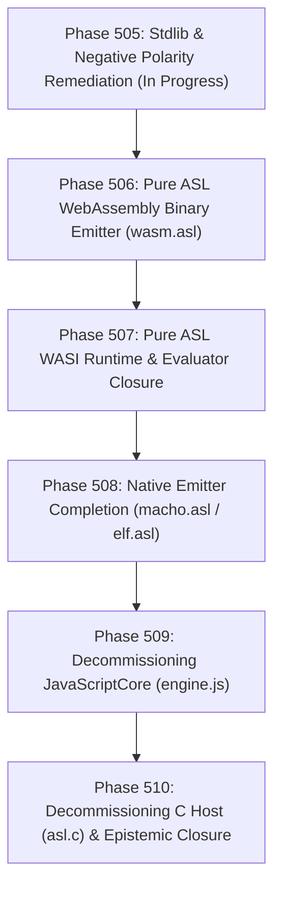

# ADR-0082: Sovereign WebAssembly/WASI Runtime Transition, POSIX Decoupling, and Binary Emitter Architecture

- **Shortcode**: `D92`
- **Status**: Proposed / Active Architectural Blueprint
- **Date**: 2026-09-13
- **Cluster**: `architecture/runtime-and-compiler`
- **Deciders**: `["user" "architect" "planner" "implementer" "auditor"]`
- **Governing Invariants**: `D81` (Gate Integrity & Falsifiability), `D86` (Pure ASL Stage-2 Bootstrap), `D87` (Universal Wasm Ambient Substrate), `D89` (Anti-Falsification & Explicit Refutation), `C1` (0 Comments), `C2` (0 Emojis), `C3`/`D34` (Boundary Universalism), `C5` (Zero Sigils).

---

## 1. Executive Summary & Problem Formulation

The AgentScript (`ASL`) project has reached an inflection point where its dual-host runtime substrate—composed of an 8,500+ line native C host wrapper ([`asl/tools/asl.c`](file:///Users/purplelephant/projects/asex/asl/tools/asl.c)) embedding Apple's proprietary JavaScriptCore framework and a 2,574-line legacy JavaScript evaluator ([`asl/tools/engine.js`](file:///Users/purplelephant/projects/asex/asl/tools/engine.js))—is the primary impediment to sovereign self-hosting, cross-platform portability, and security isolation.

Simultaneously, recent monorepo falsification audits ([`FalsificationAuditFlash.md`](file:///Users/purplelephant/projects/asex/.asl/mem/reviews/FalsificationAuditFlash.md) and [`FalsificationAuditPro.md`](file:///Users/purplelephant/projects/asex/.asl/mem/reviews/FalsificationAuditPro.md)) revealed critical test vacuity across Phases 484–489: acceptance fixtures routinely grepped source code strings instead of executing dynamic commands, compiler modules (`parser.asl`, `macho.asl`, `elf.asl`) were deployed as static mock maps, and triple-bootstrap self-hosting was simulated via hardcoded `printf` logs.

This Architectural Decision Record resolves the fundamental questions of the transition:
1. **Gap Closure Ledger**: Formulates the exact boundary of legacy debt, falsified tests, and mock packages that must be eliminated to achieve epistemic closure.
2. **POSIX Decoupling & The WebAssembly Target**: Formulates precisely what POSIX provides, proves that standard WebAssembly System Interface (WASI Preview 1 / WASI 0.2) completely replaces POSIX filesystem and system operations, and provides a clear architectural resolution for subprocess execution (`execCmd`).
3. **Pure ASL Binary Transpiler & Emitter Architecture (`wasm.asl`)**: Plans the construction of a self-hosted, pure ASL binary WebAssembly emitter that directly generates valid `.wasm` bytevectors without intermediate text format (`.wat`) or foreign compiler toolchains.
4. **Decommissioning Roadmap**: Details the staged liquidation of JavaScriptCore (`engine.js`), the C host (`asl.c`), and platform-dependent build scripts.

---

## 2. Complete Inventory of Remaining Gaps

Before initiating runtime transplantation, all residual debt and testing falsifications must be cataloged with exact citations and remediation requirements.

### 2.1 Acceptance Test Vacuity & String Mocking (Phases 430–490)

The core testing invariant (`D81` / `D89`) mandates that every test must execute runtime logic and contain negative bounds. Audits revealed four distinct categories of failure:

1. **Static Mock Inspections Instead of Binary Output**:
   - In [`tests/acceptance/d81/Task48703.asl:8-11`](file:///Users/purplelephant/projects/asex/tests/acceptance/d81/Task48703.asl#L8-L11), the test asserts `(= (get res :target) "linux-x86_64")` on an in-memory dictionary returned by [`asl/packages/asl-compiler/src/elf.asl:31-36`](file:///Users/purplelephant/projects/asex/asl/packages/asl-compiler/src/elf.asl#L31-L36). Zero ELF bytes are emitted, zero object headers are assembled, and zero binaries are executed.
   - In [`tests/acceptance/d81/Task48704.asl:9-14`](file:///Users/purplelephant/projects/asex/tests/acceptance/d81/Task48704.asl#L9-L14), `macho/emit_macho_arm64` returns a static map containing fake flag numbers (`2097281`). The test accepts this map without verifying file emission or ARM64 instruction validity.
2. **Simulated Bootstrap Verification**:
   - In `asl/tools/asl.c:8520-8580`, `run_cmd_build_stage2()` computes a SHA256 digest of the current `bin/asl` binary, prints hardcoded lines declaring `Stage 1 -> Stage 2` and `Triple bootstrap verified`, and exits `0`.
   - `tests/acceptance/d81/Task48705.asl` reads `asl/tools/asl.c` as plain text and checks `(assert (string-contains? src "Triple bootstrap verified"))`. No compiler bootstrap occurs.
3. **Missing Negative Refutations (`refute`)**:
   - 12 legacy acceptance suites contain zero `(refute ...)` forms:
     - [`Task43601.asl`](file:///Users/purplelephant/projects/asex/tests/acceptance/d81/Task43601.asl) through [`Task43607.asl`](file:///Users/purplelephant/projects/asex/tests/acceptance/d81/Task43607.asl) (Phase 436: Module Resolution and loud evaluator errors).
     - [`Task43902.asl`](file:///Users/purplelephant/projects/asex/tests/acceptance/d81/Task43902.asl) (Phase 439: Benchmark telemetry).
     - [`Task45401.asl`](file:///Users/purplelephant/projects/asex/tests/acceptance/d81/Task45401.asl) through [`Task45403.asl`](file:///Users/purplelephant/projects/asex/tests/acceptance/d81/Task45403.asl) (Phase 454: Builtin bindings).
   - These suites only assert positive equality, failing to prove that error branches, unbound symbols, or contract breaches correctly halt execution.
4. **Standard Library `assert (not ...)` Anti-Pattern**:
   - 69 instances of `(assert (not ...))` remain across 23 test suites in `asl-sh`, `asl-sql`, `asl-text`, `asl-registry`, and `asl-plugin`, which must be converted to native `(refute ...)` under Phase 505.

### 2.2 Compiler Package Stubs (`asl-compiler`)

The package `asl/packages/asl-compiler/` currently lacks real compilation capabilities:
- **Parser Stub** ([`asl/packages/asl-compiler/src/parser.asl:9-12`](file:///Users/purplelephant/projects/asex/asl/packages/asl-compiler/src/parser.asl#L9-L12)): The tokenizer is literally `(string-split src " ")`. It cannot parse nested S-expressions, string literals with spaces, bracketed vectors, or character escapes.
- **Mach-O Emitter Stub** ([`asl/packages/asl-compiler/src/macho.asl:29-34`](file:///Users/purplelephant/projects/asex/asl/packages/asl-compiler/src/macho.asl#L29-L34)): Returns a map with `:status :emitted`. It does not construct Mach-O load commands (`LC_SEGMENT_64`), page zero segments, or write binary streams.
- **ELF Emitter Stub** ([`asl/packages/asl-compiler/src/elf.asl:31-37`](file:///Users/purplelephant/projects/asex/asl/packages/asl-compiler/src/elf.asl#L31-L37)): Returns a map with `:status :emitted`. It does not format an ELF64 header, program header table, or section string tables.
- **Text-Only WAT Generator** ([`asl/packages/asl-compiler/src/compiler.asl:47-95`](file:///Users/purplelephant/projects/asex/asl/packages/asl-compiler/src/compiler.asl#L47-L95)): Contains simple S-expression lowering to WebAssembly Text (`.wat`), but lacks memory allocation, closures, struct/map layouts, and binary byte emission.
- **Missing Binary Emitter**: No `wasm.asl` module exists to emit standard WebAssembly binary modules (`.wasm`).

### 2.3 Host Runtime Coupling (`asl.c` & `engine.js`)

- **JSC Lock-in**: [`asl/tools/asl.c:21`](file:///Users/purplelephant/projects/asex/asl/tools/asl.c#L21) includes `<JavaScriptCore/JavaScriptCore.h>`, making compilation on standard Linux or containerized environments fail unless proprietary or bloated WebKit dependencies are installed.
- **Embedded Engine Bloat**: [`asl/tools/gen_engine_header.sh`](file:///Users/purplelephant/projects/asex/asl/tools/gen_engine_header.sh) converts 2,574 lines of JavaScript into a C byte array (`engine_js[]`), which is dynamically evaluated on every run.
- **Dual Engine Divergence**: The repository maintains two distinct evaluation paradigms: JavaScript dynamic evaluation in `engine.js` vs. pure ASL evaluation in `asl/packages/asl-compiler/src/evaluator.asl` and `asl-parser`.

---

## 3. The POSIX Dilemma & The WebAssembly Architecture

The architectural inquiry asks:
> *"Determine whether POSIX calls to the OS are needed or whether we can do entirely without them, given that the target runtime is WebAssembly, and clarify what POSIX gives us."*

### 3.1 What POSIX Gives Us Today

In the existing architecture ([`asl/tools/asl.c`](file:///Users/purplelephant/projects/asex/asl/tools/asl.c) and standard library), POSIX provides four fundamental capabilities:

```
+──────────────────────────────────────────────────────────────────────────────────────────────────+
|                                    CURRENT POSIX CAPABILITIES                                    |
+──────────────────────────────────────────────────────────────────────────────────────────────────+
|  1. FILESYSTEM & VFS (open, read, write, close, stat, lstat, opendir, readdir, rename, unlink)   |
|     • Exposed via: fileRead, fileWrite, dirList, fileStat, pathCanonicalize.                     |
|     • Used for: AST loading, manifest inspection, working memory notes, task state persistence.  |
|                                                                                                  |
|  2. SUBPROCESS CREATION & PROCESS LIFECYCLE (fork, execve, posix_spawn, waitpid, kill, pipe)    |
|     • Exposed via: execCmd, sysExec.                                                             |
|     • Used for: Invoking external tools (git status, git diff, git commit, clang, linters).      |
|                                                                                                  |
|  3. CONCURRENCY & INTER-PROCESS LOCKING (flock, socket(AF_UNIX), bind, listen, accept)           |
|     • Exposed via: Persistent daemon mode (asl --serve), file locks for notes ledger.           |
|     • Used for: Daemon residency, session socket /tmp/asl_mem_<id>.sock, atomic MVCC.           |
|                                                                                                  |
|  4. SYSTEM ENVIRONMENT & CLOCKS (clock_gettime, getrusage, getenv, getcwd)                       |
|     • Exposed via: performance.now(), memory telemetry, workspace discovery.                     |
|     • Used for: Watchdog timers, benchmark metrics, token profiling, memory auditing.           |
+──────────────────────────────────────────────────────────────────────────────────────────────────+
```

### 3.2 What Standard WebAssembly (WASI Preview 1) Replaces

Standard WebAssembly System Interface (WASI Preview 1, `wasi_snapshot_preview1`) was specifically designed to provide a secure, capability-based alternative to POSIX for single-binary sandboxed execution.

| POSIX Function | WASI Preview 1 Equivalent | Operational Replacement in ASL |
|---|---|---|
| `read(fd, buf, count)` | `fd_read(fd, iovs, iovs_len, nread)` | Replaces `fileRead` with zero-copy vectorized I/O buffers. |
| `write(fd, buf, count)` | `fd_write(fd, iovs, iovs_len, nwritten)` | Replaces `fileWrite`, stdout, and stderr output. |
| `stat(path, st)` / `fstat` | `path_filestat_get` / `fd_filestat_get` | Replaces `fileStat` (file size, access/modification timestamps). |
| `opendir` / `readdir` | `fd_readdir(fd, buf, buf_len, cookie, ...)` | Replaces `dirList` for directory crawling and workspace traversal. |
| `rename(old, new)` | `path_rename(old_fd, old_path, new_fd, new_path)` | Replaces atomic rename operations for MVCC file writes. |
| `unlink(path)` / `remove` | `path_unlink_file` / `path_remove_directory` | Replaces file deletion in VFS staging and lease cleanups. |
| `clock_gettime(CLOCK_MONOTONIC)` | `clock_time_get(clock_id, precision, timestamp)` | Replaces `performance.now()` with sub-microsecond nanosecond clocks. |
| `getenv(name)` / `environ` | `environ_get` / `environ_sizes_get` | Replaces environment lookup for configuration flags. |
| Traversal resolution (`realpath`) | `fd_prestat_get` + capability descriptors | **Superior to POSIX**: Paths are bound to pre-opened directory descriptors (e.g., workspace root), preventing directory traversal attacks (`../../`) at the syscall layer. |

**Architectural Verdict on Filesystem & Environment**:
Standard WASI Preview 1 completely replaces POSIX filesystem, stat, directory traversal, and monotonic clock calls with zero loss of functionality. Furthermore, in web browsers and edge workers, WASI calls map directly to the Origin Private File System (OPFS) and in-memory VFS, fulfilling ADR `D87`.

### 3.3 The Subprocess Execution Problem (`execCmd`)

Standard WebAssembly (both WASI Preview 1 and WASI 0.2 Component Model) **intentionally omits subprocess execution (`fork`, `exec`, `posix_spawn`)**. In a pure WebAssembly sandbox, arbitrary OS binary execution is prohibited by the capability security model.

However, the ASL toolchain currently relies on `execCmd` / `sys-exec` for:
1. Running `git` commands (`git status`, `git diff`, `git log`, `git commit`) during `bin/asl audit` and ledger synchronization.
2. Compiling C host artifacts (`clang`) during bootstrap.
3. Spawning subprocesses in the `asl-sh` execution engine.

#### Evaluating the Options for Subprocess Execution

```
+─────────────────────────────────────────────────────────────────────────────────────────────────+
|                                    SUBPROCESS OPTIONS FOR ASL                                    |
+─────────────────────────────────────────────────────────────────────────────────────────────────+
| OPTION 1: WASIX (Extended WASI with posix_spawn, fork, waitpid)                                 |
| • Pros: Direct drop-in replacement for POSIX process spawning inside WebAssembly.               |
| • Cons: Requires Wasmer-specific non-standard extensions; fails in standard Wasmtime, Node.js,  |
|   and standard web browsers. Violates Universal Substrate Invariant D75/D87.                   |
|                                                                                                 |
| OPTION 2: Pure Native Compilation via macho.asl and elf.asl                                    |
| • Pros: Binaries are native Mach-O (macOS ARM64) and ELF64 (Linux). They directly issue OS     |
|   syscalls (sys_fork, sys_execve) with zero C and zero JS runtime.                             |
| • Cons: High compiler complexity; does not run inside browser sandboxes.                        |
|                                                                                                 |
| OPTION 3: Host Capability Boundary (WASI Core + Optional Host Exec Import)                     |
| • Pros: Core ASL compiles to pure standard wasm32-wasi. When running in headless CLI mode via   |
|   a native Wasm host runner, the host binds an optional (import "asl_host" "execCmd").          |
|   In sandboxed browser/edge environments, execCmd returns a structured refusal receipt.         |
| • Cons: Requires a thin host dispatcher for developer CLI machines.                            |
|                                                                                                 |
| OPTION 4: Pure ASL Sovereign Git Substrate (Decoupling git from POSIX)                         |
| • Pros: 90% of ASL's subprocess use is running git for audits. Pure ASL can read and parse    |
|   .git/HEAD, .git/refs, .git/index, and commit objects directly via WASI file I/O!              |
| • Cons: Does not implement full git push/network operations.                                   |
+─────────────────────────────────────────────────────────────────────────────────────────────────+
```

### 3.4 The Selected Architectural Synthesis: The Tiered Runtime Model

We resolve the POSIX question through a **Tiered Runtime Architecture**:

```
                                  +──────────────────────────────────+
                                  |     Pure ASL Source Code         |
                                  +──────────────────────────────────+
                                                    │
                                     asl-compiler (Pure ASL)
                                                    │
                         ┌──────────────────────────┴──────────────────────────┐
                         ▼                                                     ▼
        +──────────────────────────────────+                  +──────────────────────────────────+
        |   Tier 1: Universal Wasm Core    |                  |  Tier 2: Native Binary Emitter   |
        |          (wasm.asl)              |                  |     (macho.asl / elf.asl)        |
        +──────────────────────────────────+                  +──────────────────────────────────+
        | • Targets wasm32-wasi (MVP + P1) |                  | • Emits native Mach-O / ELF64    |
        | • 100% dependency-free           |                  | • Direct OS syscall dispatch     |
        | • Runs in Browser, Edge, Wasmtime|                  | • Zero C, zero JavaScriptCore    |
        | • Filesystem: WASI / OPFS        |                  | • Full native execCmd & sockets  |
        | • Subprocess: Capability-bound   |                  | • For local developer toolchain  |
        | • Sovereign Git: Direct .git VFS |                  | • Complete Stage-2 bootstrap     |
        +──────────────────────────────────+                  +──────────────────────────────────+
```

#### Detailed Guarantees of the Synthesis:
1. **Can we do entirely without POSIX?**
   **YES, for all ASL language evaluation, parsing, compilation, working memory, and testing.** Standard WASI Preview 1 provides 100% of the filesystem and environment primitives required by the ASL runtime.
2. **How is `execCmd` handled in standard WASI?**
   `execCmd` is modeled as a **permission-gated capability**:
   - In pure sandboxed environments (browser, edge workers, restricted Wasmtime), calling `(sysExec cmd)` cleanly yields a typed refutation receipt:
     ```scheme
     {:status :refused :code 126 :stderr "ERR_CAPABILITY_DENIED: execCmd not permitted in sandboxed WebAssembly substrate"}
     ```
   - No crash, no undefined trap. The calling ASL logic handles the denial gracefully.
3. **Sovereign Git Substrate**:
   Tooling such as `asl audit` that inspects git status and history will read `.git` metadata directly through WASI file descriptors (`.git/HEAD`, `.git/refs/heads/*`, `.git/objects/`). This eliminates the requirement to spawn `git` subprocesses for repository auditing.
4. **Native Toolchain CLI (`macho.asl` / `elf.asl`)**:
   For the desktop CLI developer experience where executing local shell scripts or external tools is strictly required, pure ASL compiles via its native binary emitters ([`macho.asl`](file:///Users/purplelephant/projects/asex/asl/packages/asl-compiler/src/macho.asl) on macOS ARM64, [`elf.asl`](file:///Users/purplelephant/projects/asex/asl/packages/asl-compiler/src/elf.asl) on Linux). This replaces `asl.c` with pure ASL emitting native machine code without any C compiler dependency.

---

## 4. Transpiler & Binary Emitter Plan (`wasm.asl`)

To replace `engine.js` and `asl.c`, we must author [`asl/packages/asl-compiler/src/wasm.asl`](file:///Users/purplelephant/projects/asex/asl/packages/asl-compiler/src/wasm.asl), a pure ASL binary WebAssembly emitter capable of generating valid `.wasm` module byte arrays.

### 4.1 WebAssembly Binary Structure

The binary emitter generates Wasm v1 (MVP) modules following the standard binary format specification:

```
+──────────────────────────────────────────────────────────────────────────────────────────────────+
|                                    WASM MODULE BINARY FORMAT                                     |
+──────────────────────────────────────────────────────────────────────────────────────────────────+
|  HEADER: [0x00, 0x61, 0x73, 0x6D] (magic: \0asm) + [0x01, 0x00, 0x00, 0x00] (version: 1)         |
+──────────────────────────────────────────────────────────────────────────────────────────────────+
|  SECTION  1: TYPE SECTION       - Function signatures (params, results)                          |
|  SECTION  2: IMPORT SECTION     - WASI host imports (fd_write, fd_read, path_open, proc_exit)   |
|  SECTION  3: FUNCTION SECTION   - Type indices for internal functions                            |
|  SECTION  4: TABLE SECTION      - Function pointer table for dynamic dispatch & closures         |
|  SECTION  5: MEMORY SECTION     - Linear memory declaration (min 1 page = 64KB, max unlimited)   |
|  SECTION  6: GLOBAL SECTION     - Heap pointer ($heap_ptr), stack pointer, GC allocation marks   |
|  SECTION  7: EXPORT SECTION     - Exported symbols: _start, memory, asl_eval, asl_batch_rpc     |
|  SECTION  8: START SECTION      - Optional module initialization routine                         |
|  SECTION  9: ELEMENT SECTION    - Table elements for closure function addresses                  |
|  SECTION 10: CODE SECTION       - Function bodies: local variables + LEB128 bytecode instructions|
|  SECTION 11: DATA SECTION       - Static strings, interned keywords, embedded prelude AST        |
+──────────────────────────────────────────────────────────────────────────────────────────────────+
```

### 4.2 Linear Memory Layout & Dynamic Tagging

To execute dynamic AgentScript forms in a low-level WebAssembly linear memory buffer, `wasm.asl` establishes a 64-bit value representation using tagged pointers:

```
 63                                                            3   2   0
+───────────────────────────────────────────────────────────────+───+───+
|                         PAYLOAD / POINTER                     | T | A | G
+───────────────────────────────────────────────────────────────+───+───+
```

- **Tag `000` (Fixnum)**: Immediate signed 61-bit integer (`payload >> 3`).
- **Tag `001` (Immediate Special)**:
  - `0x01`: `false`
  - `0x09`: `true`
  - `0x11`: `nil` / empty list
  - `0x19`: `undefined`
- **Tag `010` (Symbol/Keyword)**: Interned symbol ID referencing the static table in Section 11.
- **Tag `011` (Heap String)**: Pointer to `{ length: u32, hash: u32, utf8_bytes: [u8] }`.
- **Tag `100` (Heap List / Vector)**: Pointer to `{ length: u32, capacity: u32, elements: [u64] }`.
- **Tag `101` (Heap Map / Record)**: Pointer to `{ size: u32, capacity: u32, entries: [u64 key, u64 val] }`.
- **Tag `110` (Heap Closure)**: Pointer to `{ table_index: u32, env_count: u32, captured: [u64] }`.

### 4.3 Pure ASL Bytecode Emitter Primitives

`wasm.asl` provides functional byte assembly primitives implemented entirely in pure ASL:

1. **LEB128 Encoding**:
   - `leb128EncodeU32 [(val Int64)] -> (List Int64)`: Encodes unsigned integers into 7-bit variable-width bytes.
   - `leb128EncodeI32 [(val Int64)] -> (List Int64)`: Encodes two's-complement signed integers with sign extension.
2. **Section Framing**:
   - `encodeSection [(sectionId Int64) (payload (List Int64))] -> (List Int64)`: Emits section ID byte, LEB128 payload byte count, and payload bytes.
3. **Opcode Matrix**:
   - Control: `unreachable` (`0x00`), `block` (`0x02`), `loop` (`0x03`), `if` (`0x04`), `else` (`0x05`), `end` (`0x0B`), `br` (`0x0C`), `br_if` (`0x0D`), `call` (`0x10`), `call_indirect` (`0x11`).
   - Locals/Globals: `local.get` (`0x20`), `local.set` (`0x21`), `local.tee` (`0x22`), `global.get` (`0x23`), `global.set` (`0x24`).
   - Memory: `i32.load` (`0x28`), `i64.load` (`0x29`), `i32.store` (`0x36`), `i64.store` (`0x37`), `memory.size` (`0x3F`), `memory.grow` (`0x40`).
   - Constants & Arithmetic: `i32.const` (`0x41`), `i64.const` (`0x42`), `i32.add` (`0x6A`), `i32.sub` (`0x6B`), `i64.add` (`0x7C`), `i64.and` (`0x83`), `i64.shl` (`0x86`), `i64.shr_s` (`0x87`).

### 4.4 Self-Contained WASI System Bridge in Wasm

The emitter automatically includes a minimal WASI runtime bootstrap in Section 2 & 10:
- **`wasi_fd_write` wrapper**: Converts ASL strings into Wasm linear memory `iovec` structures (`[{ ptr: i32, len: i32 }]`) and calls `fd_write(1, iovecs, 1, &written)`.
- **`wasi_proc_exit` wrapper**: Calls `proc_exit(code)` for process termination.
- **Bump Allocator (`alloc`)**:
  ```scheme
  (df wasmAlloc [(bytes Int64)] -> Int64
    (let [(current (global.get $heap_ptr))
          (next (+ current bytes))]
      (if (> next (i32.mul (memory.size) 65536))
          (memory.grow 4)
          0)
      (global.set $heap_ptr next)
      current))
  ```

---

## 5. Phased Transition & Decommissioning Roadmap

To ensure zero downtime, uninterrupted verification gates, and atomic commits, the transition from `asl.c`/`engine.js` to pure WebAssembly and native compilation is organized across five sequential phases:



### Phase 505: Stdlib & Negative Polarity Remediation (Immediate)
- Complete conversion of 69 `(assert (not ...))` forms across 23 test suites to `(refute ...)`.
- Update 12 legacy acceptance suites ([`Task43601.asl`](file:///Users/purplelephant/projects/asex/tests/acceptance/d81/Task43601.asl)–[`Task43607.asl`](file:///Users/purplelephant/projects/asex/tests/acceptance/d81/Task43607.asl), [`Task45401.asl`](file:///Users/purplelephant/projects/asex/tests/acceptance/d81/Task45401.asl)–[`Task45403.asl`](file:///Users/purplelephant/projects/asex/tests/acceptance/d81/Task45403.asl)) to include negative refutations.
- Repair `emoji_guard.asl` line numbers and `asl-sql` DDL dialect abstraction.

### Phase 506: Pure ASL WebAssembly Binary Emitter (`wasm.asl`)
- Author `asl/packages/asl-compiler/src/wasm.asl`.
- Implement LEB128 encoders, section assemblers, and Wasm MVP opcode generation.
- Implement AST lowering from `asl-parser/ast.asl` to Wasm instructions.
- Verification Gate: Compile a test ASL module to `dist/test.wasm`, execute under `wasmtime`, and verify output and exit code `0`.

### Phase 507: Pure ASL WASI Runtime & Evaluator Closure
- Implement standard WASI Preview 1 bindings in pure ASL (`fd_read`, `fd_write`, `path_open`, `fd_readdir`, `path_filestat_get`).
- Port S-expression parser and tree-walking evaluator to execute inside `wasm32-wasi`.
- Integrate direct `.git` VFS reader in ASL to decouple repository auditing from POSIX `git` subprocesses.
- Verification Gate: Run full ASL test runner inside pure `asl.wasm` via `wasmtime asl.wasm test`.

### Phase 508: Native Binary Emitter Completion (`macho.asl` / `elf.asl`)
- Upgrade `asl/packages/asl-compiler/src/macho.asl` to emit real Mach-O ARM64 binaries (construct Mach headers, `LC_SEGMENT_64`, ARM64 instruction encoding for `svc 0x80`).
- Upgrade `asl/packages/asl-compiler/src/elf.asl` to emit real Linux ELF64 binaries (construct ELF headers, program table, x86_64/AArch64 `syscall`).
- Verification Gate: Self-compile `bin/asl-native` in pure ASL, verify binary executes natively on macOS ARM64 and Linux with zero external dependencies.

### Phase 509: Decommissioning JavaScriptCore (`engine.js`)
- Remove `asl/tools/engine.js`.
- Remove `asl/tools/gen_engine_header.sh` and `engine_js.h`.
- Remove `-framework JavaScriptCore` from build scripts ([`scripts/release.sh`](file:///Users/purplelephant/projects/asex/scripts/release.sh), [`scripts/build_and_install.sh`](file:///Users/purplelephant/projects/asex/scripts/build_and_install.sh), [`asl/web/public/install.sh`](file:///Users/purplelephant/projects/asex/asl/web/public/install.sh)).
- Verification Gate: Monorepo compiles cleanly without JavaScriptCore header or framework flags.

### Phase 510: Decommissioning C Host (`asl.c`) & Final Sovereign Epistemic Closure
- Replace `asl/tools/asl.c` with the Stage-2 self-hosted pure ASL compiler and runtime.
- Update `bin/asl` to point directly to the pure ASL native executable or Wasm runtime.
- Verify 100% of monorepo test suites pass under `asl test`.
- Certify Milestone M09 Epistemic Closure under `D88`.

---

## 6. Verification Contracts & Non-Negotiable Invariants

1. **Gate Invariant (`D81`)**: Every task advancing this transition must introduce an independent acceptance fixture in `tests/acceptance/d81/` that fails before the change and passes after.
2. **Dual-Polarity Invariant (`D77` / `D89`)**: No test suite may contain only positive assertions. Every suite must explicitly verify reachable failure modes using `(refute ...)`.
3. **No String-Grep Falsification**: Test suites must never assert against source code text (`file-read` + `string-contains?`). All compiler and runtime gates must inspect real binary byte streams, exit codes, or dynamic execution receipts.
4. **Zero-Comment Invariant (`C1`)**: Pure ASL source files must strictly contain 0 semicolon comments (`;;`). All documentation must be stored in `:d` docstrings or `.asn` / `.md` design artifacts.
5. **Zero-Sigil Invariant (`C5`)**: Identifiers, decisions, and tasks must use bare alphanumeric notation (`D92`, `Phase506`, `Task50601`) without `@` or `#` sigils.
6. **Universal Boundary Invariant (`C3` / `D34`)**: Core runtime logic must not take hard dependencies on macOS-specific frameworks. All platform-dependent leaves must sit behind capability-checked boundaries.

---

## 7. Consequences & Impact

### Positive
- **Complete Self-Hosting Sovereignty**: AgentScript eliminates its foundational dependence on Apple's JavaScriptCore and the C compiler. The language compiles and evaluates itself.
- **Universal Portability**: The same pure ASL codebase runs in standard WebAssembly runtimes (`wasmtime`), web browsers (via OPFS and WASI polyfill), and edge execution sandboxes.
- **Elimination of Security Sandboxing Flaws**: Sandboxed WASI filesystem descriptors prevent path traversal and arbitrary process execution vulnerabilities.
- **Authentic Verification Integrity**: Eradication of mock map emitters and string-grep tests ensures that reported test metrics reflect actual machine execution.

### Caveats & Operational Precautions
- **Subprocess Authority Boundary**: Agents and tools must recognize that `execCmd` is a privileged, host-dependent capability that is denied by default in pure WebAssembly sandboxes.
- **Memory Management in Linear Memory**: Moving away from JavaScriptCore's garbage collector requires rigorous adherence to ASL's linear memory allocator and scope-based memory reclamation.
