# Monorepo Master Execution Roadmap (.plans)

## Structural Overview
This execution DAG resolves all 58 empirical gap records cataloged in .asl/mem/decisions/GAPS.asn. All phases are sequenced by strict dependencies and partitioned by git submodule boundaries to prevent index.lock collisions.

```mermaid
graph TD
    P1["Phase 1: TD-303 Batch RPC Error Resilience (Completed)"] --> P2["Phase 2: P0 Engine Runtime, Evaluator & Module Foundation (Completed)"]
    P2 --> P3["Phase 3: P1 Test Regression Restoration & Assertion Integrity (Completed)"]
    P3 --> P4["Phase 4: P2 Invariant Normalization & Boundary Deduplication (Completed)"]
    P4 --> P5["Phase 5: Token Economy & Manifest Synchronization (Completed)"]
    P5 --> P6["Phase 6: Repository Hygiene, Lexicon Truth & Duplication Eradication (Completed)"]
    P6 --> P7["Phase 7: Repository Hygiene, Configuration Truth & Full Corpus Gate Scope (Completed)"]
    P7 --> P8["Phase 8: Verification Layer Honesty & Static Analysis Toolchain (Completed)"]
    P8 --> P9["Phase 9: Instruction Surface Truth, Doctor Tooling & Capabilities Lock (Completed)"]
    P9 --> P10["Phase 10: Agent Working Memory Surface (Completed)"]
    P10 --> P11["Phase 11: Closing the Unplanned (Completed)"]
    P11 --> P12["Phase 12: Client Launch & Codex Efficiency (Completed)"]
    P12 --> P13["Phase 13: Tool Reliability & Scenario Coverage (Completed)"]
    P13 --> P14["Phase 14: Paradigm by Force & Tier (Completed)"]
    P14 --> P15["Phase 15: Intent, Goal and Practice Lifecycle (Completed)"]
    P15 --> P16["Phase 16: Swarm Edit Visibility and Collision Avoidance (Done)"]
    P16 --> P17["Phase 17: Capability Corpus Ground Truth, Schema Separation & Harness Selection (Done)"]
    P17 --> P18["Phase 18: Language Optimization, Staging & Tooling Runtime (Done)"]
    P18 --> P19["Phase 19: Runtime Boundary and Memory Safety (Done)"]
```

---

## Phase Matrix

| Phase | Path | Priority | Scope & Acceptance Criteria |
| :--- | :--- | :--- | :--- |
| **Phase 1** | [.plans/phase-1/PLAN.md](file:///Users/purplelephant/projects/asex/.plans/phase-1/PLAN.md) | **Done** | Native C batch RPC error shielding, non-blocking socket framing, and daemon timeouts. |
| **Phase 2** | [.plans/phase-2/PLAN.md](file:///Users/purplelephant/projects/asex/.plans/phase-2/PLAN.md) | **Done** | Evaluator enum qualification, binary recompilation, core/strings eradication across 5 packages, :exports to :x, and pure functional steps-pipeline. |
| **Phase 3** | [.plans/phase-3/PLAN.md](file:///Users/purplelephant/projects/asex/.plans/phase-3/PLAN.md) | **Done** | Restore all 36 failing test suites to green under asl test --strict-falsify (SVG attribute reordering, reducer newline split, StepResult observation, BM25 token counts, Option unwrap, zero-socket RPC). |
| **Phase 4** | [.plans/phase-4/PLAN.md](file:///Users/purplelephant/projects/asex/.plans/phase-4/PLAN.md) | **Done** | Invariant C2 unicode emoji to SVG/ASCII normalization, eradicate ../../ escapes, unify TaskState/TaskRecord enums, and consolidate 56 duplicate helpers in mem. |
| **Phase 5** | [.plans/phase-5/PLAN.md](file:///Users/purplelephant/projects/asex/.plans/phase-5/PLAN.md) | **Done** | PascalCase test functions refactor (D51), sigil eradication (@/#) in XRef/TUI (C5), manifest synchronization across 10 packages (MAN-01..07), and zero stub certification in asl-gateway. |
| **Phase 6** | [.plans/phase-6/PLAN.md](file:///Users/purplelephant/projects/asex/.plans/phase-6/PLAN.md) | **Done** | Nested build artifact cleanup (asl/dist/dist), installer synchronization across distribution targets, canonical spoken lexicon (asl/grammar/lexicon.asn), retire voice mishearing (harness), and eradicate shadowed helpers in codec. |
| **Phase 7** | [.plans/phase-7/PLAN.md](file:///Users/purplelephant/projects/asex/.plans/phase-7/PLAN.md) | **Done** | Restrict pnpm-workspace to valid packages, correct core-packages coverage paths in .asl.config.asn, synchronize local lexicon (.asl/hyness.config.asn), eradicate comments in .addie/config.asn (C1), restore Gate 5 scope to full monorepo corpus (313 suites), and reconcile engine binaries. |
| **Phase 8** | [.plans/phase-8/PLAN.md](file:///Users/purplelephant/projects/asex/.plans/phase-8/PLAN.md) | **Done** | Verification layer honesty hardening (Task45501 - asl test empty refusal), static analysis subcommands (Task45701-45703 - asl audit bind, dup, dead), engine binary parity reconciliation (Task47303 - bin/asl, asl/bin/asl, asl/asl), and master gate certification. |
| **Phase 9** | [.plans/phase-9/PLAN.md](file:///Users/purplelephant/projects/asex/.plans/phase-9/PLAN.md) | **Done** | Instruction surface truth (Task46401 - AGENTS.md, README.md), native capability measurement subcommand & lock file (Task46403 - asl doctor, capabilities.lock), binary parity (Task47303 - bin/asl, asl/bin/asl, asl/asl), and master gate certification. |
| **Phase 10** | [.plans/phase-465/PLAN.md](file:///Users/purplelephant/projects/asex/.plans/phase-465/PLAN.md) | **Done** | Agent Working Memory Surface: facade/checkpoint suite integrity (Task46505), native command surface (asl note/task/queue) and batch RPC (Task46501), cursor file worklist (Task46502), scope lifecycles (Task46503), working memory rules (Task46504), and empirical telemetry evaluation (Task46506). |
| **Phase 11** | [.plans/phase-471/PLAN.md](file:///Users/purplelephant/projects/asex/.plans/phase-471/PLAN.md) | **Done** | Closing the Unplanned: repository plan verification command (Task47101 - asl audit plan), first-class agent scaffolding and staged editing (Task47102 - asl scaffold, RPC staging), and dependency ledger truth (Task47103 - python3 purge). |
| **Phase 12** | [.plans/phase-437/PLAN.md](file:///Users/purplelephant/projects/asex/.plans/phase-437/PLAN.md) | **Done** | Client Launch and Codex Efficiency: complete MCP removal (Task43701), per-client minimal launch projections for Claude (Task43702), Codex/AGY projections (Task43703), deduplicated injection (Task43704), capability reference validation (Task43705), contradictory directives settlement (Task43706), and canonical rules generation across 7 surfaces (Task43707). |
| **Phase 13** | [.plans/phase-467/PLAN.md](file:///Users/purplelephant/projects/asex/.plans/phase-467/PLAN.md) | **Done** | Tool Reliability and Scenario Coverage: tool inventory command (Task46701), scenario matrix suite (Task46702), real content search (Task46703), queryable call-graph/impact (Task46704), engine session/process model (Task46705), and multi-language support matrix (Task46706). |
| **Phase 14** | [.plans/phase-466/PLAN.md](file:///Users/purplelephant/projects/asex/.plans/phase-466/PLAN.md) | **Done** | Paradigm by Force and Tier: four forces classification (Task46601), context load tiers (Task46602), three missing orientations (Task46603), modular domain packs (Task46604), and empirical tier telemetry (Task46605). |
| **Phase 15** | [.plans/phase-468/PLAN.md](file:///Users/purplelephant/projects/asex/.plans/phase-468/PLAN.md) | **Done** | Intent, Goal and Practice Lifecycle: three closure kinds (Task46801), reconstructibility write threshold (Task46802), automated retirement lifecycle (Task46803), dynamic state view & roadmap audit (Task46804), and unified memory surface (Task46805). |
| **Phase 16** | [.plans/phase-469/PLAN.md](file:///Users/purplelephant/projects/asex/.plans/phase-469/PLAN.md) | **Done** | Swarm Edit Visibility and Collision Avoidance: published claims roster (Task46901), pull-based observability (Task46902), bus residency decision (Task46903), branching causal intent merge (Task46904), repaired agent-bus test suites (Task46905), canonical :x export syntax (Task46906), and empirical collision reduction (Task46907). |
| **Phase 17** | [.plans/phase-482/PLAN.md](file:///Users/purplelephant/projects/asex/.plans/phase-482/PLAN.md) | **Done** | Capability Corpus Ground Truth, Schema Separation & Harness Selection: W3C/WCAG/GOV.UK provenance facts, schema separation from legacy SkillPacks, 10 grounded capabilities, query exclusion filtering, explainable selection receipts, and accessible SVG playground presets. |
| **Phase 18** | [.plans/phase-438/PLAN.md](file:///Users/purplelephant/projects/asex/.plans/phase-438/PLAN.md) | **Done** | Language Optimization, Staging & Tooling Runtime: literal content search (Task43804), in-memory staging table, diff, flush, and discard (Task43805), sequenced batch fail-fast abort (Task43805), path boundary canonicalization (Task43809), and triple binary parity. |
| **Phase 19** | [.plans/phase-472/PLAN.md](file:///Users/purplelephant/projects/asex/.plans/phase-472/PLAN.md) | **Done** | Runtime Boundary & Memory Safety: safe child argv execution for git commit (Task47201), universal path boundary check across find, grep, and JS filesystem bridge (Task47202), buffer growth failure propagation and eval arg bounds hardening (Task47204). |

---

## Execution Constraints & Invariants
1. **Submodule Isolation**: Edits must be committed within individual submodules (asl, harness, agent-core, mem, agent-bus, etc.) before advancing across phases.
2. **Strict Falsification**: Every work item must fail before implementation and pass upon completion. Exit code 0 and non-zero evaluated assertions are mandatory.
3. **No Monolithic Leaps**: Items within a phase execute sequentially unless marked in independent waves with disjoint file ownership (owns).
