# Monorepo Master Execution Roadmap (.plans)

## Structural Overview
This execution DAG tracks all active, completed, and planned phases across the monorepo under ADR-0081 and monorepo verification contracts. All phases are sequenced by strict dependencies and partitioned by git submodule boundaries to prevent index.lock collisions.

```mermaid
graph TD
    P1["Phase 1: TD-303 Batch RPC Error Resilience (Completed)"] --> P2["Phase 2: P0 Engine Runtime, Evaluator & Module Foundation (Completed)"]
    P2 --> P3["Phase 3: P1 Test Regression Restoration & Assertion Integrity (Completed)"]
    P3 --> P4["Phase 4: P2 Invariant Normalization & Boundary Deduplication (Completed)"]
    P4 --> P5["Phase 5: Token Economy & Manifest Synchronization (Completed)"]
    P5 --> P6["Phase 6: Repository Hygiene, Lexicon Truth & Duplication Eradication (Completed)"]
    P6 --> P7["Phase 7: Repository Hygiene, Configuration Truth & Full Corpus Gate Scope (Completed)"]
    P7 --> P8["Phase 8: Verification Layer Honesty & Static Analysis Toolchain (Completed)"]
    P8 --> P9["Phase 9: Instruction Surface Truth, Doctor Tooling & Capabilities Lock (Completed)"]
    P9 --> P10["Phase 10: Agent Working Memory Surface (Phase 465, Completed)"]
    P10 --> P11["Phase 11: Closing the Unplanned (Phase 471, Completed)"]
    P11 --> P12["Phase 12: Client Launch & Codex Efficiency (Phase 437, Completed)"]
    P12 --> P13["Phase 13: Tool Reliability & Scenario Coverage (Phase 467, Completed)"]
    P13 --> P14["Phase 14: Paradigm by Force & Tier (Phase 466, Completed)"]
    P14 --> P15["Phase 15: Intent, Goal and Practice Lifecycle (Phase 468, Completed)"]
    P15 --> P16["Phase 16: Swarm Edit Visibility and Collision Avoidance (Phase 469, Done)"]
    P16 --> P17["Phase 17: Capability Corpus Ground Truth (Phase 482, Done)"]
    P17 --> P18["Phase 18: Language Optimization & Staging Runtime (Phase 438, Done)"]
    P18 --> P19["Phase 19: Runtime Boundary & Memory Safety (Phase 472, Done)"]
    P19 --> P20["Phase 20: Configuration & Distribution Truth (Phase 473, In Progress)"]
    P20 --> P21["Phase 21: One Projection, Many Surfaces (Phase 474, In Progress)"]
    P21 --> P22["Phase 22: Scheme & Racket Alignment (Phases 459–463, Done)"]
    P22 --> P23["Phase 23: Language Semantics & Ground Truth (Phases 436, 439, 440, 454, Planned)"]
    P23 --> P24["Phase 24: Attention Prosthesis & Lexicon (Phases 441, 442, 445, 447, Certified)"]
    P24 --> P25["Phase 25: Editorial Design & Scope Recovery (Phases 448, 470, Planned)"]
    P25 --> P26["Phase 26: FINSEL Monorepo Remediation (Phase FINSEL, Planned)"]
```

---

## Phase Matrix

| Phase | Path | Priority | Scope & Acceptance Criteria |
| :--- | :--- | :--- | :--- |
| **Phase 1** | [.plans/phase-1/PLAN.md](file:///Users/purplelephant/projects/asex/.plans/phase-1/PLAN.md) | **Done** | Native C batch RPC error shielding, non-blocking socket framing, and daemon timeouts. |
| **Phase 2** | [.plans/phase-2/PLAN.md](file:///Users/purplelephant/projects/asex/.plans/phase-2/PLAN.md) | **Done** | Evaluator enum qualification, binary recompilation, core/strings eradication across 5 packages, :exports to :x, and pure functional steps-pipeline. |
| **Phase 3** | [.plans/phase-3/PLAN.md](file:///Users/purplelephant/projects/asex/.plans/phase-3/PLAN.md) | **Done** | Restore all 36 failing test suites to green under asl test --strict-falsify (SVG attribute reordering, reducer newline split, StepResult observation, BM25 token counts, Option unwrap, zero-socket RPC). |
| **Phase 4** | [.plans/phase-4/PLAN.md](file:///Users/purplelephant/projects/asex/.plans/phase-4/PLAN.md) | **Done** | Invariant C2 unicode emoji to SVG/ASCII normalization, eradicate ../../ escapes, unify TaskState/TaskRecord enums, and consolidate 56 duplicate helpers in mem. |
| **Phase 5** | [.plans/phase-5/PLAN.md](file:///Users/purplelephant/projects/asex/.plans/phase-5/PLAN.md) | **Done** | PascalCase test functions refactor (D51), sigil eradication (@/#) in XRef/TUI (C5), manifest synchronization across 10 packages (MAN-01..07), and zero stub certification in asl-gateway. |
| **Phase 6** | [.plans/phase-6/PLAN.md](file:///Users/purplelephant/projects/asex/.plans/phase-6/PLAN.md) | **Done** | Nested build artifact cleanup (asl/dist/dist), installer synchronization across distribution targets, canonical spoken lexicon (asl/grammar/lexicon.asn), retire voice mishearing (harness), and eradicate shadowed helpers in codec. |
| **Phase 7** | [.plans/phase-7/PLAN.md](file:///Users/purplelephant/projects/asex/.plans/phase-7/PLAN.md) | **Done** | Restrict pnpm-workspace to valid packages, correct core-packages coverage paths in .asl.config.asn, synchronize local lexicon (.asl/hyness.config.asn), eradicate comments in .addie/config.asn (C1), restore Gate 5 scope to full monorepo corpus (313 suites), and reconcile engine binaries. |
| **Phase 8** | [.plans/phase-8/PLAN.md](file:///Users/purplelephant/projects/asex/.plans/phase-8/PLAN.md) | **Done** | Verification layer honesty hardening (Task45501 - asl test empty refusal), static analysis subcommands (Task45701-45703 - asl audit bind, dup, dead), engine binary parity reconciliation (Task47303 - bin/asl, asl/bin/asl, asl/asl), and master gate certification. |
| **Phase 9** | [.plans/phase-9/PLAN.md](file:///Users/purplelephant/projects/asex/.plans/phase-9/PLAN.md) | **Done** | Instruction surface truth (Task46401 - AGENTS.md, README.md), native capability measurement subcommand & lock file (Task46403 - asl doctor, capabilities.lock), binary parity (Task47303 - bin/asl, asl/bin/asl, asl/asl), and master gate certification. |
| **Phase 10** | [.plans/phase-465/PLAN.md](file:///Users/purplelephant/projects/asex/.plans/phase-465/PLAN.md) | **Done** | Agent Working Memory Surface: facade/checkpoint suite integrity (Task46505), native command surface (asl note/task/queue) and batch RPC (Task46501), cursor file worklist (Task46502), scope lifecycles (Task46503), working memory rules (Task46504), and empirical telemetry evaluation (Task46506). |
| **Phase 11** | [.plans/phase-471/PLAN.md](file:///Users/purplelephant/projects/asex/.plans/phase-471/PLAN.md) | **Done** | Closing the Unplanned: repository plan verification command (Task47101 - asl audit plan), first-class agent scaffolding and staged editing (Task47102 - asl scaffold, RPC staging), and dependency ledger truth (Task47103 - python3 purge). |
| **Phase 12** | [.plans/phase-437/PLAN.md](file:///Users/purplelephant/projects/asex/.plans/phase-437/PLAN.md) | **Done** | Client Launch and Codex Efficiency: complete MCP removal (Task43701), per-client minimal launch projections for Claude (Task43702), Codex/AGY projections (Task43703), deduplicated injection (Task43704), capability reference validation (Task43705), contradictory directives settlement (Task43706), and canonical rules generation across 7 surfaces (Task43707). |
| **Phase 13** | [.plans/phase-467/PLAN.md](file:///Users/purplelephant/projects/asex/.plans/phase-467/PLAN.md) | **Done** | Tool Reliability and Scenario Coverage: tool inventory command (Task46701), scenario matrix suite (Task46702), real content search (Task46703), queryable call-graph/impact (Task46704), engine session/process model (Task46705), and multi-language support matrix (Task46706). |
| **Phase 14** | [.plans/phase-466/PLAN.md](file:///Users/purplelephant/projects/asex/.plans/phase-466/PLAN.md) | **Done** | Paradigm by Force and Tier: four forces classification (Task46601), context load tiers (Task46602), three missing orientations (Task46603), modular domain packs (Task46604), and empirical tier telemetry (Task46605). |
| **Phase 15** | [.plans/phase-468/PLAN.md](file:///Users/purplelephant/projects/asex/.plans/phase-468/PLAN.md) | **Done** | Intent, Goal and Practice Lifecycle: three closure kinds (Task46801), reconstructibility write threshold (Task46802), automated retirement lifecycle (Task46803), dynamic state view & roadmap audit (Task46804), and unified memory surface (Task46805). |
| **Phase 16** | [.plans/phase-469/PLAN.md](file:///Users/purplelephant/projects/asex/.plans/phase-469/PLAN.md) | **Done** | Swarm Edit Visibility and Collision Avoidance: published claims roster (Task46901), pull-based observability (Task46902), bus residency decision (Task46903), branching causal intent merge (Task46904), repaired agent-bus test suites (Task46905), canonical :x export syntax (Task46906), and empirical collision reduction (Task46907). |
| **Phase 17** | [.plans/phase-482/PLAN.md](file:///Users/purplelephant/projects/asex/.plans/phase-482/PLAN.md) | **Done** | Capability Corpus Ground Truth, Schema Separation & Harness Selection: W3C/WCAG/GOV.UK provenance facts, schema separation from legacy SkillPacks, 10 grounded capabilities, query exclusion filtering, explainable selection receipts, and accessible SVG playground presets. |
| **Phase 18** | [.plans/phase-438/PLAN.md](file:///Users/purplelephant/projects/asex/.plans/phase-438/PLAN.md) | **Done** | Language Optimization, Staging & Tooling Runtime: literal content search (Task43804), in-memory staging table, diff, flush, and discard (Task43805), sequenced batch fail-fast abort (Task43805), path boundary canonicalization (Task43809), and triple binary parity. |
| **Phase 19** | [.plans/phase-472/PLAN.md](file:///Users/purplelephant/projects/asex/.plans/phase-472/PLAN.md) | **Done** | Runtime Boundary & Memory Safety: safe child argv execution for git commit (Task47201), universal path boundary check across find, grep, and JS filesystem bridge (Task47202), buffer growth failure propagation and eval arg bounds hardening (Task47204). |
| **Phase 20** | [.plans/phase-473/PLAN.md](file:///Users/purplelephant/projects/asex/.plans/phase-473/PLAN.md) | **In Progress** | Configuration and Distribution Truth: package distribution artifacts, compiler configurations, and installation verification. |
| **Phase 21** | [.plans/phase-474/PLAN.md](file:///Users/purplelephant/projects/asex/.plans/phase-474/PLAN.md) | **In Progress** | One Projection, Many Surfaces: rules projection via `asl project`, unified skill tree (24 skills), client launch invariants. |
| **Phase 22** | [.plans/phase-442/PLAN.md](file:///Users/purplelephant/projects/asex/.plans/phase-442/PLAN.md) | **Done** | Agent Reliability Utilities: timeout protection, execution sandbox bounds, and crash recovery. |
| **Phase 23** | [.plans/phase-459/PLAN.md](file:///Users/purplelephant/projects/asex/.plans/phase-459/PLAN.md) | **Done** | Language Compaction and Predictability: one name per concept, canonical naming semantics, and cl100k token optimizations. |
| **Phase 24** | [.plans/phase-460/PLAN.md](file:///Users/purplelephant/projects/asex/.plans/phase-460/PLAN.md) | **Done** | Scheme Alignment and Racket Concepts: Scheme core forms, Racket binding shapes, source location blame, and contract boundaries. |
| **Phase 25** | [.plans/phase-461/PLAN.md](file:///Users/purplelephant/projects/asex/.plans/phase-461/PLAN.md) | **Done** | Core and Interchangeable Extensions: strict decoupling between core engine and extension libraries under D34/C3. |
| **Phase 26** | [.plans/phase-462/PLAN.md](file:///Users/purplelephant/projects/asex/.plans/phase-462/PLAN.md) | **Done** | LLM-First Lexicon: measured token cost decisions under cl100k, lossless substrate translation, and portable semantic records. |
| **Phase 27** | [.plans/phase-463/PLAN.md](file:///Users/purplelephant/projects/asex/.plans/phase-463/PLAN.md) | **Done** | ASL-First Beyond Racket: bounded nesting depth tracking, bounded binding-to-use distance, and empirical emission error rates. |
| **Phase 28** | [.plans/phase-477/PLAN.md](file:///Users/purplelephant/projects/asex/.plans/phase-477/PLAN.md) | **Done** | Invariant Normalization and Boundary Deduplication: Unicode emoji normalization to SVG/ASCII (C2). |
| **Phase 29** | [.plans/phase-436/PLAN.md](file:///Users/purplelephant/projects/asex/.plans/phase-436/PLAN.md) | **Planned** | Language Semantics Ground Truth: import binding, loud evaluator failures, boolean test contracts, honest RPC capability declarations. |
| **Phase 30** | [.plans/phase-439/PLAN.md](file:///Users/purplelephant/projects/asex/.plans/phase-439/PLAN.md) | **Planned** | Efficiency Final Review: fault detection mutation vs assertion falsification, cache use telemetry, quantitative claim reproduction. |
| **Phase 31** | [.plans/phase-440/PLAN.md](file:///Users/purplelephant/projects/asex/.plans/phase-440/PLAN.md) | **Planned** | Full ASL Self-Hosting: self-hosted AST evaluator in pure ASL, dual native/WASM bootstrap compiler generation, tooling routing. |
| **Phase 32** | [.plans/phase-441/PLAN.md](file:///Users/purplelephant/projects/asex/.plans/phase-441/PLAN.md) | **Planned** | Attention Prosthesis: session runner receipts, byte-stable prompt prefixes, hidden test protection, and rule tier budgets. |
| **Phase 32b (Phase 443)** | [.plans/phase-443/PLAN.md](file:///Users/purplelephant/projects/asex/.plans/phase-443/PLAN.md) | **Done** | Test Coverage Campaign: 7 tasks covering boundary (Task44301), evaluator (Task44302), RPC dispatcher (Task44303), VFS staging and leases (Task44304), gates non-vacuity (Task44305), text codec/escaping (Task44306), and session ledger attention ops (Task44307). |
| **Phase 32c (Phase 444)** | [.plans/phase-444/PLAN.md](file:///Users/purplelephant/projects/asex/.plans/phase-444/PLAN.md) | **Done** | Test Telemetry and Coverage Guarantees: 6 tasks covering test telemetry records (Task44401), three decidable coverage guarantees and 12-kind catalog (Task44402), evaluator deficit closure (Task44403), mutation strategy with equivalence triage and digest caching (Task44404), flakiness and bottleneck detection (Task44405), and LLM case proposal feedback loop (Task44406). |
| **Phase 33** | [.plans/phase-445/PLAN.md](file:///Users/purplelephant/projects/asex/.plans/phase-445/PLAN.md) | **Done** | Static Confirmation Coverage: native parser for `rules.asn`, static checkers for all unconfirmed rules, and concept-to-checker coverage. |
| **Phase 34** | [.plans/phase-447/PLAN.md](file:///Users/purplelephant/projects/asex/.plans/phase-447/PLAN.md) | **Done** | Canonical Lexicon Cross Client: single source of truth `lexicon.asn`, eradication of "hyness" phonetic drift, cross-client rendering. |
| **Phase 35** | [.plans/phase-448/PLAN.md](file:///Users/purplelephant/projects/asex/.plans/phase-448/PLAN.md) | **Done** | Instrumented Editorial Web Design: token contract in `styles.asn`, prose spine layout, accessible responsive UI primitives. |
| **Phase 35b (Phase 446)** | [.plans/phase-446/PLAN.md](file:///Users/purplelephant/projects/asex/.plans/phase-446/PLAN.md) | **Done** | Multi-Runtime Relay and Observability: 6 tasks covering relay surface reclassification (Task44601), unified wire contract across stdio/unix socket/http/sse (Task44602), cross-runtime causal trace mesh (Task44603), partitioned ownership & lease arbitration (Task44604), in-browser wasm engine & OPFS boundary policy (Task44605), and universal camelCase machine emitters & D51 checker (Task44606). |
| **Phase 36** | [.plans/phase-454/PLAN.md](file:///Users/purplelephant/projects/asex/.plans/phase-454/PLAN.md) | **Done** | Engine Binding Ground Truth: manifest-driven module resolution, fatal unresolved imports, 40 missing builtins, first-class `refute`. |
| **Phase 36b (Phase 456)** | [.plans/phase-456/PLAN.md](file:///Users/purplelephant/projects/asex/.plans/phase-456/PLAN.md) | **Completed** | Duplication, Dead Code and Unwired Eradication: 4 tasks covering single tracked install.sh (Task45604 - certified), deleting redundant copies (Task45601 - certified), retiring dead unreferenced definitions and stubs (Task45602 - certified), and verdict for unreachable modules (Task45603 - certified). |
| **Phase 37** | [.plans/phase-470/PLAN.md](file:///Users/purplelephant/projects/asex/.plans/phase-470/PLAN.md) | **Planned** | Restore Gate Scope and Reach Execution: full monorepo corpus scope for Gate 5, built binary parity, embedded binary launch command. |
| **Phase 38** | [.plans/phase-finsel/PLAN.md](file:///Users/purplelephant/projects/asex/.plans/phase-finsel/PLAN.md) | **Planned** | FINSEL Master Remediation: 39 falsifiable tasks resolving all defects cataloged during the 8-wave, 3-model monorepo audit. |

---

## Execution Constraints & Invariants
1. **Submodule Isolation**: Edits must be committed within individual submodules (asl, harness, agent-core, mem, agent-bus, etc.) before advancing across phases.
2. **Strict Falsification**: Every work item must fail before implementation and pass upon completion. Exit code 0 and non-zero evaluated assertions are mandatory.
3. **No Monolithic Leaps**: Items within a phase execute sequentially unless marked in independent waves with disjoint file ownership (owns).
