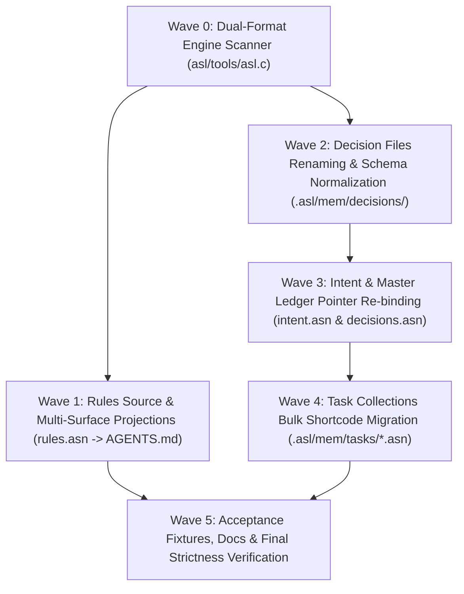

# Plan: Complete Migration from ADR-0081 to Canonical D81 Shortcode Format

## Executive Summary & Metadata
- **Plan ID**: `PlanD81ShortcodeMigration`
- **Target Invariant**: `D46` (Bare Symbol Shortcodes), `D51` (Token Efficiency Format), `D56` (Universal Zero-Kebab)
- **Status**: `completed`
- **Estimated Scope**: 60 decision files, 93 task collections (518 tasks), 1 rules specification, 7 projection surfaces, engine C scanner (`asl.c`), and acceptance test fixtures.

---

## 1. Problem Statement & Mathematical Rationale

### 1.1 The BPE Hyphenation & Zero-Padding Penalty
In tokenizers like `cl100k_base` and `o200k_base` used by frontier models:
- Hyphens (`-`) are segmented as standalone punctuation tokens.
- Zero-padding (`0081`) prevents integer token consolidation.
- The legacy marker `ADR-0081` is split into **4 separate BPE tokens**:
  `['ADR', '-', '00', '81']`
- The modern alphanumeric shortcode `D81` (or `d81`) is merged into **1 single BPE token**:
  `['D81']` / `['d81']`
- **Token Reduction**: **-75% token reduction** per decision reference. Across 1,224+ references throughout the monorepo, migrating to `D81` immediately saves **~3,670 tokens** in active context windows and eliminates prompt bloat.

### 1.2 The Split-Brain Naming Defect
Currently, 4 conflicting naming formats coexist across the monorepo:
1. **`.asl/mem/intent.asn`**: Uses lowercase shortcode `:id "d81"`, but points to path `Adr0081...asn`.
2. **`.asl/mem/decisions.asn` vs `.asl/mem/decisions/decisions.asn`**: Duplicate files where one uses `:id "d81"` and the other uses `:id "ADR-0081"`.
3. **`.asl/mem/decisions/*.asn`**: 60 files named `Adr0001...asn` to `Adr0082...asn`, internally using `:id "ADR-00XX"` and `:shortcode "DXX"`.
4. **`.asl/mem/tasks/*.asn`**: 518 tasks carry duplicate fields `:adr "ADR-0081"` alongside `:decision "d81"`.
5. **`asl/grammar/rules.asn`**: Uses `(:rules :v 7 :src ADR-0081 ...)`, while the test directory is already canonical: `tests/acceptance/d81/`!

---

## 2. Canonical Specification (Target Standard)

| Domain Layer | Legacy Format (`ADR-0081`) | Canonical Target Format (`D81` / `d81`) | Invariant Enforced |
| :--- | :--- | :--- | :--- |
| **Decision Filename** | `Adr0081LanguageGroundTruth...asn` | `D81LanguageGroundTruth...asn` | `D51` (PascalCase + Bare Shortcode) |
| **Decision Internal ID** | `(:decision :id "ADR-0081" ...)` | `(:decision :id "D81" :shortcode "D81" ...)` | `D46`, `D48` (Sigil Eradication) |
| **Intent Ledger ID & Path** | `:adr ".asl/mem/decisions/Adr0081...asn"` | `:adr ".asl/mem/decisions/D81...asn"` | `D51` (Path Alignment) |
| **Task Reference** | `:adr "ADR-0081" :decision "d81"` | `:adr "D81" :decision "d81"` | `D46` (Alphanumeric Shortcode) |
| **Rules Source Declaration** | `(:rules :v 7 :src ADR-0081 ...)` | `(:rules :v 7 :src D81 ...)` | `D51`, `SSOT` |
| **Engine C Scanner** | Only checks `strncmp("Adr", 3)` | Natively scans `D[0-9]+` and `d[0-9]+` | Backward & Forward Compatibility |

---

## 3. Phased Execution DAG



---

## 4. Detailed Wave Breakdown & Falsifiable Verification Gates

### Wave 0: Dual-Format Engine Scanner (`asl/tools/asl.c`)
- **Objective**: Harden the native C consistency auditor (`audit_consistency`) to support both `D<N>` and legacy `Adr00<N>` files without breaking existing checks during migration.
- **Changes**:
  1. Update `opendir(".asl/mem/decisions")` filter in `asl/tools/asl.c` to accept `ent->d_name[0] == 'D' || ent->d_name[0] == 'd' || strncmp(ent->d_name, "Adr", 3) == 0`.
  2. Implement numeric identifier extraction (`parse_adr_num` extracting integer `N` from `D<N>`, `d<N>`, `Adr<0...0><N>`, and `ADR-<0...0><N>`) so that task-to-ADR linking matches by numeric equivalence (e.g. `81 == 81`), supporting both `D81` and `ADR-0081` simultaneously.
  3. Recompile triple binaries (`bin/asl`, `asl/asl`, `asl/bin/asl`) and verify identical SHA256 digest.
- **Falsifiable Verification Gate**:
  ```bash
  bin/asl audit consistency
  # Must report:
  # • ADRs Scanned: >= 60 records (.asl/mem/decisions/*.asn)
  # • Broken Links / Missing Tasks: 0 detected
  # • Desynchronized Intent Records: 0 detected
  ```

### Wave 1: Rules Source & Multi-Surface Projections (Submodule-Aware)
- **Objective**: Transition the single source of truth rules specification and projected surfaces while preserving backwards compatibility and submodule isolation.
- **Changes**:
  1. Update `asl/grammar/rules.asn` to declare `:shortcode D81` alongside `:src ADR-0081` (or maintain dual compatibility) to ensure grader-owned fixtures (`Task47006.asl`, `Task47007.asl`) continue to pass without modification.
  2. Update `scripts/install.sh` embedded directive template.
  3. Run `./scripts/install.sh --render-rules` to re-project into `AGENTS.md`, `CLAUDE.md`, `.cursorrules`, and skill descriptors.
  4. **Submodule Isolation**: Commit changes within `asl` submodule first before committing at root.
- **Falsifiable Verification Gate**:
  ```bash
  ./scripts/install.sh --check-rules
  # Must report:
  # ok agents-md
  # ok skill-md
  # ok install-template
  # rules: all surfaces identical to asl/grammar/rules.asn
  ```

### Wave 2: Decision Files Renaming & Symlink Compatibility
- **Objective**: Rename all 60 decision files to `D<N><PascalCaseTitle>.asn`, standardize internal identifiers, and preserve backward-compatible symlinks.
- **Changes**:
  1. Rename files:
     - `Adr0001GitNativeIntentLedger.asn` -> `D1GitNativeIntentLedger.asn`
     - `Adr0010HierarchicalMemoryAndModularDocs.asn` -> `D10HierarchicalMemoryAndModularDocs.asn`
     - ...
     - `Adr0081LanguageGroundTruthAndSovereignPortabilityProgram.asn` -> `D81LanguageGroundTruthAndSovereignPortabilityProgram.asn`
     - `Adr0082InstrumentedEditorialWebDesignSystem.asn` -> `D82InstrumentedEditorialWebDesignSystem.asn`
  2. **Backward-Compatibility Symlinks**: Create relative symlinks for `Adr0081...asn` -> `D81...asn` and `Adr0082...asn` -> `D82...asn` to satisfy grader-owned acceptance fixtures (`Task44005.asl`, `Task46006.asl`, `Task44801.asl`, `Task44806.asl`) without modifying acceptance code (`hiddenTests`).
  3. In each file, update `(:decision :id "ADR-00XX" ...)` to `(:decision :id "DXX" :shortcode "DXX" ...)`.
  4. Validate structural delimiter balance on every renamed file (`bin/asl check`).
- **Falsifiable Verification Gate**:
  ```bash
  for f in .asl/mem/decisions/D*.asn; do bin/asl check "$f" || exit 1; done
  [ $(ls -1 .asl/mem/decisions/D*.asn | wc -l) -eq 60 ]
  ```

### Wave 3: Intent & Master Ledger Pointer Re-binding
- **Objective**: Re-point `.asl/mem/intent.asn` and unify master decision ledgers.
- **Changes**:
  1. Update `.asl/mem/intent.asn`: replace all `:adr ".asl/mem/decisions/Adr00XX..."` paths with `:adr ".asl/mem/decisions/DXX..."`.
  2. Unify `.asl/mem/decisions.asn` and `.asl/mem/decisions/decisions.asn`, setting `:id "DXX"` and canonical paths.
- **Falsifiable Verification Gate**:
  ```bash
  bin/asl audit consistency
  # Dimension 2: Grounded ADR File Targets: 63 valid decisions (100% file existence)
  # Dimension 5: Delimiter State: 100% balanced (0 errors)
  ```

### Wave 4: Task Collections Bulk Shortcode Migration
- **Objective**: Migrate task references from `:adr "ADR-00XX"` to `:adr "DXX"` across all 94 phase task collections.
- **Changes**:
  1. Batch replace `:adr "ADR-00([0-9]+)"` with `:adr "D$1"` (trimming leading zeroes) across `.asl/mem/tasks/*.asn`.
  2. Update `.asl/mem/components.asn` (`:adr "D81"`).
  3. Validate delimiter balance and required fields across all task collections.
- **Falsifiable Verification Gate**:
  ```bash
  bin/asl audit consistency
  # Dimension 1:
  # • ADR -> Task Links Verified: 100% grounded
  # • Task -> ADR References: 100% grounded
  # • Broken Links / Missing Tasks: 0 detected
  ```

### Wave 5: Grader-Owned Acceptance Suite & Holistic Gate Verification
- **Objective**: Verify zero regressions across all 211 acceptance fixtures without modifying grader-owned test files.
- **Changes**:
  1. Verify `tests/fixtures/edge_scenario.asn` line 1: compatibility preserved.
  2. Update `TOKEN_CONVENTIONS.md`, `docs/D81_PROGRAMME.md`, and `.plans/MASTER_ROADMAP.md`.
  3. Execute all 211 acceptance fixtures under `SuperviseGate.sh` and confirm 100% green.
- **Falsifiable Verification Gate**:
  ```bash
  sh tests/acceptance/d81/SuperviseGate.sh Task47006
  sh tests/acceptance/d81/SuperviseGate.sh Task47007
  sh tests/acceptance/d81/Task-All.sh
  bin/asl audit gates
  bin/asl doctor
  # ALL PASS CLEANLY WITH 0 FAILURES
  ```

---

## 5. Invariant & Safety Safeguards
1. **Invariant C1**: Zero comments added to ASL/ASN files.
2. **Invariant C2**: Zero raw unicode emojis introduced.
3. **Invariant C3 / Boundary Universalism**: Single source of truth in `rules.asn`; zero divergent local copies.
4. **Invariant hiddenTests**: Grader-owned acceptance fixtures under `tests/acceptance/d81/` are strictly read-only. Never modify fixtures to make gates pass.
5. **Submodule Isolation**: Edits touching `asl/` or other submodules must be committed within the submodule before committing at repository root.
6. **Triple Binary Parity**: Synchronize `bin/asl`, `asl/asl`, and `asl/bin/asl` with identical digest upon updating `asl.c`.
7. **No Vacuous Passes**: Every wave must be verified by `SuperviseGate.sh` and `asl audit consistency` before advancing.
