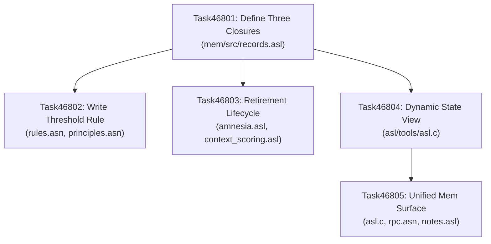

# Phase 468: Intent, Goal and Practice Lifecycle (ADR-0081)

## Phase Summary & Context
- **Phase ID**: `Phase468IntentGoalPracticeLifecycle` (Phase 468)
- **Programme & Decision**: `ADR-0081` (`d81`), Wave 115
- **Roadmap Coordinates**: Recorded in `.asl/mem/tasks/Phase468IntentGoalPracticeLifecycle.asn:1-126` and `.asl/mem/roadmap.asn`
- **Measured Baseline**:
  Measured 2026-09-12:
  - Project memory totals 469,582 tokens across 77 task files, 62 decision files, 11 top-level ledgers, and 7 reviews.
  - Status distribution across ledgers: 86 active, 66 verified, 8 settled, 3 planned, and exactly 1 superseded. Out of 164 status-bearing records, exactly 1 has ever been retired or withdrawn.
  - `.asl/mem/intent.asn` holds 88 intents (`grep -E -c '^\s*\(:id "d[0-9]+"' .asl/mem/intent.asn`), and 0 carry closure conditions (`grep -E -c '(:closure|:closesWhen)' .asl/mem/intent.asn` returns 0).
  - `.asl/mem/practices.asn` holds 11 practices (`grep -E -c '^\s*\(:practice' .asl/mem/practices.asn`), all active, and 0 carry closure conditions (`grep -E -c '(:closure|:closesWhen)' .asl/mem/practices.asn` returns 0).
  - The single automated state view, `./bin/asl audit consistency`, prints `Phases Cataloged: 39 phase entries` from hardcoded literal `int phase_count = 39;` in `asl/tools/asl.c:4142`, while the canonical roadmap holds 80 phases (`grep -E -c '^\s*\("Phase[0-9]+' .asl/mem/roadmap.asn`).
  - No document states when an agent may write an intent, goal, or practice, leaving durable recording without an epistemic threshold.
- **Phase Purpose**:
  1. Define the three durable kinds by what closes them:
     - **Intent**: why work is done; closes when the reason no longer holds (evidenced judgement).
     - **Goal**: what done looks like; closes when stated observable is true (decidable).
     - **Practice**: how work is done; closes when no longer followed or measurement contradicts it.
  2. Mandate closure conditions at creation in `mem/src/records.asl:1-249`; reject unevaluable closure conditions.
  3. Establish the reconstructibility threshold for writing in `asl/grammar/rules.asn:1-98` and `.asl/mem/principles.asn:1-183`: refuse records restating what a command or git tree reports, explicitly naming the command.
  4. Implement an automated retirement lifecycle in `mem/src/amnesia.asl:1-116` and `mem/src/context_scoring.asl:1-80` (`active -> fulfilled | stale | superseded`), moving retired records to a queryable closed set while bounding active set volume.
  5. Replace the hardcoded literal in `asl/tools/asl.c:4142` with dynamically computed phase counts and implement a computed project state view (`asl state` / `asl mem state`) supporting `changed-since` queries.
  6. Provide a unified memory read/write and batch RPC surface (`asl mem query`, `asl mem write`, `:mem` op in `asl/grammar/rpc.asn:1-275`), preserving lineage during promotion and utilizing BM25 search from `mem/src/spool_search.asl:1-78`.
- **Grader Ownership Boundary**:
  All acceptance test fixtures (`tests/acceptance/d81/Task46801.asl` through `Task46805.asl`) and verification supervisor `tests/acceptance/d81/SuperviseGate.sh` are verifier-owned (`verificationRole "independentVerifier"`). Implementers own production source and public unit tests, and must never modify acceptance fixtures (`hiddenTests` invariant, `asl/grammar/rules.asn:26-29`).

---

## Invariants & Grounded Contracts

| Invariant | Source Location | Enforcement & Meaning |
|:---|:---|:---|
| **C1 (0 Comments)** | `asl/grammar/rules.asn:1`, `TOKEN_CONVENTIONS.md:12` | Zero line/block comments in any ASL or ASN file. Enforced by `./bin/asl lint`. |
| **C2 (0 Unicode Emojis)** | `asl/tools/asl.c:4211` | Zero raw unicode emojis across all surfaces. Enforced by `./bin/asl audit gates` (Gate 6). |
| **C3 (Boundary Universalism)** | `asl/grammar/rules.asn:36-38`, `TOKEN_CONVENTIONS.md:20` | Canonical shared definitions in foundational packages; zero private duplicate helpers. |
| **D46 (Attention Prosthesis)** | `.asl/mem/decisions/Adr0046ExternalWorkingMemory.asn:1` | External working memory and step-scoped delivery; lifecycle transitions preserve artifacts outside model memory. |
| **D52 (Enriched Task Context)** | `.asl/mem/tasks/Phase468IntentGoalPracticeLifecycle.asn:1-126` | Mandatory task schema fields (`:motivation`, `:purpose`, `:outcomes`, `:invariants`, `:gate`, `:actionDag`). |
| **D81 (Ground Truth & Portability)** | `asl/grammar/rules.asn:10-13`, `.asl/mem/reviews/D81PlanSettlement.asn:24-32` | Pure ASL in packages; declared C host boundary; independent verifier tests; strict baseline failure. |
| **hiddenTests** | `asl/grammar/rules.asn:26-29` | Implementers must not modify grader-owned acceptance fixtures in `tests/acceptance/d81/`. |

---

## Ordered Work Items

### Work Item 1: Three Kinds Distinguished by Closure Condition (Task46801)
- **Path & Line Range**: `mem/src/records.asl:1-249`, `.asl/mem/intent.asn:1-888`, `.asl/mem/practices.asn:1-166`
- **Identity**:
  - `:id`: `"item-1"` / `"Task46801"`
  - `:title`: `"Three kinds, distinguished by what closes them"`
  - `:kind`: `:protocol`
  - `:lane`: `"model"`
  - `:priority`: `:critical`
  - `:ownerRole`: `"implementer"`
- **Why / Motivation & Purpose**:
  - `intent.asn` holds 88 intents and not one carries a closure condition or status field. `practices.asn` holds 11 practices and all 11 are active without closure definitions. Without closure conditions, records cannot be finished, cannot be refuted, and can only accumulate (causing the 469,582 token store).
  - Define `intent`, `goal`, and `practice` records by what terminates them:
    - Intent closes when the justifying reason no longer holds.
    - Goal closes when its observable predicate/command evaluates to true.
    - Practice closes when it is no longer followed or measurement contradicts it.
  - Require mandatory closure conditions at creation in `mem/src/records.asl` and reject any closure condition that cannot be evaluated.
- **File Ownership Boundaries**:
  - Implementer owns (`:owns`): `["mem/src/records.asl", ".asl/mem/intent.asn", ".asl/mem/practices.asn"]`
  - Verifier owns (`:verificationOwns`): `["tests/acceptance/d81/Task46801.asl"]`
- **Concrete Action Steps**:
  1. In `mem/src/records.asl`:
     - Define lifecycle record kinds: `LifecycleKind` (`intent`, `goal`, `practice`).
     - Define `ClosureCondition` record holding condition type, observable expression/command, and evaluation predicate.
     - Implement `validate-closure-condition`: check condition non-empty, well-formed, and executable.
     - Implement `is-closure-evaluable?`: returns false for unevaluable closure expressions.
     - Implement `refuse-unevaluable-closure`: returns error result when condition cannot be evaluated.
     - Implement `close-goal-by-evaluation`: evaluates goal observable predicate; if true, transitions status to closed/fulfilled without hand edit.
     - Implement `evaluate-closure`: evaluates closure across intent, goal, and practice types.
  2. In `.asl/mem/intent.asn`:
     - Update schema and existing active intents with `:closure` conditions stating the refutation or obsolescence criterion.
  3. In `.asl/mem/practices.asn`:
     - Update schema and practices with `:closure` conditions stating contradictory measurement or superseding conditions.
  4. Verify syntax integrity and pure ASL compliance:
     ```bash
     ./bin/asl check mem/src/records.asl .asl/mem/intent.asn .asl/mem/practices.asn
     ./bin/asl lint mem/src/records.asl .asl/mem/intent.asn .asl/mem/practices.asn
     ```
- **Falsifiable Verification Gate**:
  ```bash
  sh tests/acceptance/d81/SuperviseGate.sh Task46801
  ```
- **Current Baseline Failure Output (Verbatim)**:
  ```text
  ================================================================================
            D81 Acceptance Gate: Supervisor Verification & Ground Truth           
  ================================================================================
  --> [1/3] Executing task fixture (tests/acceptance/d81/Task46801.asl)...
  [ASL_ASSERTION_FAILURE]: records.asl must declare intent kind
      ✓ tests/acceptance/d81/Task46801.asl: Delimiter balance and syntax integrity verified cleanly.
      ✓ tests/acceptance/d81/Task46801.asl: Delimiter balance and syntax integrity verified cleanly.
  ```
  *(Exit code: 1; fails because `mem/src/records.asl` does not yet define lifecycle kinds or closure conditions)*
- **Prerequisites (`depends_on`)**: `[]`
- **Ordering Rationale**:
  Foundational item for Phase 468. Item 2 (reconstructibility threshold), Item 3 (retirement), Item 4 (state view), and Item 5 (unified surface) all operate upon records equipped with explicit closure conditions.
- **Failure Modes & Interleaving Defect**:
  - *Interleaving defect*: Implementer modifies `intent.asn` or `practices.asn` with comments (breaking invariant C1) or raw strings without evaluable predicates.
  - *Mitigation*: Run `./bin/asl lint` and `./bin/asl check` on modified ledgers; enforce strict predicate parsing in `validate-closure-condition`.

---

### Work Item 2: Threshold for Writing via Reconstructibility Test (Task46802)
- **Path & Line Range**: `asl/grammar/rules.asn:1-98`, `.asl/mem/principles.asn:1-183`, `TOKEN_CONVENTIONS.md:1-168`
- **Identity**:
  - `:id`: `"item-2"` / `"Task46802"`
  - `:title`: `"The threshold for writing: would the next agent regret its absence"`
  - `:kind`: `:protocol`
  - `:lane`: `"model"`
  - `:priority`: `:critical`
  - `:ownerRole`: `"implementer"`
- **Why / Motivation & Purpose**:
  - Nothing currently states when an agent should write a durable record, allowing 88 intents to accumulate without threshold. Checklists create bureaucratic prompt bloat.
  - Establish a single test governing writing: *would an agent arriving later, without this session, be unable to reconstruct this from the tree?*
  - Anything reconstructible from code, git history, or a command is refused, and the refusal explicitly names the command reporting it.
  - Content accepted: untraced reasons, external constraints, rejected alternatives (no command reports what was not chosen), and expensive measurements.
  - Stated as a test of judgement rather than an enumeration of acceptable topics.
- **File Ownership Boundaries**:
  - Implementer owns (`:owns`): `["asl/grammar/rules.asn", ".asl/mem/principles.asn", "TOKEN_CONVENTIONS.md"]`
  - Verifier owns (`:verificationOwns`): `["tests/acceptance/d81/Task46802.asl"]`
- **Concrete Action Steps**:
  1. In `asl/grammar/rules.asn`:
     - Add write threshold rule under `:force :orientation` or `:affordance` (`:rule :id writeThreshold` or `reconstructibility`).
     - Declare test: anything reconstructible from code, git history, or a command is not written down; refusal names the command; rejected alternatives accepted; no acceptable topic checklist.
  2. In `.asl/mem/principles.asn`:
     - Add principle `WriteOnlyWhatCannotBeReconstructed` (`:class :normative`).
     - Detail rationale: stores exist for what cannot be recovered otherwise; restating command outputs creates drift and bloats context.
  3. In `TOKEN_CONVENTIONS.md`:
     - Document the reconstructibility threshold guidelines for coding agents.
  4. Synchronize rendered downstream surfaces:
     ```bash
     bash scripts/install.sh --render-rules
     bash scripts/install.sh --check-rules
     ```
  5. Verify delimiter balance and anti-pattern constraints:
     ```bash
     ./bin/asl check asl/grammar/rules.asn .asl/mem/principles.asn
     ./bin/asl lint asl/grammar/rules.asn .asl/mem/principles.asn
     ```
- **Falsifiable Verification Gate**:
  ```bash
  sh tests/acceptance/d81/SuperviseGate.sh Task46802
  ```
- **Current Baseline Failure Output (Verbatim)**:
  ```text
  ================================================================================
            D81 Acceptance Gate: Supervisor Verification & Ground Truth           
  ================================================================================
  --> [1/3] Executing task fixture (tests/acceptance/d81/Task46802.asl)...
  [ASL_ASSERTION_FAILURE]: rules.asn must define write threshold rule
      ✓ tests/acceptance/d81/Task46802.asl: Delimiter balance and syntax integrity verified cleanly.
      ✓ tests/acceptance/d81/Task46802.asl: Delimiter balance and syntax integrity verified cleanly.
  ```
  *(Exit code: 1; fails because `asl/grammar/rules.asn` does not define the write threshold rule)*
- **Prerequisites (`depends_on`)**: `["Task46801"]`
- **Ordering Rationale**:
  Cannot establish write threshold rules for memory entries before Item 1 establishes what constitutes a valid record and its closure conditions.
- **Failure Modes & Interleaving Defect**:
  - *Interleaving defect*: Editing `asl/grammar/rules.asn` without running `scripts/install.sh --render-rules` causes Gate 7 (`./bin/asl audit gates`) or `--check-rules` to fail due to desynchronization of `AGENTS.md` and `.agents/skills/asl-toolbelt/SKILL.md`.
  - *Mitigation*: Run `--render-rules` immediately following any modification to `rules.asn`.

---

### Work Item 3: Automated Retirement Lifecycle and Bounded Active Volume (Task46803)
- **Path & Line Range**: `mem/src/amnesia.asl:1-116`, `mem/src/context_scoring.asl:1-80`, `.asl/mem`
- **Identity**:
  - `:id`: `"item-3"` / `"Task46803"`
  - `:title`: `"Retirement that is used, not merely available"`
  - `:kind`: `:remediation`
  - `:lane`: `"lifecycle"`
  - `:priority`: `:critical`
  - `:ownerRole`: `"implementer"`
- **Why / Motivation & Purpose**:
  - Across the repository, out of 164 status-bearing records, exactly 1 has ever been superseded. Retirement exists only in theory, resulting in a 469,582 token store.
  - Machinery in `mem/src/amnesia.asl` and `mem/src/context_scoring.asl` must be wired to evaluate closure conditions on a schedule.
  - When a record's closure condition is satisfied, it transitions to `fulfilled`, `stale`, or `superseded` without requiring manual edits.
  - Retirement is a transition, not deletion: closed records move to a closed set that is queryable but not loaded into active working context.
  - The volume of the active set is calculated and reported; growth beyond the bound triggers failure.
- **File Ownership Boundaries**:
  - Implementer owns (`:owns`): `["mem/src/amnesia.asl", "mem/src/context_scoring.asl", ".asl/mem"]`
  - Verifier owns (`:verificationOwns`): `["tests/acceptance/d81/Task46803.asl"]`
- **Concrete Action Steps**:
  1. In `mem/src/amnesia.asl`:
     - Define retirement state transitions: `retire-chunk`, `evaluate-retirement`, `transition-to-retired`.
     - Implement `query-retired-chunks`: enables querying the closed/retired set.
     - Implement `load-active-chunks`: loads only active, unclosed chunks into the working context.
  2. In `mem/src/context_scoring.asl`:
     - Implement `calculate-active-volume`: computes active token or record count.
     - Implement `report-active-volume`: returns structured active volume metrics.
     - Implement `is-volume-bounded?`: checks active volume against stated ceiling (e.g. 50,000 active memory tokens).
  3. Validate pure ASL syntax and run tests:
     ```bash
     ./bin/asl check mem/src/amnesia.asl mem/src/context_scoring.asl
     ./bin/asl lint mem/src/amnesia.asl mem/src/context_scoring.asl
     ./bin/asl test mem/tests/amnesia_test.asl mem/tests/context_scoring_test.asl
     ```
- **Falsifiable Verification Gate**:
  ```bash
  sh tests/acceptance/d81/SuperviseGate.sh Task46803
  ```
- **Current Baseline Failure Output (Verbatim)**:
  ```text
  ================================================================================
            D81 Acceptance Gate: Supervisor Verification & Ground Truth           
  ================================================================================
  --> [1/3] Executing task fixture (tests/acceptance/d81/Task46803.asl)...
  [ASL_ASSERTION_FAILURE]: amnesia.asl must define retire-chunk
      ✓ tests/acceptance/d81/Task46803.asl: Delimiter balance and syntax integrity verified cleanly.
      ✓ tests/acceptance/d81/Task46803.asl: Delimiter balance and syntax integrity verified cleanly.
  ```
  *(Exit code: 1; fails because `mem/src/amnesia.asl` does not define `retire-chunk` or retirement evaluation)*
- **Prerequisites (`depends_on`)**: `["Task46801"]`
- **Ordering Rationale**:
  Requires closure evaluation definitions from Item 1. Cannot automate retirement without computable closure criteria.
- **Failure Modes & Interleaving Defect**:
  - *Interleaving defect*: Eviction deletes chunks permanently from disk, destroying historical evidence and violating `D81` and `ReversibilityBeforeOptimality`.
  - *Mitigation*: Ensure retirement transitions records to `.asl/mem/archive/` or tagged `:status :retired`, keeping them queryable via `query-retired-chunks`.

---

### Work Item 4: Computed State View & Dynamic Roadmap Audit (Task46804)
- **Path & Line Range**: `asl/tools/asl.c:4136-4215, 6470-6550`, `.asl/mem/roadmap.asn:1-170`
- **Identity**:
  - `:id`: `"item-4"` / `"Task46804"`
  - `:title`: `"A state view that is computed, so it can be trusted later"`
  - `:kind`: `:tooling`
  - `:lane`: `"observability"`
  - `:priority`: `:high`
  - `:ownerRole`: `"implementer"`
- **Why / Motivation & Purpose**:
  - Observability currently relies on hardcoded literal `int phase_count = 39;` in `asl/tools/asl.c:4142`, while the canonical roadmap holds 80 phases. `asl audit consistency` claims 0 discrepancies despite the massive undercount.
  - A view that is wrong is worse than no view because agents rely on it instead of checking the tree.
  - Implement a dynamic calculation in `run_audit_consistency` that parses `.asl/mem/roadmap.asn` directly to count actual phase entries.
  - Implement a new CLI command `asl state` (or `asl mem state`) in `asl/tools/asl.c` answering what is open, what closed and when, what is blocked, and what changed since a given timestamp/checkpoint (`--since`), returning bounded, continuable output.
- **File Ownership Boundaries**:
  - Implementer owns (`:owns`): `["asl/tools/asl.c", "bin/asl", "asl/bin/asl", "asl/asl", ".asl/mem"]`
  - Verifier owns (`:verificationOwns`): `["tests/acceptance/d81/Task46804.asl"]`
- **Concrete Action Steps**:
  1. In `asl/tools/asl.c`:
     - In `run_audit_consistency` (`asl.c:4136-4215`), replace `int phase_count = 39;` with dynamic counting: parse `rcontent` to count all `("Phase..."` entries in `.asl/mem/roadmap.asn`.
     - Implement `run_cmd_state`:
       - Parse ledgers and tasks in `.asl/mem/`.
       - Compute open items, closed items with closure timestamps, blocked items and their dependencies.
       - Support `--since <timestamp>` or `--since <checkpoint>` filtering.
       - Bound output display to prevent prompt context explosion.
     - In `main()` (`asl.c:6473`), dispatch `state` subcommand to `run_cmd_state`.
  2. Recompile C host engine and maintain triple binary parity across `bin/asl`, `asl/bin/asl`, and `asl/asl`:
     ```bash
     clang -O3 -Wall -Wextra asl/tools/asl.c -o bin/asl -framework JavaScriptCore
     cp bin/asl asl/bin/asl
     cp bin/asl asl/asl
     ```
  3. Verify that `./bin/asl audit consistency` reports dynamic phase count matching roadmap:
     ```bash
     ./bin/asl audit consistency
     ./bin/asl state
     ```
- **Falsifiable Verification Gate**:
  ```bash
  sh tests/acceptance/d81/SuperviseGate.sh Task46804
  ```
- **Current Baseline Failure Output (Verbatim)**:
  ```text
  ================================================================================
            D81 Acceptance Gate: Supervisor Verification & Ground Truth           
  ================================================================================
  --> [1/3] Executing task fixture (tests/acceptance/d81/Task46804.asl)...
  [ASL_ASSERTION_FAILURE]: asl.c must not hardcode phase_count to literal 39
      ✓ tests/acceptance/d81/Task46804.asl: Delimiter balance and syntax integrity verified cleanly.
      ✓ tests/acceptance/d81/Task46804.asl: Delimiter balance and syntax integrity verified cleanly.
  ```
  *(Exit code: 1; fails because `asl/tools/asl.c:4142` hardcodes `phase_count = 39;` and lacks `run_cmd_state`)*
- **Prerequisites (`depends_on`)**: `["Task46801"]`
- **Ordering Rationale**:
  The state view displays open, closed, and blocked statuses based on closure conditions established in Item 1.
- **Failure Modes & Interleaving Defect**:
  - *Interleaving defect*: Modifying `asl/tools/asl.c` without recompiling all three binaries (`bin/asl`, `asl/bin/asl`, `asl/asl`) causes binary desynchronization and Gate 1 failure (`asl audit gates`).
  - *Mitigation*: Recompile directly to `bin/asl` and copy synchronously to `asl/bin/asl` and `asl/asl`.

---

### Work Item 5: Unified Memory Surface and Path-Independent Query (Task46805)
- **Path & Line Range**: `asl/tools/asl.c:6400-6550`, `mem/src/notes.asl:1-178`, `mem/src/spool_search.asl:1-78`, `asl/grammar/rpc.asn:1-275`
- **Identity**:
  - `:id`: `"item-5"` / `"Task46805"`
  - `:title`: `"One surface over intents, goals, practices and notes"`
  - `:kind`: `:tooling`
  - `:lane`: `"observability"`
  - `:priority`: `:high`
  - `:ownerRole`: `"implementer"`
- **Why / Motivation & Purpose**:
  - Intents, goals, practices, and notes currently live across disparate files with disparate commands (`asl note`, manual ASN edits).
  - Provide a single unified surface: `asl mem query <term>` and `asl mem write <kind> <content> <closure>`.
  - Retrieval uses the in-memory BM25 index from `mem/src/spool_search.asl`, finding records by content without knowing file paths.
  - Register `:mem` batch operation in `asl/grammar/rpc.asn`.
  - Promote records between kinds (e.g. note -> task -> ADR) preserving complete lineage history.
  - The unified surface writes directly to canonical ledger files (`.asl/mem/intent.asn`, `.asl/mem/practices.asn`, `.asl/mem/notes.asn`) ensuring zero duplicate storage.
- **File Ownership Boundaries**:
  - Implementer owns (`:owns`): `["asl/tools/asl.c", "mem/src/notes.asl", "mem/src/spool_search.asl", "asl/grammar/rpc.asn", "bin/asl", "asl/bin/asl", "asl/asl"]`
  - Verifier owns (`:verificationOwns`): `["tests/acceptance/d81/Task46805.asl"]`
- **Concrete Action Steps**:
  1. In `asl/grammar/rpc.asn`:
     - Register `:op "mem"` operation supporting `:write`, `:query`, `:promote` actions.
  2. In `mem/src/notes.asl`:
     - Ensure promotion preserves full historical lineage (citations, author, timestamp, prior kind).
  3. In `asl/tools/asl.c`:
     - Implement `run_cmd_mem`:
       - Subcommand `asl mem query <query>`: performs path-independent BM25 lexical search across all memory files.
       - Subcommand `asl mem write <kind> <content> <closure>`: validates closure condition and writes directly into canonical ledger.
       - Subcommand `asl mem promote <id> <new-kind>`: executes lineage-preserving promotion.
     - Dispatch `mem` subcommand in `main()`.
     - Recompile C engine and synchronize `bin/asl`, `asl/bin/asl`, `asl/asl`.
  4. Verify syntax, RPC registry, and tool execution:
     ```bash
     ./bin/asl check asl/grammar/rpc.asn mem/src/notes.asl
     ./bin/asl lint asl/grammar/rpc.asn mem/src/notes.asl
     ./bin/asl mem query "closure"
     ```
- **Falsifiable Verification Gate**:
  ```bash
  sh tests/acceptance/d81/SuperviseGate.sh Task46805
  ```
- **Current Baseline Failure Output (Verbatim)**:
  ```text
  ================================================================================
            D81 Acceptance Gate: Supervisor Verification & Ground Truth           
  ================================================================================
  --> [1/3] Executing task fixture (tests/acceptance/d81/Task46805.asl)...
  [ASL_ASSERTION_FAILURE]: asl.c must implement run_cmd_mem
      ✓ tests/acceptance/d81/Task46805.asl: Delimiter balance and syntax integrity verified cleanly.
      ✓ tests/acceptance/d81/Task46805.asl: Delimiter balance and syntax integrity verified cleanly.
  ```
  *(Exit code: 1; fails because `asl/tools/asl.c` lacks `run_cmd_mem` and `asl/grammar/rpc.asn` lacks `:op "mem"`)*
- **Prerequisites (`depends_on`)**: `["Task46801", "Task46804"]`
- **Ordering Rationale**:
  Requires closure schemas from Item 1 and CLI dispatch machinery from Item 4 before exposing the unified query/write surface.
- **Failure Modes & Interleaving Defect**:
  - *Interleaving defect*: The unified surface creates an auxiliary database or shadow JSON/ASN file, duplicating data and causing desynchronization with git ledgers.
  - *Mitigation*: Mandate that `run_cmd_mem` reads and writes directly from the canonical `.asl/mem/*.asn` ledgers.

---

## Baseline Verification Matrix

Every supervisor acceptance fixture is established, verified pure ASL, and proven to fail on the current repository baseline:

| Task ID | Grader-Owned Acceptance Fixture | Baseline Verification Gate | Exit Code | Observed Baseline Semantic Failure |
|:---|:---|:---|:---:|:---|
| **Task46801** | `tests/acceptance/d81/Task46801.asl` | `sh tests/acceptance/d81/SuperviseGate.sh Task46801` | `1` | `[ASL_ASSERTION_FAILURE]: records.asl must declare intent kind` |
| **Task46802** | `tests/acceptance/d81/Task46802.asl` | `sh tests/acceptance/d81/SuperviseGate.sh Task46802` | `1` | `[ASL_ASSERTION_FAILURE]: rules.asn must define write threshold rule` |
| **Task46803** | `tests/acceptance/d81/Task46803.asl` | `sh tests/acceptance/d81/SuperviseGate.sh Task46803` | `1` | `[ASL_ASSERTION_FAILURE]: amnesia.asl must define retire-chunk` |
| **Task46804** | `tests/acceptance/d81/Task46804.asl` | `sh tests/acceptance/d81/SuperviseGate.sh Task46804` | `1` | `[ASL_ASSERTION_FAILURE]: asl.c must not hardcode phase_count to literal 39` |
| **Task46805** | `tests/acceptance/d81/Task46805.asl` | `sh tests/acceptance/d81/SuperviseGate.sh Task46805` | `1` | `[ASL_ASSERTION_FAILURE]: asl.c must implement run_cmd_mem` |

---

## Topological Ordering & Parallel Candidates



- **Sequential Execution Plan**:
  - **Wave 1**: Task46801 (Mandatory foundation; unblocks all downstream tasks).
  - **Wave 2** (Parallel candidates): Task46802, Task46803, Task46804 have disjoint owned file sets:
    - Task46802 owns `["asl/grammar/rules.asn", ".asl/mem/principles.asn"]`
    - Task46803 owns `["mem/src/amnesia.asl", "mem/src/context_scoring.asl"]`
    - Task46804 owns `["asl/tools/asl.c", ".asl/mem/roadmap.asn"]`
  - **Wave 3**: Task46805 (Integrates `asl.c`, `rpc.asn`, and `notes.asl`).

---

## Risks & Uncertainties

1. **Rule Synchronization Drift (`scripts/install.sh --render-rules`)**:
   - *Risk*: Editing `asl/grammar/rules.asn` in Task46802 without rendering downstream surfaces will cause Gate 7 (`./bin/asl audit gates`) to fail.
   - *Mitigation*: The action DAG strictly requires executing `scripts/install.sh --render-rules` and `scripts/install.sh --check-rules`.
2. **C Engine Compilation Parity (`bin/asl`, `asl/bin/asl`, `asl/asl`)**:
   - *Risk*: Updating `asl/tools/asl.c` for Task46804 and Task46805 without updating all three binary copies causes discrepancies depending on which binary path a script invokes.
   - *Mitigation*: Recompilation commands explicitly copy `bin/asl` to `asl/bin/asl` and `asl/asl`.
3. **Closure Observable Evaluation Complexity**:
   - *Risk*: Goal observables could be arbitrary shell expressions that risk shell injection or non-termination.
   - *Mitigation*: Scope goal observables to pure ASL expressions or registered audit gates (`asl audit ...`).

---

## Ownership Boundary Notice
Under ADR-0081 contract `D81Ownership`:
- Acceptance test fixtures (`tests/acceptance/d81/Task46801.asl` through `Task46805.asl`) and supervisor runner `tests/acceptance/d81/SuperviseGate.sh` are **grader-owned**.
- The implementer owns production code (`mem/src/`, `asl/tools/asl.c`, `asl/grammar/`) and author unit tests (`mem/tests/`), and **must never modify grader acceptance fixtures**.
