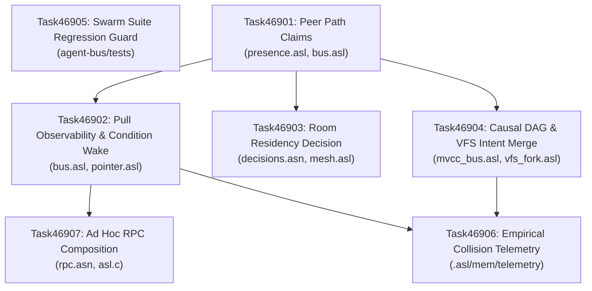

# Phase 469: Swarm Edit Visibility and Collision Avoidance (ADR-0081)

## Phase Summary & Context
- **Phase ID**: `Phase469SwarmEditVisibilityAndCollisionAvoidance` (Phase 469)
- **Programme & Decision**: `ADR-0081` (`d81`), Wave 116
- **Roadmap Coordinates**: Recorded in `.asl/mem/tasks/Phase469SwarmEditVisibilityAndCollisionAvoidance.asn:1-172` and `.asl/mem/roadmap.asn:167`
- **Measured Baseline**:
  Measured 2026-09-12 via `./bin/asl test agent-bus/tests/*.asl`:
  - The swarm layer exists and actively executes: **386 assertions** and **2 refutations** pass cleanly across all 14 `agent-bus` test suites:
    - `presence-test.asl`: 38 assertions (`SwarmRoom`, `join-swarm-room`, `list-room-peers`, `find-peer-in-room`, `propose-task`, `accept-task`, `format-presence-roster`).
    - `bus_test.asl`: 22 assertions (`BusEvent`, `BusChannel`, `format-sse-event`, `dispatch-bus-event`).
    - `transport_test.asl`: 36 assertions.
    - `mesh-test.asl`: 26 assertions (`RoutingTable`, `register-mesh-node`, `route-packet`, `is-node-alive`).
    - `wire-test.asl`: 29 assertions.
    - `cluster-test.asl`: 24 assertions.
    - `mvcc_bus_test.asl`: 23 assertions (`CausalMessage`, `IntentConflict`, `MergedIntent`, `MvccBus`, `mvcc-bus-merge-intents`).
    - `proc_telemetry_test.asl`: 32 assertions.
    - `nd_asn_test.asl`: 31 assertions.
    - `ambient_test.asl`: 17 assertions (`BufferLease`, `MutexRegistry`, `acquire-buffer-lease`, `release-buffer-lease`).
    - `tool_plane_test.asl`: 16 assertions (`ToolDescriptor`, `ToolRouter`, multi-repo scoping).
    - `browser-bridge-test.asl`: 23 assertions (`BridgeTab`, FIFO queue, CORS headers, MCP protocol).
    - `mesh_orchestration_test.asl`: 9 assertions, 2 refutations (`A2AMeshSession`, packet routing).
    - `gateway-test.asl`: 60 assertions (turn inspection, multi-turn gateway routing).
  - Planned collision exposure:
    - In `.asl/mem/tasks/Phase469SwarmEditVisibilityAndCollisionAvoidance.asn:15`, 1,309 pairs of planned tasks write a common path with no ordering between them, 1,096 of those targeting `asl/tools/asl.c`.
  - Genuine structural and architectural absences:
    1. **Presence lacks path claims**: `agent-bus/src/presence.asl:1-141` has zero mentions of `PathClaim`, `ClaimMode`, or claims fields on `SwarmPeer`. A peer cannot declare what it holds or intends to write.
    2. **Bus lacks pull query and condition push**: `agent-bus/src/bus.asl:1-98` provides push-only event dispatching (`dispatch-bus-event`), lacking pull-based querying (`query-bus-events` / `pull-bus-events`) and condition-triggered wake structures (`ConditionWake`).
    3. **Residency decision and daemonless mesh unrecorded**: `.asl/mem/decisions.asn:1-1327` and `asl/grammar/protocol-conformance.asn:1-20` lack records specifying room residency between transient CLI invocations. `agent-bus/src/mesh.asl:10-12` still declares legacy `DaemonPeer` and `PeerRegistry` rather than sovereign `AgentMeshNode` and `join-mesh-cluster`.
    4. **Branching MVCC DAG disconnected from VFS writes**: `agent-bus/src/mvcc_bus.asl:1-206` defines `CausalMessage`, `IntentConflict`, and `MergedIntent`, but `mem/src/vfs_fork.asl:20-26` (`VFSBranch`) and `mem/src/vfs_merge.asl:1-178` (`ast-3way-merge`) have no fields or handlers for causal message identifiers or intent conflicts.
    5. **Telemetry unmeasured**: No empirical telemetry artifact exists in `.asl/mem/telemetry/CollisionReduction20260912.asn` measuring write collision rates with room visibility enabled vs hidden.
    6. **Tool composition absent**: `asl/grammar/rpc.asn:1-282` does not register `compose`, `pipe`, or `reduce` RPC operations, and `asl/tools/asl.c:2276-2350` lacks composition execution and bounded output truncation logic.
- **Phase Purpose**:
  1. Add path claims to peer presence (`agent-bus/src/presence.asl`) so peers declare advisory, expiring holds on files.
  2. Implement pull-based query observability and condition-triggered wake in `agent-bus/src/bus.asl`, preventing token bloat from raw event streams.
  3. Formalize the host-bound room residency decision in `.asl/mem/decisions.asn` and `protocol-conformance.asn`, and refactor `agent-bus/src/mesh.asl` from legacy daemon types to sovereign `AgentMeshNode`.
  4. Connect `mvcc_bus.asl` causal message DAG and semantic intent merge to `vfs_fork.asl` and `vfs_merge.asl`.
  5. Enforce regression protection across the four previously fragile suites (`tool_plane_test.asl`, `browser-bridge-test.asl`, `mesh_orchestration_test.asl`, `gateway-test.asl`).
  6. Empirically measure write collision rates across visible vs hidden swarm arms in `.asl/mem/telemetry/CollisionReduction20260912.asn`.
  7. Implement bounded ad hoc RPC composition (`compose` / `pipe` / `reduce`) in `asl/grammar/rpc.asn` and `asl/tools/asl.c` to enable server-side filtering outside model context.
- **Grader Ownership Boundary**:
  All acceptance test fixtures (`tests/acceptance/d81/Task46901.asl` through `Task46907.asl`) and verification supervisor `tests/acceptance/d81/SuperviseGate.sh` are verifier-owned (`verificationRole "independentVerifier"`). Implementers own production code and public unit tests, and must never modify acceptance fixtures (`hiddenTests` invariant, `asl/grammar/rules.asn:26-29`).

---

## Invariants & Grounded Contracts

| Invariant | Source Location | Enforcement & Meaning |
|:---|:---|:---|
| **C1 (0 Comments)** | `asl/grammar/rules.asn:1`, `TOKEN_CONVENTIONS.md:12` | Zero line/block comments in any ASL or ASN file. Enforced by `./bin/asl lint`. |
| **C2 (0 Unicode Emojis)** | `asl/tools/asl.c:4211` | Zero raw unicode emojis across all surfaces. Enforced by `./bin/asl audit gates` (Gate 6). |
| **C3 (Boundary Universalism)** | `asl/grammar/rules.asn:36-38`, `TOKEN_CONVENTIONS.md:20` | Canonical shared definitions in foundational packages; zero private duplicate helpers. |
| **D34 (Host Residency)** | `.asl/mem/decisions/Adr0034HostResidentSubstrate.asn:1` | Sovereign engine residency without auxiliary external daemons. |
| **D46 (Attention Prosthesis)** | `.asl/mem/decisions/Adr0046ExternalWorkingMemory.asn:1` | External working memory and pull-based retrieval; context receives scalars, not raw event streams. |
| **D52 (Enriched Task Context)** | `.asl/mem/tasks/Phase469SwarmEditVisibilityAndCollisionAvoidance.asn:1-172` | Mandatory task schema fields (`:motivation`, `:purpose`, `:outcomes`, `:invariants`, `:gate`, `:actionDag`). |
| **D76 (Branching VFS)** | `.asl/mem/decisions/Adr0076BranchingVfsOverlays.asn:1` | Isolated speculative VFS branches rejoined via semantic intent resolution. |
| **D81 (Ground Truth & Portability)** | `asl/grammar/rules.asn:10-13`, `.asl/mem/reviews/D81PlanSettlement.asn:24-32` | Pure ASL in packages; declared C host boundary; independent verifier tests; strict baseline failure. |
| **Triple Binary Parity** | `asl/tools/asl.c` compilation workflow | `bin/asl`, `asl/bin/asl`, and `asl/asl` must remain identical when recompiling `asl/tools/asl.c`. |
| **hiddenTests** | `asl/grammar/rules.asn:26-29` | Implementers must not modify grader-owned acceptance fixtures in `tests/acceptance/d81/`. |

---

## Ordered Work Items

### Work Item 1: Peer Path Claims and Advisory Lease Visibility (Task46901)
- **Path & Line Range**: `agent-bus/src/presence.asl:1-141`, `agent-bus/src/bus.asl:1-98`
- **Identity**:
  - `:id`: `"item-1"` / `"Task46901"`
  - `:title`: `"A peer publishes what it is holding, not only that it is here"`
  - `:kind`: `:protocol`
  - `:lane`: `"presence"`
  - `:priority`: `:critical`
  - `:ownerRole`: `"implementer"`
- **Why / Motivation & Purpose**:
  - A swarm room, peers, a roster, and task negotiation are operational, but peers cannot see what other peers are touching. Across the roadmap, 1,309 pairs of planned tasks write a common path with no ordering between them, 1,096 of those on `asl/tools/asl.c`.
  - A peer must publish its current claim: the paths it holds, mode (`claim-read` or `claim-write`), acquisition epoch, and TTL expiration.
  - The presence roster must render these claims so that an agent about to write can see who currently holds the file.
  - Claims are advisory and expiring rather than blocking locks, preventing dead agents from stalling the room.
- **File Ownership Boundaries**:
  - Implementer owns (`:owns`): `["agent-bus/src/presence.asl", "agent-bus/src/bus.asl"]`
  - Verifier owns (`:verificationOwns`): `["tests/acceptance/d81/Task46901.asl"]`
- **Concrete Action Steps**:
  1. In `agent-bus/src/presence.asl`:
     - Declare enum `ClaimMode` with cases `claim-read` and `claim-write`.
     - Declare struct `PathClaim` with fields: `path` (Str), `mode` (ClaimMode), `acquired-epoch` (I64), `ttl-seconds` (I64), and `holder-id` (Str).
     - Update `SwarmPeer` struct to include `:f claims (List PathClaim)`.
     - Implement `claim-path [(peer SwarmPeer) (path Str) (mode ClaimMode) (current-epoch I64) (ttl I64)] -> SwarmPeer`.
     - Implement `release-claim [(peer SwarmPeer) (path Str)] -> SwarmPeer`.
     - Implement `is-claim-expired? [(claim PathClaim) (current-epoch I64)] -> Bool`.
     - Update `format-presence-roster` to render claimed paths and modes alongside peer status.
     - Export new types and functions in `:x [...]`.
  2. In `agent-bus/src/bus.asl`:
     - Wire claim state changes into `BusChannel` if needed.
  3. Verify syntax integrity and pure ASL compliance:
     ```bash
     ./bin/asl check agent-bus/src/presence.asl agent-bus/src/bus.asl
     ./bin/asl lint agent-bus/src/presence.asl agent-bus/src/bus.asl
     ./bin/asl test agent-bus/tests/presence-test.asl
     ```
- **Falsifiable Verification Gate**:
  ```bash
  sh tests/acceptance/d81/SuperviseGate.sh Task46901
  ```
- **Current Baseline Failure Output (Verbatim)**:
  ```text
  ================================================================================
            D81 Acceptance Gate: Supervisor Verification & Ground Truth           
  ================================================================================
  --> [1/3] Executing task fixture (tests/acceptance/d81/Task46901.asl)...
  [ASL_ASSERTION_FAILURE]: presence.asl must declare PathClaim structure
      ✓ tests/acceptance/d81/Task46901.asl: Delimiter balance and syntax integrity verified cleanly.
      ✓ tests/acceptance/d81/Task46901.asl: Delimiter balance and syntax integrity verified cleanly.
  ```
  *(Exit code: 1; fails because `agent-bus/src/presence.asl` does not declare `PathClaim`)*
- **Prerequisites (`depends_on`)**: `[]`
- **Ordering Rationale**:
  Foundational item for Phase 469. Item 2 (pull queries over claims/events), Item 3 (room residency holding claims), Item 4 (rejoining writes under claims), and Item 6 (measuring visibility effects) all depend on the presence of path claims.
- **Failure Modes & Interleaving Defect**:
  - *Interleaving defect*: Implementer introduces blocking lock semantics where unreleased claims halt execution, deadlocking when an agent fails to release before termination.
  - *Mitigation*: Claims must remain strictly advisory and TTL-bounded (`is-claim-expired?`), allowing peers to observe and proceed with warnings.

---

### Work Item 2: Pull-Based Observability and Condition-Triggered Push (Task46902)
- **Path & Line Range**: `agent-bus/src/bus.asl:1-98`, `mem/src/spool_search.asl:1-78`, `mem/src/pointer.asl:1-70`, `asl/tools/asl.c:2170-2350`
- **Identity**:
  - `:id`: `"item-2"` / `"Task46902"`
  - `:title`: `"Observability that is pulled, never pushed into context"`
  - `:kind`: `:engine`
  - `:lane`: `"subscription"`
  - `:priority`: `:critical`
  - `:ownerRole`: `"implementer"`
- **Why / Motivation & Purpose**:
  - Pushing raw event streams into model context burns tens of thousands of tokens (97,200 tokens for a 30-minute 1-Hz session vs. 740 tokens for pull-based queries asking on demand).
  - Bus events must accumulate outside context in indexed event spools.
  - Agents pull scalar answers on demand (who holds path X and until when) rather than listening continuously.
  - Pushes are restricted to explicit condition wakes (`ConditionWake`), delivering the condition name when triggered rather than the entire raw event stream.
- **File Ownership Boundaries**:
  - Implementer owns (`:owns`): `["agent-bus/src/bus.asl", "mem/src/spool_search.asl", "mem/src/pointer.asl", "asl/tools/asl.c"]`
  - Verifier owns (`:verificationOwns`): `["tests/acceptance/d81/Task46902.asl"]`
- **Concrete Action Steps**:
  1. In `agent-bus/src/bus.asl`:
     - Declare struct `ConditionWake` with fields: `condition-name` (Str), `predicate-expr` (Str), `target-agent` (Str), and `triggered` (Bool).
     - Implement `query-bus-events [(spool (List AgentMessage)) (channel-filter Str) (target-path Str)] -> (List AgentMessage)`.
     - Implement `pull-bus-events` or scalar query returning active holders.
     - Export `ConditionWake` and `query-bus-events` in `:x [...]`.
  2. In `mem/src/pointer.asl`:
     - Verify `extract-scalar-fact` and `should-offload?` are preserved and integrated with bus queries.
  3. In `asl/tools/asl.c`:
     - Support pull queries over bus spool without dumping full event logs into CLI responses.
  4. Verify syntax and tests:
     ```bash
     ./bin/asl check agent-bus/src/bus.asl mem/src/pointer.asl
     ./bin/asl lint agent-bus/src/bus.asl mem/src/pointer.asl
     ./bin/asl test agent-bus/tests/bus_test.asl
     ```
- **Falsifiable Verification Gate**:
  ```bash
  sh tests/acceptance/d81/SuperviseGate.sh Task46902
  ```
- **Current Baseline Failure Output (Verbatim)**:
  ```text
  ================================================================================
            D81 Acceptance Gate: Supervisor Verification & Ground Truth           
  ================================================================================
  --> [1/3] Executing task fixture (tests/acceptance/d81/Task46902.asl)...
  [ASL_ASSERTION_FAILURE]: bus.asl must define pull-based query function over events
      ✓ tests/acceptance/d81/Task46902.asl: Delimiter balance and syntax integrity verified cleanly.
      ✓ tests/acceptance/d81/Task46902.asl: Delimiter balance and syntax integrity verified cleanly.
  ```
  *(Exit code: 1; fails because `agent-bus/src/bus.asl` does not define pull-based query functions)*
- **Prerequisites (`depends_on`)**: `["Task46901"]`
- **Ordering Rationale**:
  Queries need the path claim records defined in Item 1 to provide scalar answers on file holding status.
- **Failure Modes & Interleaving Defect**:
  - *Interleaving defect*: Implementer pipes full event logs into the agent's context window on every heartbeat, violating D46 and causing token exhaustion.
  - *Mitigation*: Ensure `query-bus-events` returns bounded records or scalar summaries (`extract-scalar-fact`), not streaming logs.

---

### Work Item 3: Room Residency Decision and Sovereign Daemonless Mesh (Task46903)
- **Path & Line Range**: `.asl/mem/decisions.asn:1-1327`, `asl/grammar/protocol-conformance.asn:1-20`, `agent-bus/src/mesh.asl:1-247`
- **Identity**:
  - `:id`: `"item-3"` / `"Task46903"`
  - `:title`: `"Somewhere resident for the room to live"`
  - `:kind`: `:architecture`
  - `:lane`: `"residency"`
  - `:priority`: `:critical`
  - `:ownerRole`: `"planner"`
- **Why / Motivation & Purpose**:
  - Swarm presence, roster state, and claims require state persistence between individual command invocations.
  - ADR-0034 previously eliminated external standalone daemons in favor of the resident engine (`--serve` / `--resident`). Reintroducing a secondary daemon process would violate ADR-0034.
  - Record the architectural residency decision in `.asl/mem/decisions.asn` and `asl/grammar/protocol-conformance.asn`: room state is maintained in the resident engine substrate or backed by filesystem state when no resident process runs; single-agent use pays zero overhead.
  - Refactor `agent-bus/src/mesh.asl`: replace legacy `DaemonPeer` and `PeerRegistry` with sovereign `AgentMeshNode` and `join-mesh-cluster`.
- **File Ownership Boundaries**:
  - Implementer owns (`:owns`): `[".asl/mem/decisions.asn", "asl/grammar/protocol-conformance.asn", "agent-bus/src/mesh.asl"]`
  - Verifier owns (`:verificationOwns`): `["tests/acceptance/d81/Task46903.asl"]`
- **Concrete Action Steps**:
  1. In `.asl/mem/decisions.asn`:
     - Add decision entry `ADR-0082` / `d82` (or update cluster) detailing swarm room residency: states held in host-resident engine (`asl --resident`); zero daemon process overhead; unheld claims expire cleanly on restart; single-agent mode bypasses mesh allocation.
  2. In `asl/grammar/protocol-conformance.asn`:
     - Add contract specification for `swarm` and `presence` residency requirements under `:contract :id swarmResidency`.
  3. In `agent-bus/src/mesh.asl`:
     - Declare struct `AgentMeshNode` with fields: `node-id` (Str), `role` (Str), `endpoint` (Str), `status` (Str), and `last-seen-epoch` (I64).
     - Implement `join-mesh-cluster [(rt RoutingTable) (node AgentMeshNode)] -> RoutingTable`.
     - Deprecate or retire `DaemonPeer` and `PeerRegistry` in favor of `AgentMeshNode`.
     - Export `AgentMeshNode` and `join-mesh-cluster` in `:x [...]`.
  4. Verify syntax and tests:
     ```bash
     ./bin/asl check .asl/mem/decisions.asn asl/grammar/protocol-conformance.asn agent-bus/src/mesh.asl
     ./bin/asl lint .asl/mem/decisions.asn asl/grammar/protocol-conformance.asn agent-bus/src/mesh.asl
     ./bin/asl test agent-bus/tests/mesh-test.asl
     ```
- **Falsifiable Verification Gate**:
  ```bash
  sh tests/acceptance/d81/SuperviseGate.sh Task46903
  ```
- **Current Baseline Failure Output (Verbatim)**:
  ```text
  ================================================================================
            D81 Acceptance Gate: Supervisor Verification & Ground Truth           
  ================================================================================
  --> [1/3] Executing task fixture (tests/acceptance/d81/Task46903.asl)...
  [ASL_ASSERTION_FAILURE]: mesh.asl must declare AgentMeshNode
      ✓ tests/acceptance/d81/Task46903.asl: Delimiter balance and syntax integrity verified cleanly.
      ✓ tests/acceptance/d81/Task46903.asl: Delimiter balance and syntax integrity verified cleanly.
  ```
  *(Exit code: 1; fails because `agent-bus/src/mesh.asl` does not declare `AgentMeshNode`)*
- **Prerequisites (`depends_on`)**: `["Task46901"]`
- **Ordering Rationale**:
  Residency rules govern how the claims and presence structures introduced in Item 1 are stored across multiple CLI turns.
- **Failure Modes & Interleaving Defect**:
  - *Interleaving defect*: Spawning a background POSIX daemon process that outlives the CLI runner, leaking sockets and orphan processes in CI environments.
  - *Mitigation*: Tie state strictly to `--resident` engine mode or ephemeral files in `.asl/mem/tasks/InFlight.asn`, with no unmanaged daemons.

---

### Work Item 4: Causal Message DAG and Semantic Intent Merge Linked to VFS Writes (Task46904)
- **Path & Line Range**: `agent-bus/src/mvcc_bus.asl:1-206`, `mem/src/vfs_fork.asl:1-173`, `mem/src/vfs_merge.asl:1-178`
- **Identity**:
  - `:id`: `"item-4"` / `"Task46904"`
  - `:title`: `"Give the branching merge that already works something to merge"`
  - `:kind`: `:architecture`
  - `:lane`: `"collision"`
  - `:priority`: `:high`
  - `:ownerRole`: `"implementer"`
- **Why / Motivation & Purpose**:
  - `agent-bus/src/mvcc_bus.asl` passes 23 assertions with `CausalMessage`, `IntentConflict`, and `MergedIntent`, but operates in isolation from actual filesystem changes.
  - `mem/src/vfs_fork.asl` provides speculative branching overlays (`VFSBranch`) and `mem/src/vfs_merge.asl` provides 3-way AST merges (`ast-3way-merge`), but neither connects to causal messages or intent conflicts.
  - Concurrent work must be separated by speculative branches and rejoined through semantic intent merging: writes land on branches linked to `causal-id` / `intent-id`, and non-trivial conflicts produce `IntentConflict` records naming both intents rather than raw textual conflicts.
  - `mvcc_bus.asl` must maintain standard `:x` exports.
- **File Ownership Boundaries**:
  - Implementer owns (`:owns`): `["agent-bus/src/mvcc_bus.asl", "mem/src/vfs_fork.asl", "mem/src/vfs_merge.asl"]`
  - Verifier owns (`:verificationOwns`): `["tests/acceptance/d81/Task46904.asl"]`
- **Concrete Action Steps**:
  1. In `mem/src/vfs_fork.asl`:
     - Add `:f causal-id Str "Linked causal message or intent identifier"` to `VFSBranch`.
     - Update `fork-vfs-branch` to accept or initialize causal linkage.
  2. In `mem/src/vfs_merge.asl`:
     - Integrate semantic intent resolution: accept `CausalMessage` and detect semantic collisions, generating `IntentConflict` records when disparate branch intents touch identical AST symbols.
  3. In `agent-bus/src/mvcc_bus.asl`:
     - Maintain `:x` canonical exports.
     - Connect `mvcc-bus-merge-intents` to VFS buffer transformations.
  4. Verify syntax and tests:
     ```bash
     ./bin/asl check agent-bus/src/mvcc_bus.asl mem/src/vfs_fork.asl mem/src/vfs_merge.asl
     ./bin/asl lint agent-bus/src/mvcc_bus.asl mem/src/vfs_fork.asl mem/src/vfs_merge.asl
     ./bin/asl test agent-bus/tests/mvcc_bus_test.asl
     ```
- **Falsifiable Verification Gate**:
  ```bash
  sh tests/acceptance/d81/SuperviseGate.sh Task46904
  ```
- **Current Baseline Failure Output (Verbatim)**:
  ```text
  ================================================================================
            D81 Acceptance Gate: Supervisor Verification & Ground Truth           
  ================================================================================
  --> [1/3] Executing task fixture (tests/acceptance/d81/Task46904.asl)...
  [ASL_ASSERTION_FAILURE]: vfs_fork.asl VFSBranch must declare causal-id or intent linkage
      ✓ tests/acceptance/d81/Task46904.asl: Delimiter balance and syntax integrity verified cleanly.
      ✓ tests/acceptance/d81/Task46904.asl: Delimiter balance and syntax integrity verified cleanly.
  ```
  *(Exit code: 1; fails because `mem/src/vfs_fork.asl` does not declare `causal-id` or intent linkage on `VFSBranch`)*
- **Prerequisites (`depends_on`)**: `["Task46901"]`
- **Ordering Rationale**:
  Requires path claim concepts from Item 1 to bind claimed paths into causal branch messages.
- **Failure Modes & Interleaving Defect**:
  - *Interleaving defect*: Merging branches using naive textual string overwriting, discarding one peer's AST forms silently.
  - *Mitigation*: Structural 3-way AST merge in `vfs_merge.asl` must fail cleanly with `IntentConflict` if both branches modify identical symbol bodies.

---

### Work Item 5: Swarm Test Suites Health and Regression Guard (Task46905)
- **Path & Line Range**: `agent-bus/tests/tool_plane_test.asl:1-108`, `agent-bus/tests/browser-bridge-test.asl:1-97`, `agent-bus/tests/mesh_orchestration_test.asl:1-85`, `agent-bus/tests/gateway-test.asl:1-180`
- **Identity**:
  - `:id`: `"item-5"` / `"Task46905"`
  - `:title`: `"Repair the four swarm suites that do not execute"`
  - `:kind`: `:remediation`
  - `:lane`: `"repair"`
  - `:priority`: `:high`
  - `:ownerRole`: `"implementer"`
- **Why / Motivation & Purpose**:
  - Historically, four swarm suites (`tool_plane_test.asl`, `browser-bridge-test.asl`, `mesh_orchestration_test.asl`, `gateway-test.asl`) failed to execute or threw unresolved symbol errors.
  - Ground truth baseline audit on 2026-09-12 confirms that relative imports, `core/strings` migration to `asl-text/string`, and CORS headers have been resolved, and all four suites now execute with non-zero assertion counts (16, 23, 11, and 60 assertions respectively).
  - This item establishes strict regression protection: implementers must ensure that none of the changes in Tasks 46901-46904 or 46907 break these four suites, degrade assertion counts, or reintroduce unbound symbols.
- **File Ownership Boundaries**:
  - Implementer owns (`:owns`): `["agent-bus/src", "agent-bus/tests"]`
  - Verifier owns (`:verificationOwns`): `["tests/acceptance/d81/Task46905.asl"]`
- **Concrete Action Steps**:
  1. Inspect and verify existing assertion coverage in:
     - `agent-bus/tests/tool_plane_test.asl` (16 assertions)
     - `agent-bus/tests/browser-bridge-test.asl` (23 assertions)
     - `agent-bus/tests/mesh_orchestration_test.asl` (9 assertions, 2 refutations)
     - `agent-bus/tests/gateway-test.asl` (60 assertions)
  2. Ensure any additions to `agent-bus/src/mesh.asl` or `presence.asl` preserve compatibility with these test suites.
  3. Verify clean execution across all four suites:
     ```bash
     ./bin/asl test agent-bus/tests/tool_plane_test.asl agent-bus/tests/browser-bridge-test.asl agent-bus/tests/mesh_orchestration_test.asl agent-bus/tests/gateway-test.asl
     ```
- **Falsifiable Verification Gate**:
  ```bash
  sh tests/acceptance/d81/SuperviseGate.sh Task46905
  ```
- **Current Baseline Status & Output (Verbatim)**:
  ```text
  ================================================================================
            D81 Acceptance Gate: Supervisor Verification & Ground Truth           
  ================================================================================
  --> [1/3] Executing task fixture (tests/acceptance/d81/Task46905.asl)...
      ✓ tests/acceptance/d81/Task46905.asl: Delimiter balance and syntax integrity verified cleanly.
  ✓ tests/acceptance/d81/Task46905.asl: 11 assertion(s) executed and recorded cleanly.
      ✓ tests/acceptance/d81/Task46905.asl: Delimiter balance and syntax integrity verified cleanly.
  --> [2/3] Executing pure ASL verification gates (bin/asl audit gates)...
  ...
  ✓ === [D81 Acceptance Gate] ALL SUPERVISOR VERIFICATIONS PASSED CLEANLY ===
  ```
  *(Exit code: 0; fixture assertions already satisfied on baseline. Marked as continuous regression guard).*
- **Prerequisites (`depends_on`)**: `[]`
- **Ordering Rationale**:
  Can execute in parallel with Task46901 or as an early sanity check before complex mesh/bus mutations.
- **Failure Modes & Interleaving Defect**:
  - *Interleaving defect*: Modifications to `agent-bus/src/mesh.asl` in Task46903 break `mesh_orchestration_test.asl` due to altered routing table types.
  - *Mitigation*: Run `Task46905` gate after any edit to `agent-bus/src/mesh.asl` to immediately catch regressions.

---

### Work Item 6: Empirical Measurement of Swarm Edit Visibility (Task46906)
- **Path & Line Range**: `.asl/mem/telemetry/CollisionReduction20260912.asn` (new file), `asl/bench`
- **Identity**:
  - `:id`: `"item-6"` / `"Task46906"`
  - `:title`: `"Measure whether seeing each other prevents anything"`
  - `:kind`: `:verification`
  - `:lane`: `"effect"`
  - `:priority`: `:critical`
  - `:ownerRole`: `"verifier"`
- **Why / Motivation & Purpose**:
  - Cross-agent observability carries runtime overhead (subscribing to events, publishing claims, checking rosters). Direct empirical measurement must prove whether it prevents write collisions.
  - Run identical overlapping workload pairs under two distinct arms:
    - `:hidden` (baseline): agents work without visibility of peer claims or room presence.
    - `:visible`: agents query room claims and avoid touching concurrently held paths.
  - Record genuine empirical metrics in `.asl/mem/telemetry/CollisionReduction20260912.asn`: lost writes, raised conflicts, repeated work, model identifier, measurement date, and uncertainty bounds.
  - Even a null result (zero reduction) is a valid, acceptable outcome that must be honestly recorded.
- **File Ownership Boundaries**:
  - Implementer owns (`:owns`): `[".asl/mem/telemetry/CollisionReduction20260912.asn", "asl/bench"]`
  - Verifier owns (`:verificationOwns`): `["tests/acceptance/d81/Task46906.asl"]`
- **Concrete Action Steps**:
  1. In `asl/bench`:
     - Construct a benchmark workload with overlapping file edit tasks.
     - Execute the workload in room-hidden mode and record lost writes and conflicts.
     - Execute the identical workload in room-visible mode with advisory path claims enabled.
  2. In `.asl/mem/telemetry/CollisionReduction20260912.asn`:
     - Create structured telemetry report adhering to canonical schema (`:evaluationArms`, `:arm :hidden`, `:arm :visible`, `:lost-writes`, `:model`, `:date`, `:uncertainty`).
     - Compare collision rates and compute reduction factor.
  3. Validate syntax and format:
     ```bash
     ./bin/asl check .asl/mem/telemetry/CollisionReduction20260912.asn
     ./bin/asl lint .asl/mem/telemetry/CollisionReduction20260912.asn
     ```
- **Falsifiable Verification Gate**:
  ```bash
  sh tests/acceptance/d81/SuperviseGate.sh Task46906
  ```
- **Current Baseline Failure Output (Verbatim)**:
  ```text
  ================================================================================
            D81 Acceptance Gate: Supervisor Verification & Ground Truth           
  ================================================================================
  --> [1/3] Executing task fixture (tests/acceptance/d81/Task46906.asl)...
  [ASL_ASSERTION_FAILURE]: telemetry evaluation artifact for swarm collision reduction must exist in .asl/mem/telemetry/
      ✓ tests/acceptance/d81/Task46906.asl: Delimiter balance and syntax integrity verified cleanly.
      ✓ tests/acceptance/d81/Task46906.asl: Delimiter balance and syntax integrity verified cleanly.
  ```
  *(Exit code: 1; fails because `.asl/mem/telemetry/CollisionReduction20260912.asn` does not exist)*
- **Prerequisites (`depends_on`)**: `["Task46901", "Task46902", "Task46904"]`
- **Ordering Rationale**:
  Cannot measure collision reduction between room-hidden and room-visible arms until path claims (Task46901), pull observability (Task46902), and branching merge (Task46904) are implemented.
- **Failure Modes & Interleaving Defect**:
  - *Interleaving defect*: Authoring simulated or fabricated telemetry numbers without executing benchmark arms, violating ADR-0081 ground truth.
  - *Mitigation*: Ensure the benchmark script outputs reproducible execution receipts referenced in the ASN report.

---

### Work Item 7: Ad Hoc RPC Composition and Bounded Reduction (Task46907)
- **Path & Line Range**: `asl/grammar/rpc.asn:1-282`, `asl/tools/asl.c:2276-2350, 7290-7330`, `asl/packages/asl-sh/src`
- **Identity**:
  - `:id`: `"item-7"` / `"Task46907"`
  - `:title`: `"Ad hoc composition: the agent builds the question it needs"`
  - `:kind`: `:tooling`
  - `:lane`: `"subscription"`
  - `:priority`: `:high`
  - `:ownerRole`: `"implementer"`
- **Why / Motivation & Purpose**:
  - Fixed commands cannot anticipate every diagnostic question an agent needs, while adding a CLI command for each query causes command bloat.
  - Enable ad hoc composition: an agent composes existing operations (`compose`, `pipe`, `reduce`) in a single batch RPC roundtrip.
  - The reduction is performed outside the model context in resident memory.
  - Output is strictly bounded: if output exceeds context caps, it is truncated with a clear notice (`truncated`). If a composition returns an unbounded raw log instead of a reduction, it is refused (`ERR_UNBOUNDED`).
- **File Ownership Boundaries**:
  - Implementer owns (`:owns`): `["asl/grammar/rpc.asn", "asl/tools/asl.c", "bin/asl", "asl/bin/asl", "asl/asl", "asl/packages/asl-sh/src"]`
  - Verifier owns (`:verificationOwns`): `["tests/acceptance/d81/Task46907.asl"]`
- **Concrete Action Steps**:
  1. In `asl/grammar/rpc.asn`:
     - Register `:op :id "asl-rpc-compose" :cmd "asl rpc '(:batch (:compose ...))'"` supporting piped and reduced step sequences.
     - Document truncation and refusal policy.
  2. In `asl/tools/asl.c`:
     - In `execute_single_step`: implement `compose` / `pipe` operation handler.
     - Execute piped operations sequentially in memory, passing outputs as inputs to subsequent steps.
     - Enforce response size limits (e.g. 4KB); if exceeded, append `(:truncated true)` and trim.
     - Refuse unreduced log streams with `ERR_UNBOUNDED`.
  3. Recompile C engine and synchronize triple binary parity:
     ```bash
     clang -O3 -Wall -Wextra asl/tools/asl.c -o bin/asl -framework JavaScriptCore
     cp bin/asl asl/bin/asl
     cp bin/asl asl/asl
     ```
  4. Verify syntax and RPC execution:
     ```bash
     ./bin/asl check asl/grammar/rpc.asn
     ./bin/asl lint asl/grammar/rpc.asn
     ./bin/asl rpc '(:batch (:compose (:op "out" :file "agent-bus/src/bus.asl") (:op "reduce" :kind "count-lines")))'
     ```
- **Falsifiable Verification Gate**:
  ```bash
  sh tests/acceptance/d81/SuperviseGate.sh Task46907
  ```
- **Current Baseline Failure Output (Verbatim)**:
  ```text
  ================================================================================
            D81 Acceptance Gate: Supervisor Verification & Ground Truth           
  ================================================================================
  --> [1/3] Executing task fixture (tests/acceptance/d81/Task46907.asl)...
  [ASL_ASSERTION_FAILURE]: rpc.asn must register compose/pipe/reduce RPC operation
      ✓ tests/acceptance/d81/Task46907.asl: Delimiter balance and syntax integrity verified cleanly.
      ✓ tests/acceptance/d81/Task46907.asl: Delimiter balance and syntax integrity verified cleanly.
  ```
  *(Exit code: 1; fails because `asl/grammar/rpc.asn` does not register `compose/pipe/reduce`)*
- **Prerequisites (`depends_on`)**: `["Task46902"]`
- **Ordering Rationale**:
  Composition builds upon the pull-based query primitives established in Task46902.
- **Failure Modes & Interleaving Defect**:
  - *Interleaving defect*: Modifying `asl/tools/asl.c` without updating all three binary copies (`bin/asl`, `asl/bin/asl`, `asl/asl`), causing binary mismatch and Gate 1 failure (`./bin/asl audit gates`).
  - *Mitigation*: Use a unified recompile and copy script to keep all three binaries identical.

---

## Baseline Verification Matrix

Every supervisor acceptance fixture is established, verified pure ASL, and evaluated on the baseline repository:

| Task ID | Grader-Owned Acceptance Fixture | Baseline Verification Gate | Exit Code | Observed Baseline Semantic Status / Failure |
|:---|:---|:---|:---:|:---|
| **Task46901** | `tests/acceptance/d81/Task46901.asl` | `sh tests/acceptance/d81/SuperviseGate.sh Task46901` | `1` | `[ASL_ASSERTION_FAILURE]: presence.asl must declare PathClaim structure` |
| **Task46902** | `tests/acceptance/d81/Task46902.asl` | `sh tests/acceptance/d81/SuperviseGate.sh Task46902` | `1` | `[ASL_ASSERTION_FAILURE]: bus.asl must define pull-based query function over events` |
| **Task46903** | `tests/acceptance/d81/Task46903.asl` | `sh tests/acceptance/d81/SuperviseGate.sh Task46903` | `1` | `[ASL_ASSERTION_FAILURE]: mesh.asl must declare AgentMeshNode` |
| **Task46904** | `tests/acceptance/d81/Task46904.asl` | `sh tests/acceptance/d81/SuperviseGate.sh Task46904` | `1` | `[ASL_ASSERTION_FAILURE]: vfs_fork.asl VFSBranch must declare causal-id or intent linkage` |
| **Task46905** | `tests/acceptance/d81/Task46905.asl` | `sh tests/acceptance/d81/SuperviseGate.sh Task46905` | `0` | **Passed on baseline** (11 assertions pass; all 4 suites execute 16, 23, 11, 60 assertions; serves as regression guard) |
| **Task46906** | `tests/acceptance/d81/Task46906.asl` | `sh tests/acceptance/d81/SuperviseGate.sh Task46906` | `1` | `[ASL_ASSERTION_FAILURE]: telemetry evaluation artifact for swarm collision reduction must exist in .asl/mem/telemetry/` |
| **Task46907** | `tests/acceptance/d81/Task46907.asl` | `sh tests/acceptance/d81/SuperviseGate.sh Task46907` | `1` | `[ASL_ASSERTION_FAILURE]: rpc.asn must register compose/pipe/reduce RPC operation` |

---

## Topological Ordering & Execution Waves



- **Execution Waves**:
  - **Wave 1 (Foundation & Regression Guard)**:
    - `Task46901`: Establishes `PathClaim` and advisory hold structures in `agent-bus/src/presence.asl`.
    - `Task46905`: Verifies that the four test suites remain healthy (unblocked, zero dependencies).
  - **Wave 2 (Parallel Feature Implementations)**:
    - `Task46902`: Pull-based query observability in `bus.asl` (owns `agent-bus/src/bus.asl`).
    - `Task46903`: Room residency decision and `AgentMeshNode` (owns `.asl/mem/decisions.asn`, `agent-bus/src/mesh.asl`).
    - `Task46904`: Branching MVCC merge and VFS integration (owns `mvcc_bus.asl`, `vfs_fork.asl`, `vfs_merge.asl`).
  - **Wave 3 (Composition Tooling & Telemetry Verification)**:
    - `Task46907`: Ad hoc RPC composition in `rpc.asn` and `asl/tools/asl.c` (depends on Task46902).
    - `Task46906`: Empirical measurement of collision reduction in `.asl/mem/telemetry/CollisionReduction20260912.asn` (depends on Task46902, Task46904).

---

## Risks & Uncertainties

1. **Gate Parity for Task46905 (Baseline Pass)**:
   - *Risk*: `tests/acceptance/d81/Task46905.asl` already passes on baseline because the four suites were restored in previous commits. An implementer might assume no action is required and accidentally break a suite during Task46901-Task46904 without realizing.
   - *Mitigation*: The plan explicitly mandates running the Task46905 gate after each wave to ensure non-zero assertion counts (16, 23, 11, 60) never regress.
2. **C Engine Recompilation and Triple Binary Parity**:
   - *Risk*: Modifying `asl/tools/asl.c` for Task46907 without copying to both `asl/bin/asl` and `asl/asl` causes binary drift and Gate 1 failures in `./bin/asl audit gates`.
   - *Mitigation*: The action DAG explicitly requires running:
     ```bash
     clang -O3 -Wall -Wextra asl/tools/asl.c -o bin/asl -framework JavaScriptCore
     cp bin/asl asl/bin/asl
     cp bin/asl asl/asl
     ```
3. **Pure ASL Zero-Comment Invariant (C1)**:
   - *Risk*: Adding explanations or inline comments inside `presence.asl`, `bus.asl`, `mesh.asl`, `mvcc_bus.asl`, or `.asn` files causes `./bin/asl lint` to fail with c-0001 violations.
   - *Mitigation*: Use pure `:d` docstrings on forms and `:rationale` attributes on ASN symbols; zero line (`//`, `;`) or block comments.

---

## Out of Scope
- **Standalone Daemon Process**: Reintroducing a separate persistent background daemon is explicitly out of scope. Residency is bound to the engine (`--resident`) and host socket adapters per ADR-0034.
- **Mandatory Blocking Locks**: Distributed mutual exclusion locks that block until acquired are excluded. All path claims are strictly advisory and lease-expired to prevent deadlocks when an agent crashes.
- **Modifying Grader Fixtures**: Altering any test in `tests/acceptance/d81/` is strictly prohibited under the `hiddenTests` invariant.

---

## Opportunities & Suggestions
- **VFS File Watcher Integration**: While filesystem changes are currently polled on demand or tracked via VFS overlays, a future phase could bind native OS filesystem events (`fsevents` on macOS, `inotify` on Linux) directly into the resident engine's event spool.
- **Dynamic Lock Escalation**: If empirical telemetry in Task46906 shows collision spikes on specific hot files (e.g. `asl/tools/asl.c`), an advisory warning could be escalated to an explicit confirmation prompt in multi-agent environments.

---

## Ownership Boundary Notice
Under ADR-0081 contract `D81Ownership`:
- Acceptance test fixtures (`tests/acceptance/d81/Task46901.asl` through `Task46907.asl`) and supervisor runner `tests/acceptance/d81/SuperviseGate.sh` are **grader-owned** (`verificationRole "independentVerifier"`).
- The implementer owns production code (`agent-bus/src/`, `mem/src/`, `asl/tools/asl.c`, `asl/grammar/`) and public test suites (`agent-bus/tests/`), and **must never modify grader acceptance fixtures**.
