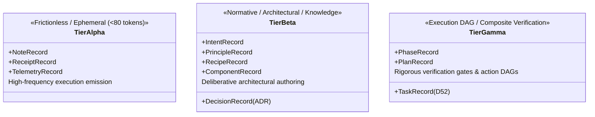
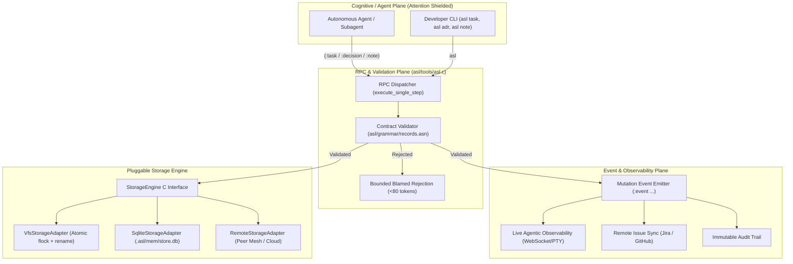
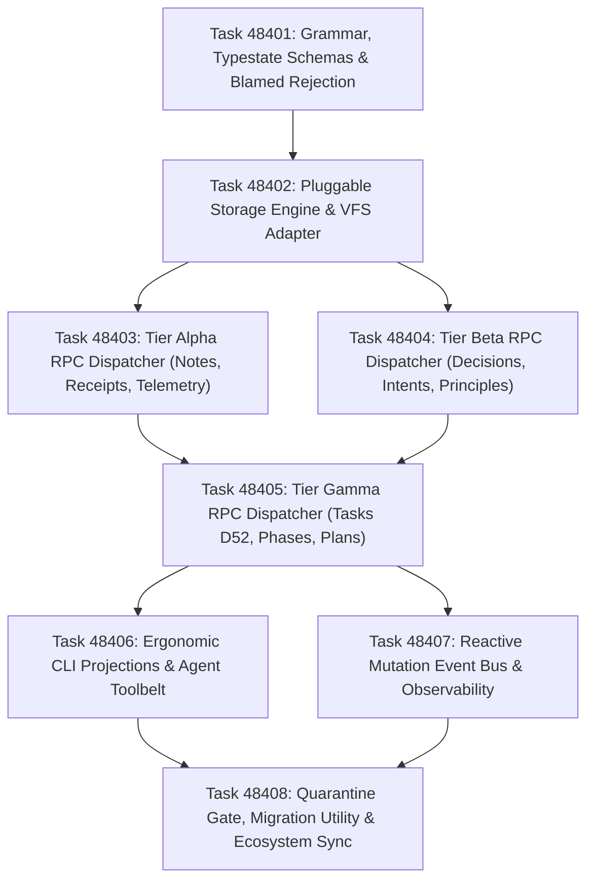

# Phase 484 Plan: RPC Record Store, Attention Separation, and Event-Driven Memory Architecture

## Executive Summary & Metadata
- **Phase ID**: `Phase484RpcRecordStoreAndDeterministicDistribution`
- **Shortcode**: `Phase 484`
- **Architecture Mandate**: `D83` (RPC-First Record Store, Attention Separation, and Event-Driven Memory Architecture)
- **Status**: `planned`
- **Priority**: `critical`
- **Deciders**: `["user" "architect" "planner" "implementer" "auditor"]`
- **Invariants Enforced**: `C1` (0 comments), `C2` (0 emojis), `C3` / `D34` (Boundary Universalism), `C4` / `D44` (Lexical Density), `C5` (0 sigils), `D51` (Token Efficiency & CamelCase), `D52` (Enriched Task Context), `D58` (Attention Reliability & Deliberation), `D59` (Monorepo Memory Hierarchy), `D81` (Canonical Shortcodes), `D83` (RPC Record Store).
- **Core Themes**: Cognitive Attention Separation, Typestate Cognitive Load Clustering, Write-Time Contract Validation, Bounded Blamed Rejection (<80 tokens), Deterministic VFS Persistence, Pluggable Storage Adapters, and Reactive Mutation Event Streaming.

---

## 1. Problem Statement & The Attention Separation Theory

### 1.1 The Dual Cognitive Burden of Direct File Writing
In autonomous agent architectures, an LLM's active attention window is a bounded, fragile computational resource. Under the current direct-filesystem-write model in `.asl/mem/`:
- Tasks are written directly to `.asl/mem/tasks/*.asn`
- Decisions are written directly to `.asl/mem/decisions/*.asn`
- Notes are appended to `.asl/mem/notes.asn` (120KB)
- Receipts are appended to `.asl/mem/receipts.asn` (94KB)
- Plans, telemetry, intents, principles, recipes, and component docs are scattered across monolithic files.

This architecture forces the agent to simultaneously execute two fundamentally opposing cognitive tasks:
1. **High-Level Semantic Reasoning**: Formulating architectural motivation, purpose, failure modes, invariants, and falsifiable verification gates.
2. **Low-Level Syntactic Micro-Management**: Calculating closing parentheses, indentation, string escaping, relative filesystem paths, avoiding illegal comments, and handling file locks.

### 1.2 Cognitive Pathology of Direct File Writing
1. **Attention Dispersion**: Attention heads allocated to counting closing parentheses or escaping strings are robbed from invariant checking and edge-case anticipation.
2. **Late Failure Loops**: The agent only discovers a syntax or schema defect *after* writing the file and running an audit gate. The resulting compiler error dumps or diffs flood the context, triggering expensive, hallucination-prone trial-and-error editing cycles.
3. **Monolithic Append Concurrency Collisions**: When multiple parallel subagents append to `notes.asn` or `receipts.asn`, simultaneous writes cause race conditions, line clobbering, and broken S-expressions that fail Gate 2 (Structural Delimiter Invariant).
4. **Storage Substrate Lock-In**: Workflows are hardcoded to relative filesystem paths in `.asl/mem/`. Swapping the underlying persistence engine to SQLite, DuckDB, or a remote mesh service requires rewriting every agent prompt, skill, and script.
5. **Observability Blind Spot**: External tools, live UI dashboards, and issue trackers (Jira, GitHub) cannot react to mutations without wasteful, high-latency disk polling.

---

## 2. The 6 Planes of Attention Separation

To eliminate cognitive sprawl and guarantee system integrity, Phase 484 establishes **6 Planes of Attention Separation**:

```
+─────────────────────────────────────────────────────────────────────────────────────────────+
|                                    ATTENTION SEPARATION                                     |
+─────────────────────────────────────────────────────────────────────────────────────────────+
|  PLANE 1: SEMANTIC INTENT PLANE (AGENT CONTEXT SHIELDING)                                   |
|  • The agent operates purely as an author of semantic intent.                               |
|  • The agent NEVER opens a file, formats indentation, or counts parentheses.                |
|  • The agent emits pure semantic ASN forms to `asl rpc '(:batch (...))'`.                   |
+─────────────────────────────────────────────────────────────────────────────────────────────+
|  PLANE 2: TYPESTATE COGNITIVE LOAD CLUSTERING (TOKEN & REASONING BUDGET)                    |
|  • Tier Alpha (Frictionless / Ephemeral / <80 tokens): Notes, Receipts, Telemetry.          |
|  • Tier Beta (Normative / Architectural / Medium Load): Decisions, Intents, Principles,     |
|    Recipes, Component Manifests.                                                            |
|  • Tier Gamma (Execution DAG / High Load): Tasks (D52), Phases, Plans.                      |
+─────────────────────────────────────────────────────────────────────────────────────────────+
|  PLANE 3: CONTRACT VALIDATION & BOUNDED BLAMED REJECTION                                    |
|  • Write-time schema validation in native C before any byte touches disk.                   |
|  • If invalid, immediate return of a sub-80 token blamed receipt (:field, :expected, :got). |
|  • The agent's attention window is immediately focused without compiler stack dump bloat.   |
+─────────────────────────────────────────────────────────────────────────────────────────────+
|  PLANE 4: STEP-SCOPED CONTEXT DELIVERY ((:where) & SURGICAL SLICES)                         |
|  • Agents never read monolithic 100KB+ memory files into context.                           |
|  • The engine's (:where) delivering strictly the active task, active step, owned files,    |
|    and relevant rule constraints for the current execution slice.                          |
+─────────────────────────────────────────────────────────────────────────────────────────────+
|  PLANE 5: PLUGGABLE STORAGE SUBSTRATE & PERSISTENCE ISOLATION                               |
|  • StorageEngine C interface decouples schema contracts from persistence implementation.   |
|  • VfsStorageAdapter enforces atomic flock locking, canonical S-expression indentation,    |
|    100% balanced delimiters, C1 comment-free purity, and atomic temp-file rename.           |
|  • Transparent future support for SQLite, DuckDB, and remote mesh storage.                  |
+─────────────────────────────────────────────────────────────────────────────────────────────+
|  PLANE 6: REACTIVE MUTATION EVENT BUS & AGENTIC OBSERVABILITY                               |
|  • Every record mutation emits a structured (:event ...) form.                              |
|  • Live WebSocket dashboards, peer agent swarms, and Jira/GitHub sync react in sub-5ms      |
|    without reading disk or polling files.                                                   |
+─────────────────────────────────────────────────────────────────────────────────────────────+
```

---

## 3. Typestate Cognitive Load Hierarchy (11 Monorepo Records)

All 11 monorepo record categories are formalized into three distinct cognitive tiers:



### 3.1 Tier Alpha: Frictionless Working Memory (<80 Tokens)
1. **`NoteRecord`**: Transient working memory observations, facts, and volatile state.
   - Schema: `(:note :id <str> :topic <str> :session <str> :tags [<str>] :fact <str> :reconstructibility <bool> :status <enum>)`
   - Cognitive Load: Frictionless emission during execution; prevents context loss across steps.
2. **`ReceiptRecord`**: Immutable execution evidence from runner tools.
   - Schema: `(:receipt :id <str> :taskId <str> :gate <str> :exitCode <int> :status <enum> :timestamp <int> :digest <str> :executedAsserts <int> :durationMs <int>)`
   - Cognitive Load: Emitted by runner; immutable ground truth.
3. **`TelemetryRecord`**: Micro-benchmarks, token counts, and step timings.
   - Schema: `(:telemetry :series <str> :timestamp <int> :host <str> :metric <str> :value <num> :tags [<str>])`
   - Cognitive Load: Emitted automatically by execution harness.

### 3.2 Tier Beta: Normative Architecture & Knowledge Base
4. **`DecisionRecord` (ADR)**: Architectural decision records under D81 canonical format.
   - Schema: `(:adr :id "D<N>" :shortcode "D<N>" :title <str> :status <enum> :date <str> :cluster <str> :deciders [<str>] :problem <str> :drivers [<str>] :decision <str> :invariants [<str>] :tasks [<str>] :outcomes [<str>] :consequences [<form>])`
5. **`IntentRecord`**: Architectural teleology vectors and long-term invariants.
   - Schema: `(:intent :id "d<N>" :sym <str> :title <str> :intent <str> :outcome <str> :whyNot [<str>] :adr <str> :tasks [<str>] :closure <str> :status <enum>)`
6. **`PrincipleRecord`**: Monorepo governance axioms and empirical constraints.
   - Schema: `(:principle :id <str> :normativeOrEmpirical <enum> :name <str> :statement <str> :invariants [<str>] :checkCommand <str> :gateCommand <str> :why <str>)`
7. **`RecipeRecord`**: Standard operating procedures, diagnostic playbooks, and recovery guides.
   - Schema: `(:recipe :id <str> :name <str> :goal <str> :prerequisites [<str>] :steps [<str>] :pitfalls [<str>] :recovery <str>)`
8. **`ComponentRecord`**: Subsystem interface manifests, typestate definitions, and boundary contracts.
   - Schema: `(:component :id <str> :package <str> :module <str> :typestates [<str>] :invariants [<str>] :exports [<str>] :contracts [<str>] :dependencies [<str>])`

### 3.3 Tier Gamma: Execution DAG & Formal Verification
9. **`TaskRecord` (D52 Enriched)**: Atomic work item specification.
   - Schema: `(:task :id "Task<N>" :phase <str> :title <str> :kind <enum> :lane <str> :state <enum> :priority <enum> :ownerRole <str> :motivation <str> :purpose <str> :context <form> :outcomes [<str>] :owns [<str>] :targetSymbols [<str>] :relatedSymbols [<str>] :invariants [<str>] :adr <str> :decision <str> :dependsOn [<str>] :gate <str> :actionDag [<str>] :acceptanceCriteria <form> :contractRefs [<sym>] :verificationRole <str> :verificationOwns [<str>] :verificationCases [<str>] :gateReadiness <enum> :baselineProbe <form> :reviewStatus <enum> :stepIndex <int> :receipts [<form>])`
10. **`PhaseRecord`**: Roadmap phase collections, wave placement, and acceptance gates.
    - Schema: `(:phase :id <str> :title <str> :status <enum> :wave <str> :gate <str> :tasks [<str>] :dependencies [<str>])`
11. **`PlanRecord`**: Master roadmap plan specifications and execution DAGs.
    - Schema: `(:plan :id <str> :phase <str> :title <str> :status <enum> :clusters [<form>] :items [<form>] :verdict <enum>)`

---

## 4. Clustered System Architecture



---

## 5. Ordered Implementation Work Items (8 Clustered Tasks)



### Task 48401 (Cluster 1: Grammar, Typestate Schemas & Blamed Rejection Taxonomy)
- **Lane**: `records`
- **Priority**: `critical`
- **Motivation**: Direct file writes lack machine-verifiable grammar contracts for monorepo records, permitting syntax errors, broken parentheses, and schema drift.
- **Purpose**: Author `asl/grammar/records.asn` defining formal ASN contracts for all 11 monorepo record types across Tier Alpha, Tier Beta, and Tier Gamma, along with a bounded error taxonomy for blamed rejections.
- **Files Owned**:
  - `asl/grammar/records.asn`
  - `tests/acceptance/d81/Task48401.asl`
- **Verification Gate**:
  ```bash
  sh tests/acceptance/d81/SuperviseGate.sh Task48401
  ```
- **Dependencies**: None.

### Task 48402 (Cluster 2: Pluggable Storage Engine & Deterministic VFS Adapter)
- **Lane**: `storage`
- **Priority**: `critical`
- **Motivation**: Concurrent subagent file writes cause line clobbering, race conditions, and unbalanced S-expressions in shared ledgers.
- **Purpose**: Implement `StorageEngine` interface and `VfsStorageAdapter` in `asl/tools/asl.c` with native C canonical S-expression formatting, 0 comments (C1), `flock()` concurrency locking with 2000ms timeout, and atomic temporary-file rename.
- **Files Owned**:
  - `asl/tools/asl.c`
  - `bin/asl`
  - `asl/asl`
  - `asl/bin/asl`
  - `tests/acceptance/d81/Task48402.asl`
- **Verification Gate**:
  ```bash
  sh tests/acceptance/d81/SuperviseGate.sh Task48402
  ```
- **Dependencies**: `Task48401`.

### Task 48403 (Cluster 3A: Tier Alpha RPC Contract Dispatcher - Notes, Receipts, Telemetry)
- **Lane**: `rpc-alpha`
- **Priority**: `critical`
- **Motivation**: Notes, receipts, and telemetry are currently appended directly to 100KB+ files, exhausting token context and risking syntax corruption.
- **Purpose**: Implement RPC handlers in `asl/tools/asl.c` for `:note`, `:receipt`, and `:telemetry` with write-time schema validation and sub-80 token blamed rejection receipts.
- **Files Owned**:
  - `asl/tools/asl.c`
  - `bin/asl`
  - `asl/asl`
  - `asl/bin/asl`
  - `tests/acceptance/d81/Task48403.asl`
- **Verification Gate**:
  ```bash
  sh tests/acceptance/d81/SuperviseGate.sh Task48403
  ```
- **Dependencies**: `Task48401`, `Task48402`.

### Task 48404 (Cluster 3B: Tier Beta RPC Contract Dispatcher - Decisions, Intents, Principles, Recipes, Components)
- **Lane**: `rpc-beta`
- **Priority**: `critical`
- **Motivation**: Architectural decisions, intents, principles, recipes, and component manifests are scattered across files without unified write contracts.
- **Purpose**: Implement RPC handlers in `asl/tools/asl.c` for `:decision`, `:intent`, `:principle`, `:recipe`, and `:component` with schema validation and atomic indexing.
- **Files Owned**:
  - `asl/tools/asl.c`
  - `bin/asl`
  - `asl/asl`
  - `asl/bin/asl`
  - `tests/acceptance/d81/Task48404.asl`
- **Verification Gate**:
  ```bash
  sh tests/acceptance/d81/SuperviseGate.sh Task48404
  ```
- **Dependencies**: `Task48401`, `Task48402`.

### Task 48405 (Cluster 3C: Tier Gamma RPC Contract Dispatcher - Tasks D52, Phases, Plans)
- **Lane**: `rpc-gamma`
- **Priority**: `critical`
- **Motivation**: Tasks, phases, and plans carry complex bidirectional linkages and verification gates that currently fail late during consistency audits.
- **Purpose**: Implement RPC handlers in `asl/tools/asl.c` for `:task`, `:phase`, and `:plan` enforcing the enriched D52 schema, verification gate presence, and dependency acyclicity.
- **Files Owned**:
  - `asl/tools/asl.c`
  - `bin/asl`
  - `asl/asl`
  - `asl/bin/asl`
  - `tests/acceptance/d81/Task48405.asl`
- **Verification Gate**:
  ```bash
  sh tests/acceptance/d81/SuperviseGate.sh Task48405
  ```
- **Dependencies**: `Task48401`, `Task48402`, `Task48403`, `Task48404`.

### Task 48406 (Cluster 4: Ergonomic CLI Projections & Agent Toolbelt Commands)
- **Lane**: `cli`
- **Priority**: `normal`
- **Motivation**: Agents and developers need ergonomic CLI subcommands wrapping RPC operations to eliminate raw file editing from workflows.
- **Purpose**: Implement native CLI subcommands (`asl task`, `asl adr`, `asl note`, `asl receipt`, `asl plan`, `asl intent`) that translate CLI flags to RPC batch forms and render dense ASN or tabular views.
- **Files Owned**:
  - `asl/tools/asl.c`
  - `bin/asl`
  - `asl/asl`
  - `asl/bin/asl`
  - `tests/acceptance/d81/Task48406.asl`
- **Verification Gate**:
  ```bash
  sh tests/acceptance/d81/SuperviseGate.sh Task48406
  ```
- **Dependencies**: `Task48403`, `Task48404`, `Task48405`.

### Task 48407 (Cluster 5: Reactive Mutation Event Bus & Observability Stream)
- **Lane**: `events`
- **Priority**: `normal`
- **Motivation**: External tools, agentic observability platforms, and live dashboards cannot observe memory mutations without wasteful disk polling.
- **Purpose**: Implement structured mutation event emitter in `asl/tools/asl.c` streaming typed S-expressions to stdout and unix domain sockets for zero-polling listeners.
- **Files Owned**:
  - `asl/tools/asl.c`
  - `asl/grammar/events.asn`
  - `bin/asl`
  - `asl/asl`
  - `asl/bin/asl`
  - `tests/acceptance/d81/Task48407.asl`
- **Verification Gate**:
  ```bash
  sh tests/acceptance/d81/SuperviseGate.sh Task48407
  ```
- **Dependencies**: `Task48402`, `Task48405`.

### Task 48408 (Cluster 6: Direct-Write Quarantine Gate, Forensic Migration & Ecosystem Sync)
- **Lane**: `verification`
- **Priority**: `critical`
- **Motivation**: Without mechanical quarantine enforcement, legacy scripts and agents will revert to predictive direct file writing.
- **Purpose**: Add quarantine checks to `asl audit gates`, implement `asl mem migrate` batch ingestion utility, synchronize `rules.asn`, `AGENTS.md`, and agent skills, and certify 100% monorepo consistency.
- **Files Owned**:
  - `asl/tools/asl.c`
  - `asl/grammar/rules.asn`
  - `AGENTS.md`
  - `.plans/MASTER_ROADMAP.md`
  - `tests/acceptance/d81/Task48408.asl`
- **Verification Gate**:
  ```bash
  bin/asl audit consistency && bin/asl audit gates
  ```
- **Dependencies**: `Task48401`, `Task48402`, `Task48403`, `Task48404`, `Task48405`, `Task48406`, `Task48407`.

---

## 6. Risk Assessment & Invariant Safeguards

| Risk | Consequence | Mitigation Strategy |
| :--- | :--- | :--- |
| **Breaking Existing Memory Files** | Incompatible S-expression parsing breaks Gate 5 | `VfsStorageAdapter` must emit bit-compatible, comment-free ASN matching existing files. |
| **Submodule Index Lock Collisions** | Stalled commits in `asl` submodule | Sequence writes to `asl` first, release locks immediately, and enforce BypassSandbox when committing. |
| **Context Bloat on Validation Failure** | LLM prompt overwhelmed by error stacks | Contract validation returns compact (<80 token) blamed receipts: `(:step ... :status "rejected" :error-code ":ERR_FIELD_MISSING" :field ":gate")`. |
| **Subagent Concurrency Deadlocks** | Agents hang waiting on `flock` | Bounded lock timeouts (maximum 2000ms) with graceful retry or `:ERR_LOCK_TIMEOUT` return. |
| **Silent Mutation Loss in Stream** | External listeners miss critical updates | Mutation events carry monotonic sequence IDs and disk WAL backup for replayability. |
