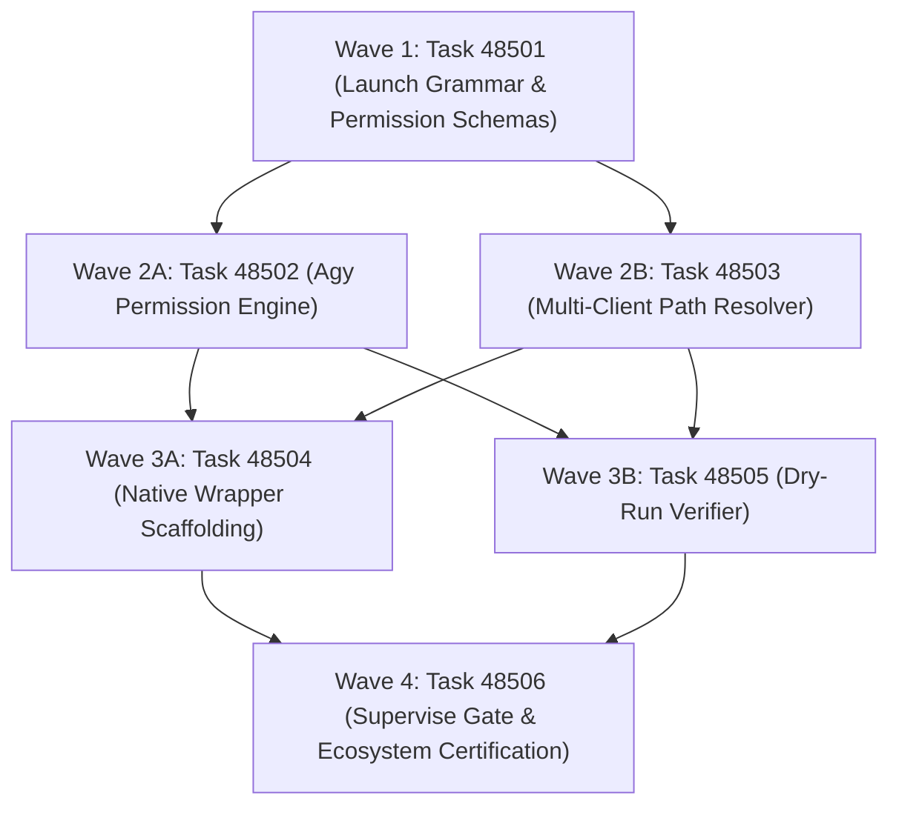

# Phase 485 Plan: Multi-Client Launcher Engine, Dangerous-Rescue Permissions, and Client Channel Protocol

## Executive Summary & Metadata
- **Phase ID**: `Phase485MultiClientLauncherEngineAndDangerousRescue`
- **Shortcode**: `Phase 485`
- **Architecture Mandate**: `D84` (Multi-Client Launcher Engine, Dangerous-Rescue Permissions, and Client Channel Protocol)
- **Status**: `planned`
- **Priority**: `critical`
- **Deciders**: `["user" "architect" "planner" "implementer" "auditor"]`
- **Invariants Enforced**: `C1` (0 comments), `C2` (0 emojis), `C3` / `D34` (Boundary Universalism), `C4` / `D44` (Lexical Density), `D51` (Token Efficiency & CamelCase), `D52` (Enriched Task Context), `D80` (Hierarchical Workspace Topology), `D81` (Canonical Shortcodes), `D84` (Multi-Client Launcher Engine).
- **Core Themes**: Permission Tier Elevation, Unattended Autonomous Session Reliability, Deterministic Multi-Client Path Discovery, Native Binary Aliases (`addie`/`eddie`), Channel Protocol Handshake, and Dry-Run Diagnostic Receipts.

---

## 1. Problem Statement & Operational Context

Autonomous agents operating across diverse developer machines and host runners (Antigravity CLI, Claude Code, Codex, Cursor, Windsurf) face recurring launch impediments:
1. **Interactive Permission Prompt Deadlocks**: Antigravity CLI and Claude Code prompt the user interactively when encountering unfamiliar tools or sandbox boundaries. In unattended background loops or overnight multi-session tasks, these prompts block execution indefinitely, halting progress.
2. **Fragile Client Discovery**: AI client binaries are frequently installed in user-local directories (`~/.local/bin/claude`, `~/bin/agy`, `/opt/homebrew/bin/cursor`) rather than system `/usr/local/bin`. Minimal subshell environments fail to find these executables, causing runtime failures.
3. **Missing Native Binary Aliases**: Historic workflows rely on `bin/addie` and `bin/eddie`. When these shims are absent or desynchronized with `bin/asl`, scripts break.
4. **Opaque Launch Configurations**: Agents lack a zero-side-effect inspection command to verify what arguments, environment flags, and permission levels will be passed to spawned processes before invocation.

---

## 2. Attention Separation Architecture in the Launcher Engine

The launcher implements strict Attention Separation across 3 Cognitive Planes:

```
+─────────────────────────────────────────────────────────────────────────────────────────────+
|                                    ATTENTION SEPARATION                                     |
+─────────────────────────────────────────────────────────────────────────────────────────────+
|  PLANE 1: CLIENT INTENT ABSTRACTION (ZERO SHELL ESCAPING COGNITION)                         |
|  • The agent or caller requests a semantic target: `asl launch agy` or `asl launch claude`.  |
|  • The agent NEVER constructs raw shell argv strings, quotes, or environment overrides.    |
|  • The engine resolves flags, permission tiers, and channels deterministically.            |
+─────────────────────────────────────────────────────────────────────────────────────────────+
|  PLANE 2: PERMISSION TIER ENCAPSULATION (SECURITY & RESCUE BOUNDARIES)                       |
|  • :read-only: strictly sandboxed perceptual reads; zero filesystem mutations.               |
|  • :sandboxed-write: workspace-bounded mutations requiring explicit allowlist bounds.       |
|  • :dangerous-rescue: automatic injection of `--dangerously-skip-permissions` for unattended|
|    autonomous rescue runs, binding the agent to the global invariant channel.               |
+─────────────────────────────────────────────────────────────────────────────────────────────+
|  PLANE 3: DRY-RUN DIAGNOSTIC RECEIPTING (BOUNDED INSPECTION)                                 |
|  • Invoking `asl launch <client> --dry-run` produces an immediate, structured ASN receipt    |
|    (<80 tokens) reporting resolved executable path, active arguments, and permission tier.  |
|  • Zero process spawning occurs; inspection is instantaneous and 100% deterministic.         |
+─────────────────────────────────────────────────────────────────────────────────────────────+
```

---

## 3. Work Item DAG & Clustered Execution Waves



### Wave 1: Schema & Protocol Specification (Independent Baseline)
- **Task 48501**: `Client Channel Protocol and Launch Session Schema`
  - **Lane**: `grammar`
  - **Owns**: `asl/grammar/launch.asn`, `tests/acceptance/d81/Task48501.asl`
  - **Gate**: `bin/asl test tests/acceptance/d81/Task48501.asl`
  - **Baseline**: Gate fails because `asl/grammar/launch.asn` does not yet declare `launch-session` and `permission-tier`.

### Wave 2: Engine Implementation (Disjoint C Core Extensions)
- **Task 48502**: `Antigravity Dangerous-Rescue Permission Elevation Engine`
  - **Lane**: `launcher-core`
  - **Owns**: `asl/tools/asl.c`, `bin/asl`, `asl/asl`, `asl/bin/asl`, `tests/acceptance/d81/Task48502.asl`
  - **Gate**: `bin/asl test tests/acceptance/d81/Task48502.asl`
  - **Baseline**: Gate fails because `asl launch agy` does not yet inject `--dangerously-skip-permissions` or record `:dangerous-rescue`.
- **Task 48503**: `Deterministic Multi-Client Path Resolver`
  - **Lane**: `launcher-resolver`
  - **Owns**: `asl/tools/asl.c`, `bin/asl`, `asl/asl`, `asl/bin/asl`, `tests/acceptance/d81/Task48503.asl`
  - **Gate**: `bin/asl test tests/acceptance/d81/Task48503.asl`
  - **Baseline**: Gate fails because client discovery does not check `~/.local/bin` and fallback heuristics.

### Wave 3: Toolbelt Ergonomics & Diagnostic Verification
- **Task 48504**: `Native Wrapper Scaffolding for bin/addie and bin/eddie`
  - **Lane**: `toolbelt`
  - **Owns**: `bin/addie`, `bin/eddie`, `tests/acceptance/d81/Task48504.asl`
  - **Gate**: `bin/asl test tests/acceptance/d81/Task48504.asl`
  - **Baseline**: Gate fails because `bin/addie` and `bin/eddie` do not exist.
- **Task 48505**: `Dry-Run Diagnostic and Capability Handshake Verifier`
  - **Lane**: `launcher-cli`
  - **Owns**: `asl/tools/asl.c`, `bin/asl`, `tests/acceptance/d81/Task48505.asl`
  - **Gate**: `bin/asl launch agy --dry-run && bin/asl launch claude --dry-run`
  - **Baseline**: Gate fails because `--dry-run` flag is unrecognized.

### Wave 4: Ecosystem Governance & Final Verification
- **Task 48506**: `Multi-Client Launcher Supervise Gate and Ecosystem Certification`
  - **Lane**: `verification`
  - **Owns**: `tests/acceptance/d81/Task48506.asl`, `AGENTS.md`, `scripts/install.sh`
  - **Gate**: `sh tests/acceptance/d81/SuperviseGate.sh Task48506`
  - **Baseline**: Gate fails prior to clean-context certification across Task48501..Task48506.

---

## 4. Verification Evidence & Quality Metrics
- Zero comment violations (`C1`) across all `.asn` and `.asl` files.
- Triple binary parity maintained across `bin/asl`, `asl/asl`, and `asl/bin/asl`.
- Full compliance with `D84` and `D80` workspace lineage boundaries.
