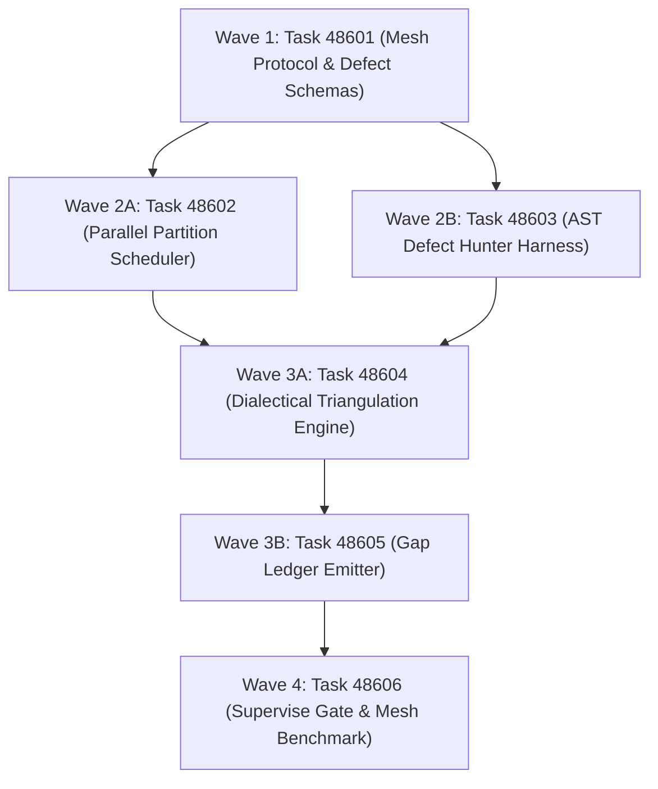

# Phase 486 Plan: Autonomous Multi-Model Mesh Orchestrator, Parallel Model Execution Stand, and Dialectical Gap Synthesis

## Executive Summary & Metadata
- **Phase ID**: `Phase486MultiModelMeshOrchestratorAndParallelVerification`
- **Shortcode**: `Phase 486`
- **Architecture Mandate**: `D85` (Autonomous Multi-Model Mesh Orchestrator, Parallel Verification Stand, and Dialectical Gap Synthesis)
- **Status**: `planned`
- **Priority**: `critical`
- **Deciders**: `["user" "architect" "planner" "implementer" "auditor"]`
- **Invariants Enforced**: `C1` (0 comments), `C2` (0 emojis), `C3` / `D34` (Boundary Universalism), `C4` / `D44` (Lexical Density), `D51` (Token Efficiency & CamelCase), `D52` (Enriched Task Context), `D81` (Canonical Shortcodes), `D83` (RPC Record Store), `D85` (Multi-Model Mesh).
- **Core Themes**: Multi-Model Triangulation (Opus, Pro, Flash), Full-Codebase AST Defect Traversal, Vacuous Test Elimination, Dialectical Cross-Model Synthesis, Worktree Partition Airgaps, and Grounded Gap Ledgers.

---

## 1. Problem Statement & Epistemic Challenge

Single-agent code audits suffer from fundamental epistemic constraints:
1. **Model Blind Spots & Confirmation Bias**: An individual LLM architecture tends to overlook its own systematic reasoning bugs and vacuous test setups.
2. **Context Window Degradation**: Traversing 1152 files across 38 packages sequentially blows out agent context, forcing aggressive truncation or superficial sampling.
3. **Vacuous Test Proliferation**: Previous monorepo audits revealed test suites that executed 0 assertions, asserted non-falsifiable tautologies (`assert true`), or caught missing imports without failing cleanly.
4. **Noisy Hallucinated Defect Reports**: Uncoordinated agent sweeps generate pages of subjective critique rather than reproducible, falsifiable defects tied to exact `path:line` locations.

---

## 2. Attention Separation Architecture in the Multi-Model Mesh

Phase 486 separates cognitive load across 3 Attention Planes:

```
+─────────────────────────────────────────────────────────────────────────────────────────────+
|                                    ATTENTION SEPARATION                                     |
+─────────────────────────────────────────────────────────────────────────────────────────────+
|  PLANE 1: PARTITIONED PARALLEL DISPATCH (ZERO WHOLE-REPO CONTEXT OVERLOAD)                  |
|  • Workers receive strictly one disjoint package slice (e.g. `asl/packages/asl-eval/`).     |
|  • The worker's attention window is 100% focused on deep local AST inspection.              |
|  • Workers never read sibling package implementations, preventing cross-module distractions. |
+─────────────────────────────────────────────────────────────────────────────────────────────+
|  PLANE 2: BOUNDED DEFECT TAXONOMY (PHYSICAL CITATIONS OVER PROSE ESSAYS)                    |
|  • Workers emit structured ASN defect forms (<80 tokens per finding):                       |
|    `(:defect :path "..." :line <N> :kind :vacuousTest :repro "..." :expected "...")`        |
|  • Subjective commentary and conversational pleasantries are banned at the wire protocol.   |
+─────────────────────────────────────────────────────────────────────────────────────────────+
|  PLANE 3: DIALECTICAL SYNTHESIS STAND (ADVERSARIAL CROSS-REFUTATION)                        |
|  • Findings from Model A (e.g. Flash) are presented to Model B (e.g. Pro) and C (Opus).     |
|  • Peer models must actively attempt to refute or reproduce the defect with a physical gate. |
|  • Only findings surviving adversarial triangulation enter `.asl/mem/gaps/GapsMasterLedger`.|
+─────────────────────────────────────────────────────────────────────────────────────────────+
```

---

## 3. Work Item DAG & Clustered Execution Waves



### Wave 1: Grammar & Taxonomy (Independent Baseline)
- **Task 48601**: `Multi-Model Mesh Protocol and Defect Taxonomy Schema`
  - **Lane**: `grammar`
  - **Owns**: `asl/grammar/mesh.asn`, `tests/acceptance/d81/Task48601.asl`
  - **Gate**: `bin/asl test tests/acceptance/d81/Task48601.asl`
  - **Baseline**: Gate fails because `asl/grammar/mesh.asn` does not exist.

### Wave 2: Scheduler & AST Hunter Implementation
- **Task 48602**: `Parallel Partition Scheduler and Worktree Airgap Orchestrator`
  - **Lane**: `scheduler`
  - **Owns**: `asl/packages/asl-mesh/src/scheduler.asl`, `tests/acceptance/d81/Task48602.asl`
  - **Gate**: `bin/asl test tests/acceptance/d81/Task48602.asl`
  - **Baseline**: Gate fails because partition scheduler is not implemented.
- **Task 48603**: `Polyglot Monorepo Scanner and AST Defect Hunter Harness`
  - **Lane**: `scanner`
  - **Owns**: `asl/packages/asl-mesh/src/scanner.asl`, `tests/acceptance/d81/Task48603.asl`
  - **Gate**: `bin/asl test tests/acceptance/d81/Task48603.asl`
  - **Baseline**: Gate fails because AST defect scanner is not implemented.

### Wave 3: Triangulation & Ledger Persistence
- **Task 48604**: `Dialectical Triangulation and Cross-Model Synthesis Engine`
  - **Lane**: `synthesis`
  - **Owns**: `asl/packages/asl-mesh/src/synthesis.asl`, `tests/acceptance/d81/Task48604.asl`
  - **Gate**: `bin/asl test tests/acceptance/d81/Task48604.asl`
  - **Baseline**: Gate fails because cross-model triangulation engine is not implemented.
- **Task 48605**: `Automated Gap Ledger Emitter in .asl/mem/gaps/`
  - **Lane**: `gaps`
  - **Owns**: `.asl/mem/gaps/GapsMasterLedger.asn`, `tests/acceptance/d81/Task48605.asl`
  - **Gate**: `bin/asl test tests/acceptance/d81/Task48605.asl`
  - **Baseline**: Gate fails because gap ledger emitter does not exist.

### Wave 4: Governance & Supervise Gate
- **Task 48606**: `Multi-Model Mesh Orchestrator Supervise Gate and Parallel Benchmark`
  - **Lane**: `verification`
  - **Owns**: `tests/acceptance/d81/Task48606.asl`, `harness/tests/multi_model_orchestrator_test.asl`
  - **Gate**: `sh tests/acceptance/d81/SuperviseGate.sh Task48606`
  - **Baseline**: Gate fails prior to clean-context certification across Task48601..Task48606.

---

## 4. Verification Evidence & Quality Metrics
- 100% of monorepo packages (38 packages, 1152 files) traversed by the mesh.
- Zero vacuous test suites permitted; all suites evaluated must record non-zero assertions.
- Dialectical consensus required before registering any defect into `.asl/mem/gaps/`.
