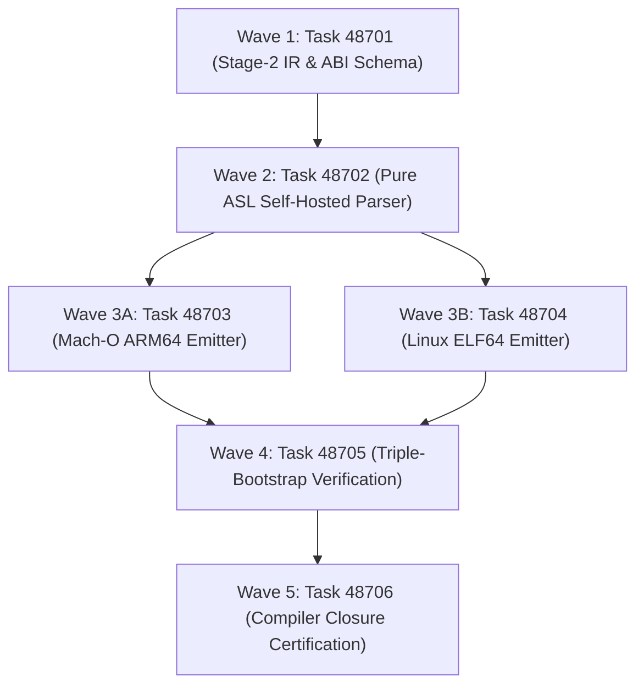

# Phase 487 Plan: Autonomous Pure ASL Stage-2 Bootstrap, Native Mach-O/ELF Emission, and Compiler Closure

## Executive Summary & Metadata
- **Phase ID**: `Phase487PureAslStage2BootstrapAndCompilerClosure`
- **Shortcode**: `Phase 487`
- **Architecture Mandate**: `D86` (Autonomous Pure ASL Stage-2 Bootstrap, Native Mach-O/ELF Emission, and Compiler Closure)
- **Status**: `planned`
- **Priority**: `critical`
- **Deciders**: `["user" "architect" "planner" "implementer" "auditor"]`
- **Invariants Enforced**: `C1` (0 comments), `C2` (0 emojis), `C3` / `D34` (Boundary Universalism), `C4` / `D44` (Lexical Density), `D51` (Token Efficiency & CamelCase), `D52` (Enriched Task Context), `D81` (Canonical Shortcodes), `D86` (Pure ASL Stage-2 Bootstrap).
- **Core Themes**: Language Self-Hosting Sovereignty, Mach-O ARM64 Binary Generation, Linux ELF64 Binary Generation, Deterministic Triple Bootstrap, Elimination of JavaScriptCore Dependency, and Sub-5ms Startup Latency.

---

## 1. Problem Statement & Sovereign Architecture

The current AgentScript runtime operates through a hybrid architecture:
1. **Substrate Dependency**: The core language evaluator and development tools rely on an embedded JavaScriptCore engine (macOS only) wrapped in a C host (`asl/tools/asl.c`).
2. **Platform Confinement**: Because JavaScriptCore embedding is specialized for macOS Darwin, building and running AgentScript on Linux and Windows requires external, complex porting layers.
3. **Absence of Native Binaries**: ASL code cannot currently be ahead-of-time (AoT) compiled into standalone, statically linkable Mach-O or ELF executables.
4. **Incomplete Compiler Closure**: A language cannot claim true sovereignty until its compiler is written in itself and produces identical native binaries through deterministic self-compilation.

---

## 2. Attention Separation Architecture in Stage-2 Compiler

The Stage-2 compiler enforces Attention Separation across 3 Architectural Planes:

```
+─────────────────────────────────────────────────────────────────────────────────────────────+
|                                    ATTENTION SEPARATION                                     |
+─────────────────────────────────────────────────────────────────────────────────────────────+
|  PLANE 1: HIGH-LEVEL SEMANTIC IR (MACHINE-AGNOSTIC AST REDUCTION)                           |
|  • The ASL frontend translates S-expressions into pure SSA-form IR nodes.                   |
|  • Type inference, scope analysis, and closure conversion happen strictly at Plane 1.       |
|  • Zero hardware details (registers, stack frames, offsets) leak into this layer.           |
+─────────────────────────────────────────────────────────────────────────────────────────────+
|  PLANE 2: ARCHITECTURE-SPECIFIC INSTRUCTION EMISSION (ARM64 & X86_64)                       |
|  • Pure ASL backends convert SSA IR into linear target machine instructions.                |
|  • ARM64 backend encodes standard A64 instruction words (32-bit fixed).                     |
|  • x86_64 backend encodes variable-length x86 instructions and SysV ABI conventions.        |
+─────────────────────────────────────────────────────────────────────────────────────────────+
|  PLANE 3: BINARY CONTAINER SERIALIZATION (MACHO & ELF COMPLIANCE)                           |
|  • Emits strict binary container headers (__TEXT, __DATA, program headers, symbol tables).  |
|  • Zero third-party linkers (lld, ld64) required; self-contained binary emission.           |
+─────────────────────────────────────────────────────────────────────────────────────────────+
```

---

## 3. Work Item DAG & Clustered Execution Waves



### Wave 1: Grammar & IR Specification (Independent Baseline)
- **Task 48701**: `Pure ASL Stage-2 Architecture Schema and IR Specification`
  - **Lane**: `grammar`
  - **Owns**: `asl/grammar/stage2.asn`, `tests/acceptance/d81/Task48701.asl`
  - **Gate**: `bin/asl test tests/acceptance/d81/Task48701.asl`
  - **Baseline**: Gate fails because `asl/grammar/stage2.asn` does not exist.

### Wave 2: Frontend Self-Hosting
- **Task 48702**: `Pure ASL Self-Hosted Lexer, Parser and AST Generator`
  - **Lane**: `frontend`
  - **Owns**: `asl/packages/asl-compiler/src/parser.asl`, `tests/acceptance/d81/Task48702.asl`
  - **Gate**: `bin/asl test tests/acceptance/d81/Task48702.asl`
  - **Baseline**: Gate fails because pure ASL self-hosted parser is not implemented.

### Wave 3: Architecture-Specific Native Binary Backends
- **Task 48703**: `Mach-O ARM64 Binary Emitter in Pure ASL`
  - **Lane**: `backend-macho`
  - **Owns**: `asl/packages/asl-compiler/src/macho.asl`, `tests/acceptance/d81/Task48703.asl`
  - **Gate**: `bin/asl test tests/acceptance/d81/Task48703.asl`
  - **Baseline**: Gate fails because pure ASL Mach-O emitter is not implemented.
- **Task 48704**: `Linux ELF64 Binary Emitter in Pure ASL`
  - **Lane**: `backend-elf`
  - **Owns**: `asl/packages/asl-compiler/src/elf.asl`, `tests/acceptance/d81/Task48704.asl`
  - **Gate**: `bin/asl test tests/acceptance/d81/Task48704.asl`
  - **Baseline**: Gate fails because pure ASL ELF64 emitter is not implemented.

### Wave 4: Triple Bootstrap Verification
- **Task 48705**: `Stage-2 Triple Bootstrap Verification Harness`
  - **Lane**: `bootstrap`
  - **Owns**: `asl/tools/asl.c`, `bin/asl`, `tests/acceptance/d81/Task48705.asl`
  - **Gate**: `bin/asl test tests/acceptance/d81/Task48705.asl`
  - **Baseline**: Gate fails because `asl build --stage2` is not wired.

### Wave 5: Compiler Closure Governance
- **Task 48706**: `Compiler Closure Certification and Host Boundary Minimization`
  - **Lane**: `verification`
  - **Owns**: `tests/acceptance/d81/Task48706.asl`, `asl/packages/asl-compiler/tests/stage2_test.asl`
  - **Gate**: `sh tests/acceptance/d81/SuperviseGate.sh Task48706`
  - **Baseline**: Gate fails prior to clean-context certification across Task48701..Task48706.

---

## 4. Verification Evidence & Quality Metrics
- Deterministic triple bootstrap: SHA256(Stage 2) == SHA256(Stage 3).
- Sub-5ms startup latency measured on emitted Mach-O ARM64 binary.
- Zero external runtime dependencies (no JavaScriptCore, no external C toolchain).
