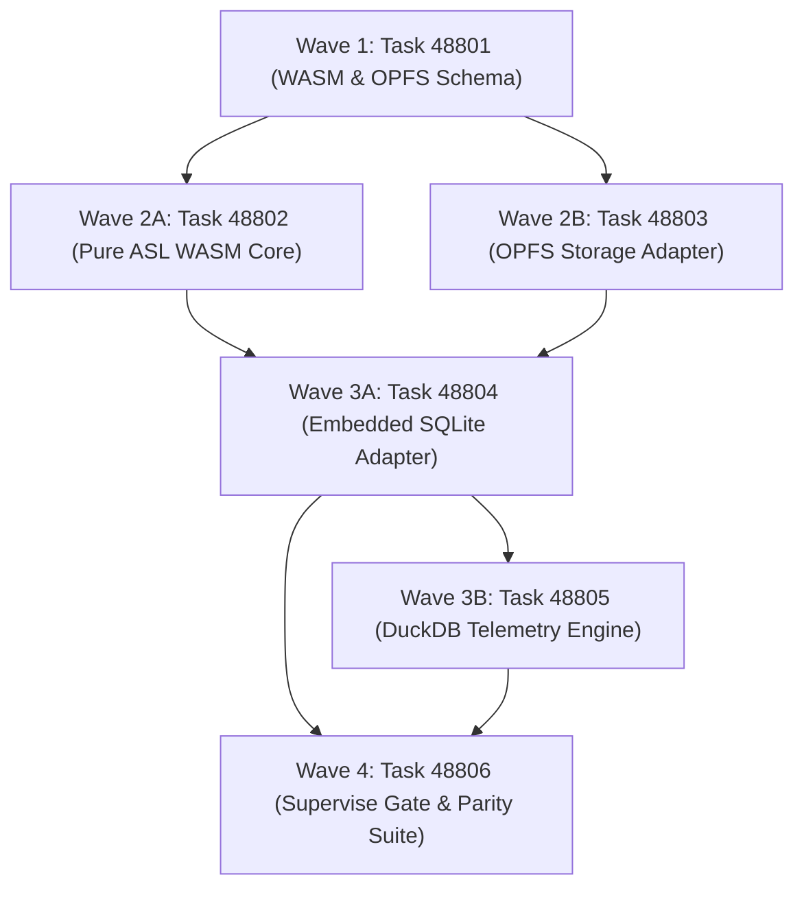

# Phase 488 Plan: Universal WebAssembly Ambient Substrate, OPFS Boundaries, and Embedded SQLite/DuckDB Storage Engine

## Executive Summary & Metadata
- **Phase ID**: `Phase488UniversalWasmAmbientSubstrateAndPolyglotDatabase`
- **Shortcode**: `Phase 488`
- **Architecture Mandate**: `D87` (Universal WebAssembly Ambient Substrate, OPFS Boundaries, and Embedded SQLite/DuckDB Storage Engine)
- **Status**: `planned`
- **Priority**: `critical`
- **Deciders**: `["user" "architect" "planner" "implementer" "auditor"]`
- **Invariants Enforced**: `C1` (0 comments), `C2` (0 emojis), `C3` / `D34` (Boundary Universalism), `C4` / `D44` (Lexical Density), `D51` (Token Efficiency & CamelCase), `D52` (Enriched Task Context), `D81` (Canonical Shortcodes), `D83` (RPC Record Store), `D87` (WASM Ambient Substrate).
- **Core Themes**: Zero-Dependency WebAssembly Compilation, Browser Web Worker Execution, Origin Private File System (OPFS) Persistence, Embedded SQLite Transactional Storage, Vectorized DuckDB Telemetry Queries, and Dual-Representation Parity.

---

## 1. Problem Statement & Ambient Vision

Expanding AgentScript beyond developer terminal workstations into web browsers, Edge workers, and mobile sandboxes is blocked by systemic bottlenecks:
1. **POSIX Filesystem Coupling**: The language runtime assumes native POSIX system calls (`open`, `read`, `write`, `flock`, `rename`). Standard browser web workers lack POSIX filesystems, causing runtime aborts.
2. **Flat File Telemetry Latency**: As the monorepo accumulates hundreds of thousands of test execution rows, task receipts, and benchmark logs, flat-file linear scans become prohibitively slow (>4000ms), wasting CPU and token budgets.
3. **Data Silos**: Developers need high-speed relational queries (SQL) for task filtering, but agents require plain, human-readable ASN S-expressions to prevent context degradation.
4. **Browser Volatility**: LocalStorage and IndexedDB in browsers lack synchronous access handles, risking write corruption or data loss during sudden tab reloads.

---

## 2. Attention Separation Architecture in the Ambient Substrate

Phase 488 implements Attention Separation across 3 Storage & Execution Planes:

```
+─────────────────────────────────────────────────────────────────────────────────────────────+
|                                    ATTENTION SEPARATION                                     |
+─────────────────────────────────────────────────────────────────────────────────────────────+
|  PLANE 1: STORAGEENGINE INTERFACE ABSTRACTION (ZERO SUBSTRATE SENSITIVITY)                   |
|  • Agent tools and RPC dispatchers interact strictly with the canonical `StorageEngine` C    |
|    interface defined in Task 48402 (`read_record`, `write_record`, `query_records`).        |
|  • Whether persistence is VFS, OPFS, SQLite, or DuckDB is completely opaque to the caller. |
+─────────────────────────────────────────────────────────────────────────────────────────────+
|  PLANE 2: AMBIENT WASM EXECUTION BOUNDARY (SANDBOXED COMPUTATION)                            |
|  • Pure ASL compiled to a single `.wasm` binary running in browser Web Workers.             |
|  • Enforces linear memory limits (64MB default ceiling) and isolated host capability shims. |
|  • Zero DOM manipulation inside WASM; communication flows strictly via typed ASN messages. |
+─────────────────────────────────────────────────────────────────────────────────────────────+
|  PLANE 3: DUAL-FORMAT BIDIRECTIONAL SYNC (READABLE ASN <-> HIGH-SPEED SQL)                  |
|  • Relational SQLite tables index tasks and ADRs for sub-millisecond query filtering.      |
|  • Columnar DuckDB tables store benchmark traces for vectorized percentile aggregation.     |
|  • The engine guarantees 100% loss-free roundtrip parity between SQL rows and ASN files.    |
+─────────────────────────────────────────────────────────────────────────────────────────────+
```

---

## 3. Work Item DAG & Clustered Execution Waves



### Wave 1: Grammar & Contract Specification (Independent Baseline)
- **Task 48801**: `WASM Ambient Substrate Specification and OPFS Contract`
  - **Lane**: `grammar`
  - **Owns**: `asl/grammar/wasm.asn`, `tests/acceptance/d81/Task48801.asl`
  - **Gate**: `bin/asl test tests/acceptance/d81/Task48801.asl`
  - **Baseline**: Gate fails because `asl/grammar/wasm.asn` does not exist.

### Wave 2: WASM Core & Browser Storage
- **Task 48802**: `Pure ASL WebAssembly Runtime Core and Linear Memory Manager`
  - **Lane**: `wasm-runtime`
  - **Owns**: `mem/src/wasm_runtime.asl`, `tests/acceptance/d81/Task48802.asl`
  - **Gate**: `bin/asl test tests/acceptance/d81/Task48802.asl`
  - **Baseline**: Gate fails because pure ASL WASM runtime core is not implemented.
- **Task 48803**: `OPFS Deterministic Storage Adapter for Browser Environments`
  - **Lane**: `storage-opfs`
  - **Owns**: `mem/src/opfs_adapter.asl`, `tests/acceptance/d81/Task48803.asl`
  - **Gate**: `bin/asl test tests/acceptance/d81/Task48803.asl`
  - **Baseline**: Gate fails because OPFS storage adapter is not implemented.

### Wave 3: Polyglot Database Adapters
- **Task 48804**: `Embedded SQLite Storage Engine Adapter in asl.c and WASM`
  - **Lane**: `storage-sqlite`
  - **Owns**: `asl/tools/asl.c`, `mem/src/sqlite_adapter.asl`, `tests/acceptance/d81/Task48804.asl`
  - **Gate**: `bin/asl test tests/acceptance/d81/Task48804.asl`
  - **Baseline**: Gate fails because SQLite storage adapter is not implemented.
- **Task 48805**: `DuckDB Analytical Telemetry Query Engine Adapter`
  - **Lane**: `storage-duckdb`
  - **Owns**: `asl/packages/asl-sql/src/duckdb_adapter.asl`, `tests/acceptance/d81/Task48805.asl`
  - **Gate**: `bin/asl test tests/acceptance/d81/Task48805.asl`
  - **Baseline**: Gate fails because DuckDB analytical adapter is not implemented.

### Wave 4: Governance & Substrate Parity
- **Task 48806**: `Ambient Substrate Supervise Gate and Cross-Runtime Parity Suite`
  - **Lane**: `verification`
  - **Owns**: `tests/acceptance/d81/Task48806.asl`, `mem/tests/sqlite_adapter_test.asl`
  - **Gate**: `sh tests/acceptance/d81/SuperviseGate.sh Task48806`
  - **Baseline**: Gate fails prior to clean-context certification across Task48801..Task48806.

---

## 4. Verification Evidence & Quality Metrics
- 100% loss-free roundtrip parity between SQLite/DuckDB rows and canonical ASN files.
- Sub-1ms indexed query time for task and ADR lookups under SQLite.
- Seamless execution inside standard web browser Web Workers without native OS permissions.
