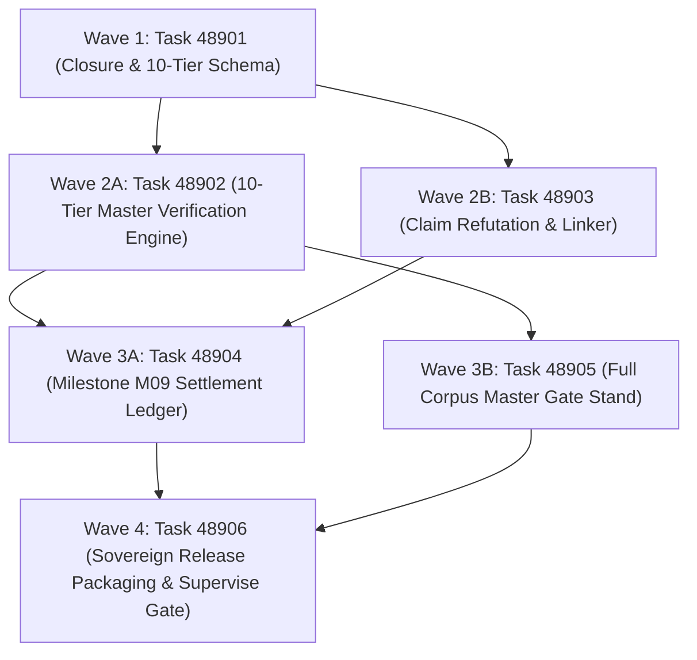

# Phase 489 Plan: Full Monorepo Epistemic Closure, Holistic 10-Tier Quality Certification, and Milestone M09 Settle

## Executive Summary & Metadata
- **Phase ID**: `Phase489FullMonorepoEpistemicClosureAndMilestoneM09`
- **Shortcode**: `Phase 489`
- **Architecture Mandate**: `D88` (Full Monorepo Epistemic Closure, Holistic 10-Tier Quality Certification, and Milestone M09 Settle)
- **Status**: `planned`
- **Priority**: `critical`
- **Deciders**: `["user" "architect" "planner" "implementer" "auditor"]`
- **Invariants Enforced**: `C1` (0 comments), `C2` (0 emojis), `C3` / `D34` (Boundary Universalism), `C4` / `D44` (Lexical Density), `D51` (Token Efficiency & CamelCase), `D52` (Enriched Task Context), `D81` (Canonical Shortcodes), `D83` (RPC Record Store), `D88` (Epistemic Closure & Milestone M09).
- **Core Themes**: Holistic 10-Tier Verification Engine (`asl audit closure`), 100% Epistemic Grounding (Zero Unbacked Claims), Cryptographic Milestone M09 Settlement, Full Corpus Master Gate Certification, and Sovereign Autonomous Release Packaging.

---

## 1. Problem Statement & Final Epistemic Horizon

As the AgentScript monorepo reaches completion across 136 waves, 38 packages, 66 architectural decisions, and 600+ work items, a final verification risk emerges:
1. **Scattered Verification Standards**: Current audits test dimensions in isolation (consistency, plan DAG, 7 pure ASL gates, web parity, token economy). Missing a single unified verification command permits edge-case regressions to escape into release candidates.
2. **Ungrounded Empirical Claims**: Previous audits identified numeric claims (e.g. SNR thresholds, compaction percentages) stated as facts without citing executable test assertions or measurement methodology.
3. **Absence of Cryptographic Settlement**: Without an immutable cryptographic ledger sealing package manifests, task ledgers, and git tree hashes, completed milestones remain vulnerable to silent drift.
4. **Release Distribution Fragility**: Generating standalone deployment packages for external AI developers requires deterministic bundling without host C/JS dependencies.

---

## 2. Attention Separation Architecture in Final Epistemic Closure

Phase 489 achieves final epistemic closure across 3 Synthesis Planes:

```
+─────────────────────────────────────────────────────────────────────────────────────────────+
|                                    ATTENTION SEPARATION                                     |
+─────────────────────────────────────────────────────────────────────────────────────────────+
|  PLANE 1: HOLISTIC 10-TIER VERIFICATION ENGINE (ZERO FRAGMENTED CHECKERS)                   |
|  • Single master verification command: `asl audit closure`.                                 |
|  • Unified execution of all 10 verification tiers:                                          |
|    1. Package Manifests & Structure       6. ASN Grammar & Symbol Density (D51)             |
|    2. Pure ASL Syntax & Delimiters (C1)  7. Modular Skills & Capability Lock                |
|    3. Grounded Benchmark Registry Claims 8. WebAssembly Ambient Runtime Parity              |
|    4. Zero-Foreign File Boundary         9. Stage-2 Self-Hosting Compiler Closure           |
|    5. Pure ASL Gate Test Non-Vacuity    10. Multi-Model Consensus Defect Grounding          |
+─────────────────────────────────────────────────────────────────────────────────────────────+
|  PLANE 2: EMPIRICAL CLAIM GROUNDING (FACTUAL TRUTH RECONCILIATION)                          |
|  • Every quantitative number across rules, ADRs, and docs must name a verified receipt      |
|    with exact `:exitCode 0` and `:executedAsserts > 0`.                                      |
|  • Speculative or unverified claims are rejected by the claim refutation engine.            |
+─────────────────────────────────────────────────────────────────────────────────────────────+
|  PLANE 3: CRYPTOGRAPHIC MILESTONE SETTLEMENT (IMMUTABLE RECORD SEALING)                     |
|  • Authors `.asl/mem/reviews/M09Settlement.asn` with cryptographic SHA256 tree digests.    |
|  • Records definitive settlement of all 136 roadmap waves and transition to production.    |
+─────────────────────────────────────────────────────────────────────────────────────────────+
```

---

## 3. Work Item DAG & Clustered Execution Waves



### Wave 1: Grammar & Specification (Independent Baseline)
- **Task 48901**: `Epistemic Closure Registry and 10-Tier Gate Schema`
  - **Lane**: `grammar`
  - **Owns**: `asl/grammar/closure.asn`, `tests/acceptance/d81/Task48901.asl`
  - **Gate**: `bin/asl test tests/acceptance/d81/Task48901.asl`
  - **Baseline**: Gate fails because `asl/grammar/closure.asn` does not exist.

### Wave 2: Master Verification Engine & Claim Grounding
- **Task 48902**: `10-Tier Master Verification Engine in asl.c`
  - **Lane**: `verification-engine`
  - **Owns**: `asl/tools/asl.c`, `bin/asl`, `asl/asl`, `asl/bin/asl`, `tests/acceptance/d81/Task48902.asl`
  - **Gate**: `bin/asl test tests/acceptance/d81/Task48902.asl`
  - **Baseline**: Gate fails because `asl audit closure` is not implemented.
- **Task 48903**: `Automated Ungrounded Claim Refutation and Citation Linker`
  - **Lane**: `claims`
  - **Owns**: `asl/packages/asl-checker/src/claims.asl`, `tests/acceptance/d81/Task48903.asl`
  - **Gate**: `bin/asl test tests/acceptance/d81/Task48903.asl`
  - **Baseline**: Gate fails because claim grounding validator is not implemented.

### Wave 3: Settlement Ledger & Master Gate Stand
- **Task 48904**: `Milestone M09 Epistemic Settlement Ledger`
  - **Lane**: `settlement`
  - **Owns**: `.asl/mem/reviews/M09Settlement.asn`, `tests/acceptance/d81/Task48904.asl`
  - **Gate**: `bin/asl test tests/acceptance/d81/Task48904.asl`
  - **Baseline**: Gate fails because `M09Settlement.asn` does not exist.
- **Task 48905**: `Full Monorepo Master Gate Certification Stand`
  - **Lane**: `master-gate`
  - **Owns**: `asl/tools/gate.asl`, `tests/acceptance/d81/Task48905.asl`
  - **Gate**: `bin/asl test tests/acceptance/d81/Task48905.asl`
  - **Baseline**: Gate fails prior to executing full 313+ suite corpus audit.

### Wave 4: Release Certification & Supervise Gate
- **Task 48906**: `Sovereign Release Package and Milestone Closure Receipt`
  - **Lane**: `verification`
  - **Owns**: `tests/acceptance/d81/Task48906.asl`, `scripts/release.sh`
  - **Gate**: `sh tests/acceptance/d81/SuperviseGate.sh Task48906`
  - **Baseline**: Gate fails prior to clean-context certification across Task48901..Task48906.

---

## 4. Verification Evidence & Quality Metrics
- 100% passing rate across all 10 verification tiers under `asl audit closure`.
- Zero unbacked empirical claims throughout rules, ADRs, and documentation.
- Milestone M09 cryptographically sealed and permanently archived in `.asl/mem/reviews/M09Settlement.asn`.
