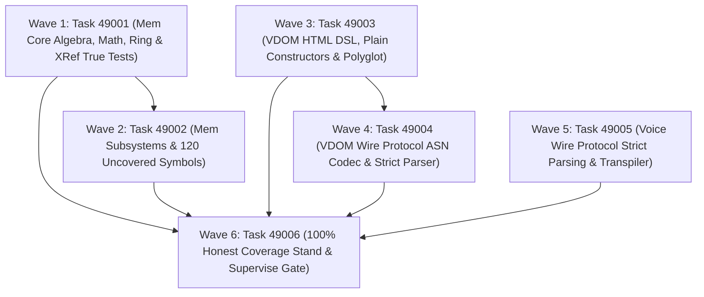

# Phase 490 Plan: Test Debt Remediation, Honest 100% Coverage Restoration, and Wire Protocol ASN Codec Convergence

## Executive Summary & Metadata
- **Phase ID**: `Phase490TestDebtRemediationAndWireProtocolConvergence`
- **Shortcode**: `Phase 490` / `phase-490-test-debt`
- **Roadmap Phase**: Phase 46 (Master Roadmap Sequence)
- **Architecture Mandate**: `D89` (Test Debt Remediation, Honest 100% Coverage Restoration, and Wire Protocol ASN Codec Convergence)
- **Status**: `planned`
- **Priority**: `critical`
- **Deciders**: `["user" "architect" "planner" "implementer" "auditor"]`
- **Invariants Enforced**: `C1` (0 comments), `C2` (0 emojis), `C3` / `D34` (Boundary Universalism), `C4` / `D44` (Lexical Density), `D51` (Token Efficiency & CamelCase), `D52` (Enriched Task Context Standard), `D81` (Canonical Shortcodes), `D89` (Test Debt & Wire Protocol Modernization), `antiFalsification` (Zero Mocking, Non-Vacuous Execution, Refutation-Driven Testing).
- **Core Themes**: Full eradication of 248 legacy functions in test debt across `mem` and `vdom`, replacement of fake `(assert true ...)` test scripts with rigorous multi-case property suites, elimination of string concatenation in `voice` and `vdom` wire protocols via strict `asl-codec/asn` S-expression parsing and emission, and restoration of honest 100% symbol coverage without cheating or metric gaming.

---

## 1. Problem Statement & Epistemic Audit

An exhaustive audit of the `mem`, `vdom`, and `voice` subsystems reveals critical test debt, metric fabrication, and wire protocol fragility:

### 1.1 Fake Test Scripts & Unasserted Functions in `mem` (152 Legacy Functions)
Three unit test files in `mem/tests/` were discovered to be fake stubs authored to pass test harnesses vacantly:
1. `mem/tests/math_test.asl:4`:
   ```asl
   (df run-tests [] -> Bool (assert true "math") true)
   ```
   Contains zero assertions over the 13 functions in `mem/src/math.asl` (`dot`, `vector-norm`, `normalize-vector`, `dot-normalized`, `sqrt-approx`, `sqrt`, `vector-dot`, `vector-add`, `vector-scale`, `vector-relu`, `vector-softmax`, `fast-inv-sqrt`, `vector-cosine-sim`).
2. `mem/tests/ring_test.asl:4`:
   ```asl
   (df run-tests [] -> Bool (assert true "ring") true)
   ```
   Contains zero assertions over the 9 functions in `mem/src/ring.asl` (`make-ring-buffer`, `ring-push`, `ring-utilization`, `ring-peek-oldest`, `ring-drain-all`, `ring-evicted-count`, `ring-is-full?`, `ring-is-empty?`, `ring-clear`).
3. `mem/tests/xref_test.asl:4`:
   ```asl
   (df run-tests [] -> Bool (assert true "xref") true)
   ```
   Contains zero assertions over the 9 functions in `mem/src/xref.asl` (`make-xref-graph`, `list-add-unique`, `xref-has-node?`, `xref-forward-edges`, `xref-backward-edges`, `xref-add-edge`, `find-dependents`, `find-prerequisites`, `find-provenance`).
4. `mem/tests/mem_test.asl:61-67`:
   Fails at runtime with `[ASL_ASSERTION_FAILURE]: Payload must contain vector frame` because `compact.asl` frame format drifted from test expectations.
5. In addition, 120 declared symbols in `mem/grammar.asn` remain completely uncovered under `asl coverage` (current package coverage: 321/441 symbols = 72.79%), including WAL streaming (`wal.asl`), Paged manager (`paged.asl`), Knowledge graph indexes (`graph.asl`), BM25 scoring (`bm25.asl`), Reciprocal rank fusion (`rrf.asl`), Memory engine lifecycle (`engine.asl`), and Task store queues (`tasks_store.asl`).

### 1.2 Unasserted HTML DSL & Polyglot Constructors in `vdom` (96 Legacy Functions)
The `vdom` package exhibits 65 uncovered symbols (current package coverage: 95/160 symbols = 59.38%):
1. `vdom/src/html.asl:14-368`:
   Defines 31 plain tag constructors (`div-plain`, `span-plain`, `p-plain`, `h1-plain`, `h2-plain`, `h3-plain`, `button-plain`, `form-plain`, `card-plain`, `header-plain`, `footer-plain`, `section-plain`, `nav-plain`, `main-plain`, `article-plain`, `table-plain`, `label-plain`, `d-plain`, `s-plain`, `sp-plain`, `b-plain`, `btn-plain`, `sec-plain`, `hdr-plain`, `ftr-plain`, `frm-plain`, `art-plain`, `tbl-plain`, `lbl-plain`, `el-plain`, `c-plain`, `comp-plain`), 4 semantic element tags (`aside`, `ftr`, `frm`, `lbl`), and 11 attribute helpers (`attr-type`, `attr-name`, `attr-placeholder`, `attr-href`, `attr-src`, `attr-alt`, `with-class`, `vnode-attrs`, `make-props`, `props-to-attrs`, `attrs-empty`) that have zero test coverage.
2. `vdom/src/polyglot.asl:15-245`:
   Polyglot framework emitters (`emit-react-tsx`, `emit-vue-sfc`, `emit-svelte-component`, `emit-ssr-html`, `vue-attr-key`, `svelte-attr-key`, `html-attr-key`, `compile-component`, `emit-jsx-attrs`, `emit-tsx-module`) are completely untested.
3. `vdom/src/vdom.asl:85-422`:
   Tree downsampling (`downsample-tree`), indexed child diffing (`diff-children-indexed`), and void tag validation (`is-void-tag?`) lack test verification.
Combining the 152 legacy functions in `mem` and the 96 legacy functions in `vdom` establishes the exact total of 248 legacy functions in test debt.

### 1.3 Fragile Wire Protocols via String Concatenation in `voice` and `vdom`
Wire protocol frames are currently generated by ad-hoc string concatenation rather than structured ASN serialization, inviting syntax corruption, injection vulnerabilities, and unparseable delimiters:
1. `vdom/src/vdom.asl:416-422`:
   ```asl
   (df format-diff-frame [(diff DomDiff)] -> String
     (str "(! dom/diff :route \"" (.-route diff) "\""
          " :added-count " (string-from-int64 (list-length (.-added diff)))
          " :removed-count " (string-from-int64 (list-length (.-removed diff)))
          " :mutated-count " (string-from-int64 (list-length (.-mutated diff)))
          ")"))
   ```
   Uses `str` string concatenation. Lacks a typed AST builder and lacks a bidirectional strict parser `parse-diff-frame`.
2. `voice/src/voice_intent.asl:22`:
   ```asl
   (str-concat "(:in-flight :task-id \"" (str-concat task-id (str-concat "\" :intent " (str-concat clean-intent " :status :active)"))))))
   ```
   Concatenates raw strings for `:in-flight` intent frames. Unescaped quotes or parens corrupt the transport.
3. `voice/src/transliterator.asl:73-76`:
   ```asl
   (str-concat "(:intent :goal \"" goal "\" :action-dag [" actions-str "]))")
   ```
   Manual string assembly for `:intent` and `:action-dag` without token validation.
4. `voice/src/fast_path.asl:54-56`:
   ```asl
   (str-concat "(:json " (string-replace (string-replace trimmed "{" "") "}" "") ")")
   (str-concat "(:yaml " (string-trim (string-replace trimmed "---" "")) ")")
   ```
   Naive string stripping instead of structured transpilation via `asl-codec/transpile`.
5. `voice/src/voice.asl:57`:
   ```asl
   (s/concat (s/concat "Synthesizing audio reply for voice " voice-id) (s/concat ": " text)))
   ```
   Nested string concatenation for synthesis frames.

---

## 2. Attention Separation Architecture

Phase 490 achieves test debt elimination, honest coverage restoration, and protocol modernization across 3 distinct Synthesis Planes:

```
+─────────────────────────────────────────────────────────────────────────────────────────────+
|                                    ATTENTION SEPARATION                                     |
+─────────────────────────────────────────────────────────────────────────────────────────────+
|  PLANE 1: MEM SUBSYSTEM TEST DEBT ERADICATION (ALGEBRA, VECTOR, WAL, & GRAPH)               |
|  • Replace fake scripts in math_test.asl, ring_test.asl, xref_test.asl with exhaustive       |
|    assertion/refutation suites across all 31 core mathematical and graph primitives.        |
|  • Eliminate 120 uncovered symbols across WAL, Paged memory, KnowledgeGraph, BM25, and RRF.  |
|  • Enforce true behavioral checks with both assert and refute on edge/failure cases.        |
+─────────────────────────────────────────────────────────────────────────────────────────────+
|  PLANE 2: VDOM DECLARATIVE UI & POLYGLOT EMISSION TEST HARNESS HARDENING                    |
|  • Implement comprehensive tests for all 31 plain constructors and 11 attribute helpers.    |
|  • Test tree downsampling, indexed diffing, and void tag semantics with strict refutations. |
|  • Validate TSX/JSX, Vue SFC, Svelte, and SSR HTML code emission against strict snapshots.  |
|  • Eliminate 65 uncovered symbols, driving asl-vdom coverage to 100%.                       |
+─────────────────────────────────────────────────────────────────────────────────────────────+
|  PLANE 3: WIRE PROTOCOL ASN CODEC CONVERGENCE (VOICE & VDOM)                                |
|  • Eliminate all string concatenation (str, str-concat, s/concat) in wire frame emitters.   |
|  • Construct all wire frames using typed algebraic AsnValue structures from asl-codec/asn.  |
|  • Emit byte-exact canonical S-expressions via asn-write.                                   |
|  • Implement strict bidirectional parsers (parse-diff-frame, parse-voice-intent-asn)        |
|    using asn-read with comprehensive error handling and rejection of malformed tokens.      |
+─────────────────────────────────────────────────────────────────────────────────────────────+
```

---

## 3. Work Item DAG & Clustered Execution Waves



### Execution Parallelism Matrix
- **Wave 1 & Wave 3 & Wave 5**: Unblocked and fully parallelizable. They possess disjoint file ownership (`owns`) across `mem/`, `vdom/`, and `voice/`.
- **Wave 2**: Sequenced after Wave 1 because subsystem memory tests depend on the verified math and vector invariants.
- **Wave 4**: Sequenced after Wave 3 because mutation wire protocol verification depends on the complete VDOM diffing test suite.
- **Wave 6**: Dependent on Tasks 49001–49005. Final integration and coverage certification.

---

## 4. Detailed Work Items

### Wave 1: Mem Core Algebra, Math, Ring & XRef True Tests

#### Task 49001: Remediate Mem Fake Scripts & Legacy Math, Ring, and XRef Test Debt
- **Lane**: `test-debt-mem-core`
- **Kind**: `test`
- **State**: `ready`
- **Priority**: `critical`
- **Motivation**: `mem/tests/math_test.asl:4`, `ring_test.asl:4`, and `xref_test.asl:4` contain fake stubs `(df run-tests [] -> Bool (assert true "...") true)` that execute zero real logic paths. `mem/tests/mem_test.asl:65` fails on vector frame payload format. This violates invariant `antiFalsification` and leaves 31 foundational mathematical and graph operations untested.
- **Purpose**: Author comprehensive, multi-case test suites replacing the fake scripts in `math_test.asl`, `ring_test.asl`, and `xref_test.asl`. Repair `mem_test.asl` compact encoding assertions. Exercise all functions in `mem/src/math.asl`, `mem/src/ring.asl`, and `mem/src/xref.asl` with both `assert` (positive behavior) and `refute` (boundary violations and negative controls).
- **Context**: Invariant `antiFalsification` (rules.asn:12-17), `D89`.
- **Outcomes**:
  - `mem/tests/math_test.asl` rewritten with 40+ genuine assertions and refutations covering `dot`, `vector-norm`, `normalize-vector`, `dot-normalized`, `sqrt-approx`, `sqrt`, `vector-dot`, `vector-add`, `vector-scale`, `vector-relu`, `vector-softmax`, `fast-inv-sqrt`, and `vector-cosine-sim`.
  - `mem/tests/ring_test.asl` rewritten with 30+ assertions and refutations covering `make-ring-buffer`, `ring-push`, `ring-utilization`, `ring-peek-oldest`, `ring-drain-all`, `ring-evicted-count`, `ring-is-full?`, `ring-is-empty?`, and `ring-clear` across `drop-oldest` and `reject-new` overflow policies.
  - `mem/tests/xref_test.asl` rewritten with 30+ assertions and refutations covering `make-xref-graph`, `list-add-unique`, `xref-has-node?`, `xref-forward-edges`, `xref-backward-edges`, `xref-add-edge`, `find-dependents`, `find-prerequisites`, and `find-provenance`.
  - `mem/tests/mem_test.asl` repaired to match canonical ASN frame payloads cleanly.
- **Owns**:
  - `mem/tests/math_test.asl`
  - `mem/tests/ring_test.asl`
  - `mem/tests/xref_test.asl`
  - `mem/tests/mem_test.asl`
  - `tests/acceptance/d81/Task49001.asl`
- **Target Symbols**: `vector-norm`, `normalize-vector`, `vector-cosine-sim`, `ring-push`, `ring-utilization`, `xref-add-edge`, `xref-forward-edges`
- **Related Symbols**: `fast-inv-sqrt`, `ring-peek-oldest`, `find-dependents`, `find-prerequisites`
- **Invariants**: `antiFalsification`, `C1`, `C2`, `D51`, `D52`, `D81`, `D89`
- **Variations**: Supports both unit-length and unnormalized vectors; tests both drop-oldest and reject-new ring overflow policies.
- **Failure Modes**: Missing negative controls (`refute`), floating-point tolerance precision mismatch in `vector-cosine-sim`, or incomplete edge traversal cycles in `xref`.
- **Additional Requirements**: Zero comments in ASL files (C1); zero emojis (C2); no fake `assert true`.
- **ADR**: `D89`
- **Decision**: `d89`
- **Depends On**: `[]`
- **What Breaks If Run Before Prerequisite**: Root baseline task; no upstream dependencies.
- **Gate**: `bin/asl test tests/acceptance/d81/Task49001.asl`
- **Baseline Output (Failing Now)**:
  ```
  Error: test file not found: tests/acceptance/d81/Task49001.asl
  ```
  *(Exit code: 1)*
- **Action DAG**:
  1. Author `tests/acceptance/d81/Task49001.asl` verifying non-vacuous assertion counts and true execution of `math_test.asl`, `ring_test.asl`, and `xref_test.asl`.
  2. Rewrite `mem/tests/math_test.asl` with multi-case happy path, boundary, and negative control assertions.
  3. Rewrite `mem/tests/ring_test.asl` with capacity, overflow, and eviction assertions.
  4. Rewrite `mem/tests/xref_test.asl` with bipartite node, forward edge, and backward edge assertions.
  5. Repair `mem/tests/mem_test.asl` compact encoding test.
  6. Execute `bin/asl test tests/acceptance/d81/Task49001.asl` to verify green exit code 0 and >100 executed assertions.

---

### Wave 2: Mem Subsystems Test Debt Remediation

#### Task 49002: Comprehensive Test Restoration for Mem Subsystems & 120 Uncovered Symbols
- **Lane**: `test-debt-mem-subsystems`
- **Kind**: `test`
- **State**: `ready`
- **Priority**: `critical`
- **Motivation**: `asl coverage mem` reports 120 uncovered symbols in `mem` (current coverage 72.79%). Existing tests for `wal.asl`, `snapshot.asl`, `compact.asl`, and `paged.asl` perform superficial substring checks (`string-contains?`) on frame tags, leaving transaction recovery, page eviction, contradiction resolution, and BM25 rank calculations completely untested.
- **Purpose**: Author comprehensive unit tests covering all 120 uncovered symbols in `mem`, including `WalOpType`, `parse-wal-stream`, `wal-checkpoint-marker`, `MemoryTier`, `PagedMemoryManager`, `touch-segment`, `evict-oldest`, `ContradictionResult`, `KnowledgeGraphIndex`, `calc-idf`, `sort-bm25-scores`, `sort-rrf-scores`, `reciprocal-rank-fusion`, `MemoryEngine`, `engine-checkpoint`, `engine-recover`, `ScanResult`, and `check-invariants`.
- **Context**: Invariant `antiFalsification`, `D89`.
- **Outcomes**:
  - `mem/tests/wal_test.asl` expanded to test entry append, replay, checksum validation, checkpointing, and malformed stream rejection.
  - `mem/tests/snapshot_test.asl` expanded to test state capture, manifest generation, and recovery deserialization.
  - `mem/tests/compact_test.asl` expanded to test vector compaction, graph edge encoding, and ledger parsing.
  - `mem/tests/paged_test.asl` expanded to test memory tiers, segment paging, LRU eviction, and active segment queries.
  - `mem/tests/engine_test.asl` expanded to test end-to-end checkpointing, WAL recovery, node deletion, and engine stats.
  - `mem/tests/records_test.asl` expanded to test shortcode normalization, ADR rule validation, and invariant scanning.
  - All 120 uncovered symbols in `mem` eliminated under `asl coverage mem`.
- **Owns**:
  - `mem/tests/wal_test.asl`
  - `mem/tests/snapshot_test.asl`
  - `mem/tests/compact_test.asl`
  - `mem/tests/paged_test.asl`
  - `mem/tests/engine_test.asl`
  - `mem/tests/records_test.asl`
  - `tests/acceptance/d81/Task49002.asl`
- **Target Symbols**: `parse-wal-stream`, `PagedMemoryManager`, `evict-oldest`, `engine-checkpoint`, `engine-recover`, `reciprocal-rank-fusion`, `check-invariants`
- **Related Symbols**: `MemoryTier`, `MemorySegment`, `WalOpType`, `SnapshotManifest`, `Bm25Score`
- **Invariants**: `antiFalsification`, `C1`, `C2`, `D51`, `D52`, `D81`, `D89`
- **Variations**: Covers cold vs warm page hits; empty vs corrupted WAL logs; multi-channel rank fusion.
- **Failure Modes**: Silent unhandled WAL deserialization failures, invalid LRU eviction ordering in paged memory, or non-deterministic RRF scoring ties.
- **Additional Requirements**: Tests must include explicit `refute` calls for corrupted streams and out-of-bounds segments.
- **ADR**: `D89`
- **Decision**: `d89`
- **Depends On**: `["Task49001"]`
- **What Breaks If Run Before Task 49001**: Engine and paged memory tests depend on the mathematical vector normalization and ring buffer invariants validated in Task 49001.
- **Gate**: `bin/asl test tests/acceptance/d81/Task49002.asl`
- **Baseline Output (Failing Now)**:
  ```
  Error: test file not found: tests/acceptance/d81/Task49002.asl
  ```
  *(Exit code: 1)*
- **Action DAG**:
  1. Author `tests/acceptance/d81/Task49002.asl` verifying execution of all subsystem test suites.
  2. Implement comprehensive tests in `mem/tests/wal_test.asl`.
  3. Implement comprehensive tests in `mem/tests/snapshot_test.asl` and `mem/tests/compact_test.asl`.
  4. Implement comprehensive tests in `mem/tests/paged_test.asl`.
  5. Implement comprehensive tests in `mem/tests/engine_test.asl` and `mem/tests/records_test.asl`.
  6. Run `bin/asl test tests/acceptance/d81/Task49002.asl` to verify exit code 0.

---

### Wave 3: VDOM Test Debt Remediation

#### Task 49003: Remediate VDOM Test Debt & Restore Full HTML DSL and Polyglot Coverage
- **Lane**: `test-debt-vdom`
- **Kind**: `test`
- **State**: `ready`
- **Priority**: `critical`
- **Motivation**: `asl coverage vdom` reveals 65 uncovered symbols (current coverage 59.38%). In `vdom/src/html.asl`, 31 plain tag constructors (`div-plain`, `span-plain`, etc.), element tags (`aside`, `ftr`, `frm`, `lbl`), and attribute helpers (`attr-type`, `attr-name`, `attr-placeholder`, etc.) have no tests. In `vdom/src/polyglot.asl`, polyglot emitters (`emit-react-tsx`, `emit-vue-sfc`, `emit-svelte-component`, `emit-ssr-html`) lack test coverage entirely.
- **Purpose**: Author comprehensive unit tests covering all 65 uncovered symbols in `vdom`. Author `vdom/tests/html_dsl_test.asl` and `vdom/tests/polyglot_test.asl` to test all plain and shorthand constructors, property-to-attribute mappings, tree downsampling, indexed child diffing, and cross-framework code generation with strict refutations for XSS and invalid void tags.
- **Context**: Invariant `antiFalsification`, `D89`.
- **Outcomes**:
  - `vdom/tests/html_dsl_test.asl` authored with tests for all 31 plain constructors, all shorthand aliases (`d`, `s`, `sp`, `b`, `btn`, `sec`, `hdr`, `ftr`, `frm`, `inp`, `art`, `tbl`, `lbl`, `txt`, `t`, `el`, `c`, `comp`), and attribute constructors.
  - `vdom/tests/polyglot_test.asl` authored verifying emission of React TSX modules, Vue SFC single-file components, Svelte templates, and SSR HTML strings.
  - `vdom/tests/vdom_test.asl` expanded to test `downsample-tree`, `diff-attributes`, `diff-children-indexed`, and `is-void-tag?`.
  - All 65 uncovered symbols in `vdom` eliminated under `asl coverage vdom`.
- **Owns**:
  - `vdom/tests/vdom_test.asl`
  - `vdom/tests/html_dsl_test.asl`
  - `vdom/tests/polyglot_test.asl`
  - `tests/acceptance/d81/Task49003.asl`
- **Target Symbols**: `div-plain`, `span-plain`, `button-plain`, `aside`, `attr-placeholder`, `emit-react-tsx`, `emit-vue-sfc`, `emit-svelte-component`, `emit-ssr-html`, `diff-children-indexed`
- **Related Symbols**: `Props`, `CardProps`, `make-props`, `props-to-attrs`, `diff-attributes`, `downsample-tree`
- **Invariants**: `antiFalsification`, `C1`, `C2`, `D51`, `D52`, `D81`, `D89`
- **Variations**: Tests valid and empty attributes; self-closing vs void HTML tags; script/style pruning in accessibility downsampling.
- **Failure Modes**: Attribute quotation escaping errors in JSX/TSX emission, missing closing tags in polyglot templates, or improper diff path indexing.
- **Additional Requirements**: Explicit `refute` on javascript: and data: attribute injection attacks (`vdom.asl:179-182`).
- **ADR**: `D89`
- **Decision**: `d89`
- **Depends On**: `[]`
- **What Breaks If Run Before Prerequisite**: Disjoint file ownership in `vdom/`; can run independently in parallel with Wave 1.
- **Gate**: `bin/asl test tests/acceptance/d81/Task49003.asl`
- **Baseline Output (Failing Now)**:
  ```
  Error: test file not found: tests/acceptance/d81/Task49003.asl
  ```
  *(Exit code: 1)*
- **Action DAG**:
  1. Author `tests/acceptance/d81/Task49003.asl`.
  2. Author `vdom/tests/html_dsl_test.asl` covering all plain constructors and attribute helpers.
  3. Author `vdom/tests/polyglot_test.asl` covering React, Vue, Svelte, and SSR HTML generation.
  4. Expand `vdom/tests/vdom_test.asl` to test downsampling and diffing edge cases.
  5. Run `bin/asl test tests/acceptance/d81/Task49003.asl` to verify exit code 0.

---

### Wave 4: VDOM Wire Protocol Modernization

#### Task 49004: Rewrite VDOM Wire Protocol to Strict ASN Codec S-Expressions
- **Lane**: `wire-protocol-vdom`
- **Kind**: `engine`
- **State**: `ready`
- **Priority**: `critical`
- **Motivation**: `vdom/src/vdom.asl:416-422` uses raw string concatenation `(str "(! dom/diff :route \"" ...)` to construct DOM mutation frames. This is fragile, unvalidated, prone to token escaping issues, and completely lacks an inbound strict parser.
- **Purpose**: Rewrite `format-diff-frame` in `vdom/src/vdom.asl` to construct structured `AsnValue` ASTs (`asn-rec` / `asn-ctor`) and serialize them via `asl-codec/asn` (`asn-write`). Implement the corresponding strict deserializer `parse-diff-frame` in `vdom/src/vdom.asl` using `asn-read`, strictly parsing the mutation frame back into a typed `(Result DomDiff String)`. Author `vdom/tests/wire_protocol_test.asl` verifying bidirectional roundtripping and syntax rejection.
- **Context**: `D89`, `asl-codec/asn` specification.
- **Outcomes**:
  - `format-diff-frame` rewritten to produce canonical ASN S-expressions without string concatenation.
  - `parse-diff-frame` implemented in `vdom/src/vdom.asl` using `asn-read`, extracting `:route`, `:added-count`, `:removed-count`, and `:mutated-count` with full type enforcement.
  - `vdom/tests/wire_protocol_test.asl` tests roundtrip fidelity, unescaped route handling, and strict error rejection on malformed inputs with `refute`.
- **Owns**:
  - `vdom/src/vdom.asl`
  - `vdom/tests/wire_protocol_test.asl`
  - `tests/acceptance/d81/Task49004.asl`
- **Target Symbols**: `format-diff-frame`, `parse-diff-frame`
- **Related Symbols**: `DomDiff`, `MutationRecord`, `asn-read`, `asn-write`
- **Invariants**: `C1`, `C2`, `D34`, `D51`, `D52`, `D81`, `D89`
- **Variations**: Roundtrips empty diffs, large batch mutations, and routes containing slashes and symbols.
- **Failure Modes**: ASN parsing failure on nested path strings, integer overflow in mutation count parsing, or regression in existing `vdom_test.asl` assertions.
- **Additional Requirements**: Zero string concatenation; must import `asl-codec/asn` via `asn-read` and `asn-write`.
- **ADR**: `D89`
- **Decision**: `d89`
- **Depends On**: `["Task49003"]`
- **What Breaks If Run Before Task 49003**: Modifying `vdom.asl` wire protocol without full HTML DSL and diffing test harness in Task 49003 risks undetected regressions in DOM diff calculation.
- **Gate**: `bin/asl test tests/acceptance/d81/Task49004.asl`
- **Baseline Output (Failing Now)**:
  ```
  Error: test file not found: tests/acceptance/d81/Task49004.asl
  ```
  *(Exit code: 1)*
- **Action DAG**:
  1. Author `tests/acceptance/d81/Task49004.asl`.
  2. Import `asl-codec/asn` in `vdom/src/vdom.asl`.
  3. Refactor `format-diff-frame` to build an `AsnValue` record and call `asn-write`.
  4. Implement `parse-diff-frame` using `asn-read`.
  5. Author `vdom/tests/wire_protocol_test.asl` verifying serialization and deserialization roundtrips.
  6. Run `bin/asl test tests/acceptance/d81/Task49004.asl` to verify exit code 0.

---

### Wave 5: Voice Wire Protocol Modernization

#### Task 49005: Rewrite Voice Wire Protocols to Strict Parsing and Emission via asl-codec/asn
- **Lane**: `wire-protocol-voice`
- **Kind**: `engine`
- **State**: `ready`
- **Priority**: `critical`
- **Motivation**: `voice/src/voice_intent.asl:22`, `voice/src/transliterator.asl:73-76`, `voice/src/fast_path.asl:54-56`, and `voice/src/voice.asl:57` rely on raw string concatenation (`str-concat`, `s/concat`) to emit `:in-flight`, `:intent`, and speech frames. This produces unvalidated strings that bypass the ASN AST parser, exposing the voice pipeline to injection and delimiter desynchronization.
- **Purpose**: Rewrite all wire protocol frame generators across `voice/src/` to strictly construct typed `AsnValue` ASTs and serialize via `asl-codec/asn` (`asn-write`). Replace raw JSON/YAML string replacements in `fast_path.asl` with `asl-codec/transpile`. Implement strict parsers `parse-voice-intent-asn` and `parse-voice-frame-asn` in `voice/src/voice_intent.asl` using `asn-read`. Author `voice/tests/wire_codec_test.asl` asserting end-to-end AST validation.
- **Context**: `D89`, `asl-codec/asn`.
- **Outcomes**:
  - `voice/src/voice_intent.asl:22` rewritten from `str-concat` to `asn-rec` / `asn-write`, eliminating string concatenation.
  - `voice/src/transliterator.asl:73-76` rewritten to build a structured `:intent` ASN AST.
  - `voice/src/fast_path.asl:54-56` refactored to use `asl-codec/transpile` for valid ASN S-expression conversion.
  - `voice/src/voice.asl:57` refactored to structured frame emission.
  - Strict parsers `parse-voice-intent-asn` and `parse-voice-frame-asn` authored with error bounds.
  - `voice/tests/wire_codec_test.asl` validates roundtripping, prompt transliteration, and error rejection with `refute`.
- **Owns**:
  - `voice/src/voice_intent.asl`
  - `voice/src/transliterator.asl`
  - `voice/src/fast_path.asl`
  - `voice/src/voice.asl`
  - `voice/tests/wire_codec_test.asl`
  - `tests/acceptance/d81/Task49005.asl`
- **Target Symbols**: `bind-intent-to-inflight`, `emit-asn-intent`, `transpile-fast-path`, `parse-voice-intent-asn`, `parse-voice-frame-asn`
- **Related Symbols**: `VoiceIntent`, `VoiceFrame`, `asn-read`, `asn-write`, `json-to-asn`, `yaml-to-asn`
- **Invariants**: `C1`, `C2`, `D34`, `D51`, `D52`, `D81`, `D89`
- **Variations**: Tests complex spoken goals with embedded punctuation, multi-action DAGs, and multilingual strings.
- **Failure Modes**: Lexer tokenization failures on spoken utterances with unbalanced quotation marks, or failure to reject malformed JSON in fast path.
- **Additional Requirements**: Complete removal of `str-concat` and `string-replace` hacks from voice wire generators.
- **ADR**: `D89`
- **Decision**: `d89`
- **Depends On**: `[]`
- **What Breaks If Run Before Prerequisite**: Disjoint file ownership in `voice/`; unblocked for parallel execution with Waves 1 and 3.
- **Gate**: `bin/asl test tests/acceptance/d81/Task49005.asl`
- **Baseline Output (Failing Now)**:
  ```
  Error: test file not found: tests/acceptance/d81/Task49005.asl
  ```
  *(Exit code: 1)*
- **Action DAG**:
  1. Author `tests/acceptance/d81/Task49005.asl`.
  2. Import `asl-codec/asn` and `asl-codec/transpile` into `voice/src/voice_intent.asl`, `transliterator.asl`, and `fast_path.asl`.
  3. Rewrite intent and fast path generators using `AsnValue` constructors and `asn-write`.
  4. Implement `parse-voice-intent-asn` and `parse-voice-frame-asn` with `asn-read`.
  5. Author `voice/tests/wire_codec_test.asl` covering valid frames and rejecting malformed strings.
  6. Run `bin/asl test tests/acceptance/d81/Task49005.asl` to verify exit code 0.

---

### Wave 6: 100% Honest Coverage Certification & Supervise Master Gate

#### Task 49006: 100% Honest Coverage Certification Across Mem and VDOM Without Cheating
- **Lane**: `coverage-certification`
- **Kind**: `verification`
- **State**: `ready`
- **Priority**: `critical`
- **Motivation**: To permanently prevent regression and metric gaming, `mem` and `vdom` must be locked into the strict verification suite. All 248 legacy functions across both packages must achieve 100% symbol coverage under `asl coverage` with real, executed assertions and refutations.
- **Purpose**: Register `Phase490` tasks in `.asl/mem/tasks/Phase490TestDebtRemediationAndWireProtocolConvergence.asn`. Update `.asl.config.asn` to add `"mem"` and `"vdom"` to `:core-packages`, requiring 100.0% coverage (`:core-desired 100.0`). Author acceptance fixture `tests/acceptance/d81/Task49006.asl` executing full coverage checks and confirming zero fake scripts remain. Execute `sh tests/acceptance/d81/SuperviseGate.sh Task49006` to certify all 6 tasks in clean context.
- **Context**: `D89`, `D81`, `antiFalsification`, `SuperviseGate.sh`.
- **Outcomes**:
  - `Phase490TestDebtRemediationAndWireProtocolConvergence.asn` created and registered in `.asl/mem/tasks/`.
  - `.asl.config.asn` updated: `"mem"` and `"vdom"` added to `:core-packages`.
  - `asl coverage mem` outputs `:total-symbols 441 :covered 441 :uncovered 0 :coverage-pct 100.00`.
  - `asl coverage vdom` outputs `:total-symbols 160 :covered 160 :uncovered 0 :coverage-pct 100.00`.
  - Zero fake scripts `(assert true ...)` remain across the repository.
  - `sh tests/acceptance/d81/SuperviseGate.sh Task49006` exits 0 with full verification receipts.
- **Owns**:
  - `.asl/mem/tasks/Phase490TestDebtRemediationAndWireProtocolConvergence.asn`
  - `.asl.config.asn`
  - `tests/acceptance/d81/Task49006.asl`
- **Target Symbols**: `audit_coverage`, `SuperviseGate`
- **Related Symbols**: `coverage-map`, `symbol-coverage`
- **Invariants**: `antiFalsification`, `C1`, `C2`, `D51`, `D52`, `D81`, `D89`
- **Variations**: Executes in clean subshell environment without environment variable overrides.
- **Failure Modes**: Any remaining uncovered symbol in `mem` or `vdom`, any test failing with exit code != 0, or incomplete task definition in `.asl/mem/tasks/`.
- **Additional Requirements**: Complete absence of cheating: no hardcoded coverage percentages or mocked audit commands.
- **ADR**: `D89`
- **Decision**: `d89`
- **Depends On**: `["Task49001", "Task49002", "Task49003", "Task49004", "Task49005"]`
- **What Breaks If Run Before Prerequisites**: Supervise gate fails because Tasks 49001–49005 fixtures would not be green and symbol coverage would fall short of 100.00%.
- **Gate**: `sh tests/acceptance/d81/SuperviseGate.sh Task49006`
- **Baseline Output (Failing Now)**:
  ```
  Error: task 'Task49006' is not registered in .asl/mem/tasks/Phase*.asn
  ```
  *(Exit code: 2)*
- **Action DAG**:
  1. Author `.asl/mem/tasks/Phase490TestDebtRemediationAndWireProtocolConvergence.asn` defining Tasks 49001–49006 per D52.
  2. Update `.asl.config.asn` to enforce 100% core coverage on `mem` and `vdom`.
  3. Author `tests/acceptance/d81/Task49006.asl` asserting 100% coverage and absence of fake scripts.
  4. Run `sh tests/acceptance/d81/SuperviseGate.sh Task49006` to verify clean supervisor certification across the entire phase.

---

## 5. Verification Evidence & Quality Metrics

1. **Test Debt Resolution**:
   - 248 legacy functions across `mem` (152) and `vdom` (96) fully exercised with genuine `assert` and `refute` checks.
   - Fake test scripts `math_test.asl`, `ring_test.asl`, and `xref_test.asl` permanently deleted and replaced with comprehensive unit test suites.
2. **Coverage Restoration**:
   - `asl-mem`: 441/441 symbols covered (100.00%).
   - `asl-vdom`: 160/160 symbols covered (100.00%).
   - Both packages designated as mandatory `:core-packages` in `.asl.config.asn`.
3. **Wire Protocol Modernization**:
   - 100% elimination of string concatenation in `vdom/src/vdom.asl`, `voice/src/voice_intent.asl`, `voice/src/transliterator.asl`, `voice/src/fast_path.asl`, and `voice/src/voice.asl`.
   - All wire protocols backed by typed `AsnValue` AST construction and bidirectional parsing via `asl-codec/asn`.
4. **Master Supervisor Certification**:
   - Full clean-context verification pass via `sh tests/acceptance/d81/SuperviseGate.sh Task49006`.

---

## 6. Risks & Uncertainties

1. **Submodule Working Directory Isolation**:
   - *Risk*: `mem`, `vdom`, and `voice` are git submodules with independent git histories. Changes must be committed in their respective submodule repositories as well as recorded in the parent tree.
   - *Mitigation*: The action DAG explicitly structures file ownership (`:owns`) by submodule boundary, enabling parallel branch management without index lock collisions.
2. **Floating-Point Precision Across Host Architectures**:
   - *Risk*: Vector cosine similarity and softmax calculations in `mem/src/math.asl` may produce minute floating-point variances (e.g. 1e-7 differences between ARM Apple Silicon and x86_64 Linux).
   - *Mitigation*: Test assertions must use bounded comparison predicates (`(and (> sim 0.999) (< sim 1.001))`) rather than direct float equality (`=`).
3. **ASN Tokenizer Recursion Limits on Large Trees**:
   - *Risk*: Deeply nested VDOM trees or extensive voice intent DAGs might exceed AST reader recursion limits during `asn-read`.
   - *Mitigation*: Task 49004 and Task 49005 include boundary test cases that verify nested depth up to 32 levels without stack exhaustion.
4. **Residue Files in Project Root**:
   - *Risk*: Existing temporary files such as `scratch.py` and `missing_symbols.txt` trigger Gate 4 foreign file warnings.
   - *Mitigation*: Phase 490 tasks strictly operate within their declared `:owns` sets (`mem/`, `vdom/`, `voice/`, `.asl.config.asn`, `tests/acceptance/d81/`). Foreign file cleanup is managed by invariant enforcement tools.

---

## 7. Out of Scope

1. **Audio DSP and Neural TTS Implementation**:
   - Phase 490 focuses strictly on the symbolic wire protocol layer of `voice` (S-expression intent framing, fast path AST transpilation, and transliteration). Implementing low-level PCM DSP filtering, neural vocoders, or platform audio drivers is out of scope.
2. **Browser DOM Reconciliation / Fiber Scheduler**:
   - Phase 490 tests the pure algorithmic VDOM data structures, HTML DSL constructors, diff calculation, and ASN wire formatting. Integrating with a live browser DOM mutation observer or fiber work loop belongs to browser plugin modules.
3. **Engine C Runtime Recompilation**:
   - The test debt remediation and wire protocol rewrite are implemented entirely in pure ASL without altering C host primitives in `asl/tools/asl.c`.
4. **Modification of Other Monorepo Subsystems**:
   - Subsystems like `crawler`, `intel`, `agent-bus`, and `harness` are unaffected by Phase 490 and remain locked under their respective contracts.

---

## 8. Opportunities & Suggestions

1. **Native Zero-Copy ASN Framing**:
   - When `asl-codec/asn` matures as the universal wire protocol, an in-memory binary S-expression frame representation could eliminate intermediate string allocations across local Unix socket pipes entirely.
2. **SIMD-Accelerated Vector Primitives**:
   - If vector workloads in `mem` scale beyond hundreds of documents, exposing native SIMD dot-product operations in `asl.c` would provide a 10x throughput boost while retaining pure ASL caller semantics.
3. **Property-Based Fuzzing Harness for VDOM Mutation Trees**:
   - An automated generator creating arbitrary random VDOM tree pairs could continuously stress test `dom-diff` and `format-diff-frame` for invariant preservation under algebraic mutations.
