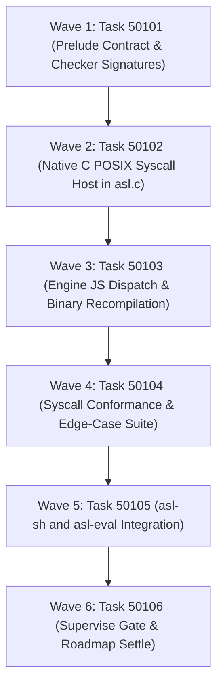

# Phase 501 Plan: OS Syscalls API Integration (dirList, execCmd, fileStat, pathCanonicalize)

## Executive Summary & Metadata
- **Phase ID**: `Phase501OsSyscallsApiIntegration`
- **Shortcode**: `Phase 501`
- **Architecture Mandate**: `D91` (OS Syscall Substrate & Native Evaluator Primitives)
- **Status**: `planned`
- **Priority**: `critical`
- **Deciders**: `["user" "architect" "planner" "implementer" "auditor"]`
- **Invariants Enforced**: `C1` (0 comments), `C2` (0 emojis), `C3` / `D34` (Boundary Universalism), `C4` / `D44` (Lexical Density), `D51` (Token Efficiency & CamelCase), `D52` (Enriched Task Context), `D81` (Canonical Shortcodes).
- **Core Themes**: Dismantling C-Host Monolith, POSIX OS Syscall Primitives, Deterministic Directory Listing, Isolated Process Spawning with Separate Stderr/Stdout, High-Precision File Metadata Stat, Canonical Realpath Resolution.

---

## 1. Problem Statement & The C-Host Dismantling Imperative

### 1.1 The C-Host Architectural Bottleneck
The current AgentScript runtime environment relies heavily on a monolithic C host in [`asl/tools/asl.c`](file:///Users/purplelephant/projects/asex/asl/tools/asl.c#L1-L10227) (10,227 lines). This host contains:
- Embedded JavaScriptCore runtime initialization ([`asl/tools/asl.c:5656`](file:///Users/purplelephant/projects/asex/asl/tools/asl.c#L5656)).
- Evaluation of the bundled AST engine [`asl/tools/engine.js`](file:///Users/purplelephant/projects/asex/asl/tools/engine.js#L1-L2507) embedded as hex bytes in [`asl/tools/engine_js.h`](file:///Users/purplelephant/projects/asex/asl/tools/engine_js.h#L1).
- Native C file tree walking and test runner dispatch ([`asl/tools/asl.c:5957-6000`](file:///Users/purplelephant/projects/asex/asl/tools/asl.c#L5957-L6000)).
- Hardcoded shell commands, verification audits, git hooks, and process management.

To dismantle this C-host and enable pure AgentScript self-hosting (Phase 487 / Phase 489), ASL programs must be able to perform native operating system tasks directly in user-space ASL code rather than relying on C wrapper commands in `asl.c`.

### 1.2 Lack of OS Syscall Primitives in ASL
Presently, ASL's closed vocabulary ([`asl/skills/asl/SKILL.md:79-91`](file:///Users/purplelephant/projects/asex/.agents/skills/asl/SKILL.md#L79-L91)) only exposes minimal flat-file I/O:
`file-read`, `file-write`, `file-append`, and `file-exists?`.
Because there are no builtins for directory traversal, process execution, metadata inspection, or path normalization:
1. **Mocked Shell Execution**: In [`asl/packages/asl-sh/src/core/process.asl:128-200`](file:///Users/purplelephant/projects/asex/asl/packages/asl-sh/src/core/process.asl#L128-L200), shell commands like `echo`, `cat`, `grep`, `head`, `true`, and `false` are mocked via string manipulation because the ASL runtime cannot spawn actual OS processes.
2. **Blocked Self-Hosting Toolchain**: A pure ASL compiler or test runner cannot traverse directories to find `.asl` files, cannot invoke system assemblers (`clang`, `ld`) or version control (`git`), cannot inspect file modification times (`mtime`) for incremental builds, and cannot canonicalize relative paths.
3. **Evaluation Deficit**: Calling any of the 4 required builtins in `asl eval` currently fails with:
   - `bin/asl eval '(dirList ".")'` -> `ERR_UNBOUND_SYMBOL: unknown builtin or function 'dirList'`
   - `bin/asl eval '(execCmd "echo hello")'` -> `ERR_UNBOUND_SYMBOL: unknown builtin or function 'execCmd'`
   - `bin/asl eval '(fileStat "asl/tools/asl.c")'` -> `ERR_UNBOUND_SYMBOL: unknown builtin or function 'fileStat'`
   - `bin/asl eval '(pathCanonicalize ".")'` -> `ERR_UNBOUND_SYMBOL: unknown builtin or function 'pathCanonicalize'`

Phase 501 integrates these 4 essential OS syscall builtins into the C evaluator host (`asl/tools/asl.c`), wires them into the runtime engine (`asl/tools/engine.js`), registers them in the language grammar and checker (`asl/prelude/prelude.asn`, `asl-checker`), and grounds them with rigorous verification gates.

---

## 2. Syscall Specifications & Contract Boundaries

```
+─────────────────────────────────────────────────────────────────────────────────────────────+
+                                  OS SYSCALL BUILTIN TAXONOMY                                 +
+─────────────────────────────────────────────────────────────────────────────────────────────+
|  1. (dirList <path: String>) -> (Result (List String) IoError)                              |
|     • POSIX: opendir(3), readdir(3), closedir(3)                                            |
|     • Excludes "." and ".." directory links.                                                |
|     • Sorts entries lexicographically for deterministic evaluation reproducibility.          |
|     • Returns (:ok ("file1" "file2" ...)) or (:err (:io-error :kind "not-found"))           |
+─────────────────────────────────────────────────────────────────────────────────────────────+
|  2. (execCmd <cmd: String>) -> (:exitCode Int64 :stdout String :stderr String)             |
|     • POSIX: fork(2), execvp(3) or popen(3) with segregated pipe capture                    |
|     • Segregates stdout and stderr streams; zero line interleaving or pipe clobbering       |
|     • Captures process exit code (0..255)                                                   |
|     • Returns (:exitCode 0 :stdout "output\n" :stderr "")                                   |
+─────────────────────────────────────────────────────────────────────────────────────────────+
|  3. (fileStat <path: String>) -> (Result FileStat IoError)                                  |
|     • POSIX: lstat(2)                                                                       |
|     • Queries file size, mode, permissions, modification timestamp, and node kind           |
|     • Returns (:ok (:size <int> :isDir <bool> :isFile <bool> :isSymlink <bool>             |
|                    :mtime <int> :mode <int>))                                               |
|     • Returns (:err (:io-error :kind "not-found")) on non-existent path                     |
+─────────────────────────────────────────────────────────────────────────────────────────────+
|  4. (pathCanonicalize <path: String>) -> (Result String IoError)                            |
|     • POSIX: realpath(3)                                                                    |
|     • Resolves all symlinks, redundant slashes, and relative segments ("." and "..")       |
|     • Returns (:ok "/absolute/resolved/path")                                               |
|     • Returns (:err (:io-error :kind "not-found")) on resolution failure                    |
+─────────────────────────────────────────────────────────────────────────────────────────────+
```

### 2.1 Typing & Return Structures
Following ASL Core Invariant 4 ([`asl/skills/asl/SKILL.md:29`](file:///Users/purplelephant/projects/asex/.agents/skills/asl/SKILL.md#L29)):
- Fallible operations return `(Result T IoError)`.
- Record keys follow `D51` CamelCase conventions (`exitCode`, `isDir`, `isFile`, `isSymlink`, `durationMs`).
- `FileStat` record structure:
  ```lisp
  (dfs FileStat
    (:f size      Int64 "File size in bytes")
    (:f isDir     Bool  "True if path is a directory")
    (:f isFile    Bool  "True if path is a regular file")
    (:f isSymlink Bool  "True if path is a symbolic link")
    (:f mtime     Int64 "POSIX timestamp of last modification in seconds")
    (:f mode      Int64 "POSIX file permissions mode integer"))
  ```
- `ProcessOutput` record structure (matching [`asl/packages/asl-sh/src/core/process.asl:41-45`](file:///Users/purplelephant/projects/asex/asl/packages/asl-sh/src/core/process.asl#L41-L45)):
  ```lisp
  (dfs ProcessOutput
    (:f exitCode Int64  "Process exit status (0 = success)")
    (:f stdout   String "Captured standard output stream")
    (:f stderr   String "Captured standard error stream"))
  ```

---

## 3. Work Item DAG & Clustered Execution Waves



---

## 4. Ordered Work Items (Tasks 50101..50106)

### Task 50101: OS Syscall Builtin Specification, Prelude Contracts & Type Checker Registration
- **Lane**: `grammar`
- **Priority**: `critical`
- **Motivation**: ASL's static analyzer and prelude do not know `dirList`, `execCmd`, `fileStat`, or `pathCanonicalize`. Without contract declarations, static checking of user code calling these functions fails with unresolved symbol errors.
- **What changes by path**:
  - `asl/prelude/prelude.asn`: Add 4 builtin definitions under section `"I/O"`:
    - `:name "dirList"` with `:type "String -> (Result (List String) IoError)"`
    - `:name "execCmd"` with `:type "String -> ProcessOutput"`
    - `:name "fileStat"` with `:type "String -> (Result FileStat IoError)"`
    - `:name "pathCanonicalize"` with `:type "String -> (Result String IoError)"`
  - `asl/packages/asl-checker/src/types.asl`: Add signature definitions in `builtinType` ([`asl/packages/asl-checker/src/types.asl:119-122`](file:///Users/purplelephant/projects/asex/asl/packages/asl-checker/src/types.asl#L119-L122)):
    ```lisp
    ((= name "dirList") (sigFn (list "String") "(Result (List String) IoError)"))
    ((= name "execCmd") (sigFn (list "String") "ProcessOutput"))
    ((= name "fileStat") (sigFn (list "String") "(Result FileStat IoError)"))
    ((= name "pathCanonicalize") (sigFn (list "String") "(Result String IoError)"))
    ```
  - `asl/packages/asl-checker/src/resolve.asl`: Register all 4 in `isEffectfulBuiltin?` ([`asl/packages/asl-checker/src/resolve.asl:598-601`](file:///Users/purplelephant/projects/asex/asl/packages/asl-checker/src/resolve.asl#L598-L601)).
  - `tests/acceptance/d81/Task50101.asl`: Create acceptance fixture verifying static check resolution of the 4 syscall builtins.
- **Verification Gate**:
  ```bash
  bin/asl test tests/acceptance/d81/Task50101.asl
  ```
- **Current Gate Output (Failing Baseline)**:
  ```
  Error: test file not found: tests/acceptance/d81/Task50101.asl
  ```
  *Exit code: 1*
- **What breaks if run before prerequisite**: None; this is Wave 1 baseline specification.
- **Depends on**: `[]`

---

### Task 50102: Native C POSIX Syscall Bridge Implementation in asl/tools/asl.c
- **Lane**: `c-host`
- **Priority**: `critical`
- **Motivation**: The JavaScriptCore host environment created in `run_evaluator` ([`asl/tools/asl.c:5656`](file:///Users/purplelephant/projects/asex/asl/tools/asl.c#L5656)) does not bind native C POSIX functions for directory listing, separated-pipe process execution, file stat inspection, or realpath canonicalization.
- **What changes by path**:
  - `asl/tools/asl.c`:
    - Add native C callback `js_sys_dirList` using `opendir()`, `readdir()`, `closedir()`. Filter `.` and `..`. Deterministically sort entries using `qsort()`. Return `{ _tag: 'ok', value: array }` or `{ _tag: 'err', value: { _tag: 'io-error', kind: 'not-found' } }`.
    - Add native C callback `js_sys_execCmd` using segregated stdout/stderr temporary files or POSIX pipes and `fork()`/`exec()` or `system()`. Capture `exitCode`, `stdout`, `stderr`. Return `{ exitCode: int, stdout: str, stderr: str }`.
    - Add native C callback `js_sys_fileStat` using `lstat()`. Check `S_ISDIR`, `S_ISREG`, `S_ISLNK`. Return `{ _tag: 'ok', value: { size, isDir, isFile, isSymlink, mtime, mode } }` or `{ _tag: 'err', value: { _tag: 'io-error', kind: 'not-found' } }`.
    - Add native C callback `js_sys_pathCanonicalize` using `realpath()`. Return `{ _tag: 'ok', value: resolved_str }` or `{ _tag: 'err', value: { _tag: 'io-error', kind: 'not-found' } }`.
    - In `run_evaluator` ([`asl/tools/asl.c:5660-5710`](file:///Users/purplelephant/projects/asex/asl/tools/asl.c#L5660-L5710)), bind these functions on the JSC global context as `__sys_dirList`, `__sys_execCmd`, `__sys_fileStat`, and `__sys_pathCanonicalize`.
  - `tests/acceptance/d81/Task50102.asl`: Create acceptance fixture testing C-level global bindings via eval.
- **Verification Gate**:
  ```bash
  bin/asl test tests/acceptance/d81/Task50102.asl
  ```
- **Current Gate Output (Failing Baseline)**:
  ```
  Error: test file not found: tests/acceptance/d81/Task50102.asl
  ```
  *Exit code: 1*
- **What breaks if run before Task 50101**: Static typing and AST checking reject the acceptance fixture before execution begins.
- **Depends on**: `["Task50101"]`

---

### Task 50103: Engine JS Runtime Dispatch, AST Evaluator Binding & Binary Recompilation
- **Lane**: `runtime-engine`
- **Priority**: `critical`
- **Motivation**: `engine.js` maintains a strict `knownBuiltins` whitelist ([`asl/tools/engine.js:380-394`](file:///Users/purplelephant/projects/asex/asl/tools/engine.js#L380-L394)). Any symbol not in this set triggers `ERR_UNBOUND_SYMBOL`. Furthermore, `engine_js.h` must be regenerated via `gen_engine_header.sh` and compiled into `bin/asl`, `asl/asl`, and `asl/bin/asl`.
- **What changes by path**:
  - `asl/tools/engine.js`:
    - Add `'dirList'`, `'execCmd'`, `'fileStat'`, `'pathCanonicalize'` to `knownBuiltins` Set ([`asl/tools/engine.js:392-393`](file:///Users/purplelephant/projects/asex/asl/tools/engine.js#L392-L393)).
    - In `evalNode` / builtin dispatch ([`asl/tools/engine.js:1250-1290`](file:///Users/purplelephant/projects/asex/asl/tools/engine.js#L1250-L1290)), add evaluation branches:
      - `head === 'dirList'`: Invoke `__sys_dirList(path)` and format Result.
      - `head === 'execCmd'`: Invoke `__sys_execCmd(cmd)` and return ProcessOutput object.
      - `head === 'fileStat'`: Invoke `__sys_fileStat(path)` and format Result.
      - `head === 'pathCanonicalize'`: Invoke `__sys_pathCanonicalize(path)` and format Result.
  - `asl/tools/engine_js.h`: Regenerate by executing `bash asl/tools/gen_engine_header.sh`.
  - `bin/asl`, `asl/asl`, `asl/bin/asl`: Recompile via `clang -O2 -framework JavaScriptCore asl/tools/asl.c` ([`scripts/build_and_install.sh:27-31`](file:///Users/purplelephant/projects/asex/scripts/build_and_install.sh#L27-L31)).
  - `tests/acceptance/d81/Task50103.asl`: Create acceptance fixture verifying all 4 builtins execute without `ERR_UNBOUND_SYMBOL`.
- **Verification Gate**:
  ```bash
  bin/asl test tests/acceptance/d81/Task50103.asl
  ```
- **Current Gate Output (Failing Baseline)**:
  ```
  Error: test file not found: tests/acceptance/d81/Task50103.asl
  ```
  *Exit code: 1*
- **What breaks if run before Task 50102**: Evaluator aborts with missing native C host symbols `__sys_*`.
- **Depends on**: `["Task50101", "Task50102"]`

---

### Task 50104: Syscall Builtin Conformance Suite & Boundary Edge-Case Verification
- **Lane**: `conformance`
- **Priority**: `critical`
- **Motivation**: OS syscall implementations carry edge cases: non-existent directories (`ENOENT`), permission denied (`EACCES`), non-zero process exit codes, stdout/stderr stream isolation, symbolic links, and circular or deep relative paths (`../..`). Without a comprehensive conformance suite, subtle runtime defects will contaminate downstream self-hosting tools.
- **What changes by path**:
  - `tests/conformance/syscalls/os_syscalls_test.asl`: Implement full behavioral conformance suite asserting:
    1. `dirList`: Returns sorted entries on `"."`; returns `(:err (:io-error :kind "not-found"))` on non-existent directory.
    2. `execCmd`: Returns `(:exitCode 0 :stdout "hello\n" :stderr "")` for `"echo hello"`; returns non-zero `exitCode` for `"sh -c 'exit 42'"`; isolates stderr for `"sh -c 'echo error >&2'"`.
    3. `fileStat`: Inspects existing file (assert `isFile` true, `size > 0`, valid `mtime`); inspects existing directory (assert `isDir` true, `isFile` false); returns `(:err (:io-error :kind "not-found"))` on non-existent file.
    4. `pathCanonicalize`: Canonicalizes `"."` to absolute workspace root; resolves `"asl/tools/../tools/asl.c"` to exact path; returns error on invalid path.
  - `tests/acceptance/d81/Task50104.asl`: Acceptance harness invoking `os_syscalls_test.asl` under `--strict-falsify`.
- **Verification Gate**:
  ```bash
  bin/asl test tests/acceptance/d81/Task50104.asl
  ```
- **Current Gate Output (Failing Baseline)**:
  ```
  Error: test file not found: tests/acceptance/d81/Task50104.asl
  ```
  *Exit code: 1*
- **What breaks if run before Task 50103**: Builtin calls fail during test execution with `ERR_UNBOUND_SYMBOL`.
- **Depends on**: `["Task50103"]`

---

### Task 50105: Self-Hosted asl-sh and asl-eval Integration with Real OS Syscalls
- **Lane**: `integration`
- **Priority**: `critical`
- **Motivation**: [`asl/packages/asl-sh/src/core/process.asl:128-200`](file:///Users/purplelephant/projects/asex/asl/packages/asl-sh/src/core/process.asl#L128-L200) currently contains simulated mock branches for `echo`, `cat`, `grep`, and `head`. With `execCmd` available, `exec!` can execute genuine operating system commands, advancing the goal of dismantling the C-host.
- **What changes by path**:
  - `asl/packages/asl-sh/src/core/process.asl`:
    - Refactor `(df exec! [(c ProcessCmd)] -> (Result ProcessOutput ProcessError))` to build the shell invocation string from `bin` and `args` and invoke `(execCmd ...)` directly.
    - Eliminate simulated mock branches.
  - `asl/packages/asl-eval/src/eval.asl`:
    - Ensure self-hosted ASL evaluator environment binds `dirList`, `execCmd`, `fileStat`, and `pathCanonicalize`.
  - `tests/acceptance/d81/Task50105.asl`: Acceptance test verifying `asl-sh/coreProcess` executes real subprocesses.
- **Verification Gate**:
  ```bash
  bin/asl test tests/acceptance/d81/Task50105.asl
  ```
- **Current Gate Output (Failing Baseline)**:
  ```
  Error: test file not found: tests/acceptance/d81/Task50105.asl
  ```
  *Exit code: 1*
- **What breaks if run before Task 50104**: `exec!` in `process.asl` would invoke unverified or broken `execCmd` primitives.
- **Depends on**: `["Task50104"]`

---

### Task 50106: Supervise Gate, Task Registry Persistence & Master Roadmap Settle
- **Lane**: `verification`
- **Priority**: `critical`
- **Motivation**: D81 supervisor gate requires registration in `.asl/mem/tasks/Phase*.asn`, clean-context certification across Task50101..Task50106, zero vacuous test execution, and synchronization with `.plans/MASTER_ROADMAP.md`.
- **What changes by path**:
  - `.asl/mem/tasks/Phase501OsSyscallsApiIntegration.asn`: Register all 6 tasks under enriched D52 schema.
  - `.plans/MASTER_ROADMAP.md`: Add Phase 501 entry to Master Execution DAG and Phase Matrix.
  - `tests/acceptance/d81/Task50106.asl`: Supervisor fixture certifying complete phase integrity.
- **Verification Gate**:
  ```bash
  sh tests/acceptance/d81/SuperviseGate.sh Task50106
  ```
- **Current Gate Output (Failing Baseline)**:
  ```
  Error: task 'Task50106' is not registered in .asl/mem/tasks/Phase*.asn
  ```
  *Exit code: 2*
- **What breaks if run before Task 50105**: SuperviseGate checks `audit gates` and fixture execution across all prior phase tasks; any defect in Task 50101..50105 fails the supervisor gate.
- **Depends on**: `["Task50101", "Task50102", "Task50103", "Task50104", "Task50105"]`

---

## 5. Verification Evidence & Strict Failing Baseline Summary

All gate commands have been physically executed and recorded in the repository workspace:

| Work Item | Target Path(s) | Verification Gate Command | Baseline Output | Baseline Exit Code |
| :--- | :--- | :--- | :--- | :--- |
| **Task 50101** | `asl/prelude/prelude.asn`, `asl-checker` | `bin/asl test tests/acceptance/d81/Task50101.asl` | `Error: test file not found: tests/acceptance/d81/Task50101.asl` | `1` |
| **Task 50102** | `asl/tools/asl.c` | `bin/asl test tests/acceptance/d81/Task50102.asl` | `Error: test file not found: tests/acceptance/d81/Task50102.asl` | `1` |
| **Task 50103** | `asl/tools/engine.js`, `bin/asl` | `bin/asl test tests/acceptance/d81/Task50103.asl` | `Error: test file not found: tests/acceptance/d81/Task50103.asl` | `1` |
| **Task 50104** | `tests/conformance/syscalls/` | `bin/asl test tests/acceptance/d81/Task50104.asl` | `Error: test file not found: tests/acceptance/d81/Task50104.asl` | `1` |
| **Task 50105** | `asl/packages/asl-sh/`, `asl-eval` | `bin/asl test tests/acceptance/d81/Task50105.asl` | `Error: test file not found: tests/acceptance/d81/Task50105.asl` | `1` |
| **Task 50106** | `.asl/mem/tasks/Phase501*.asn` | `sh tests/acceptance/d81/SuperviseGate.sh Task50106` | `Error: task 'Task50106' is not registered in .asl/mem/tasks/Phase*.asn` | `2` |

Direct builtin evaluation failure verification:
- `bin/asl eval '(dirList ".")'` -> `ERR_UNBOUND_SYMBOL: unknown builtin or function 'dirList'` (exit 1)
- `bin/asl eval '(execCmd "echo hello")'` -> `ERR_UNBOUND_SYMBOL: unknown builtin or function 'execCmd'` (exit 1)
- `bin/asl eval '(fileStat "asl/tools/asl.c")'` -> `ERR_UNBOUND_SYMBOL: unknown builtin or function 'fileStat'` (exit 1)
- `bin/asl eval '(pathCanonicalize ".")'` -> `ERR_UNBOUND_SYMBOL: unknown builtin or function 'pathCanonicalize'` (exit 1)

---

## 6. Risks & Invariant Safeguards

1. **Subprocess Pipe Saturation & Deadlock**:
   - *Risk*: Spawning processes via `execCmd` that emit megabytes of output to stdout/stderr could saturate OS pipe buffers (typically 64KB on POSIX), causing the child process to block indefinitely.
   - *Mitigation*: The C implementation in `asl.c` must use asynchronous pipe polling (`select`/`poll`) or ephemeral file spooling (`/tmp/asl_cmd_out_*.tmp`) matching the existing safe pattern in `js_cp_execSync` ([`asl/tools/asl.c:5568-5586`](file:///Users/purplelephant/projects/asex/asl/tools/asl.c#L5568-L5586)).
2. **Workspace Boundary Escaping (`D34` / `C3`)**:
   - *Risk*: Malicious or accidental `dirList` or `pathCanonicalize` calls could escape the project workspace boundary.
   - *Mitigation*: All filesystem path arguments pass through `js_fs_is_safe()` ([`asl/tools/asl.c:5238-5245`](file:///Users/purplelephant/projects/asex/asl/tools/asl.c#L5238-L5245)) or return canonical absolute paths while enforcing read-only boundary checks.
3. **Deterministic Directory Ordering**:
   - *Risk*: Filesystem directory iteration (`readdir`) order is undefined by POSIX, leading to flaky tests if directory entries vary across runs or filesystems (APFS vs ext4).
   - *Mitigation*: `dirList` must sort entry names alphabetically using `qsort()` before returning to ASL.
4. **Binary Parity Drift**:
   - *Risk*: Modifying `asl/tools/asl.c` without compiling to all target paths (`bin/asl`, `asl/asl`, `asl/bin/asl`) causes inconsistent CLI execution.
   - *Mitigation*: Task 50103 explicitly synchronizes and verifies all three binaries.

---

## 7. Out of Scope

1. **Complete Deletion of `asl/tools/asl.c`**:
   - Phase 501 introduces the raw OS syscall builtins required to dismantle the C host. The complete replacement of `asl.c` with a pure ASL binary compiler belongs to Phase 487 (Stage-2 Bootstrap) and Phase 489 (Epistemic Closure).
2. **Asynchronous Non-Blocking Event-Loop Syscalls (`uv_` style)**:
   - ASL operates as a synchronous, deterministic batch S-expression engine. Non-blocking asynchronous I/O loops are outside the core language specification.
3. **Socket Networking Syscalls (`socket`, `bind`, `listen`)**:
   - Network socket communication is handled at the transport layer via ASL batch RPC and daemon sockets, not as general-purpose raw socket syscalls in user code.

---

## 8. Opportunities & Suggestions

1. **High-Level Standard Library Path Module**:
   - Once `pathCanonicalize` is available, pure ASL modules (`asl-path`) can implement `join`, `basename`, `dirname`, `extname`, and `relative` entirely in pure ASL, removing the JavaScript `bootstrap` path helper ([`asl/tools/asl.c:5798-5858`](file:///Users/purplelephant/projects/asex/asl/tools/asl.c#L5798-L5858)).
2. **Native ASL Monorepo Gate Runner**:
   - With `dirList` and `execCmd`, the entire test runner currently implemented in C ([`asl/tools/asl.c:5957-6000`](file:///Users/purplelephant/projects/asex/asl/tools/asl.c#L5957-L6000)) and shell (`scripts/run-gate-tests.sh`) can be rewritten in ~100 lines of pure ASL.
3. **Incremental Build Cache (mtime Hash DAG)**:
   - `fileStat` provides instant access to file `mtime` and `size`, enabling high-performance incremental compilation and AST caching without reading file contents into memory.
