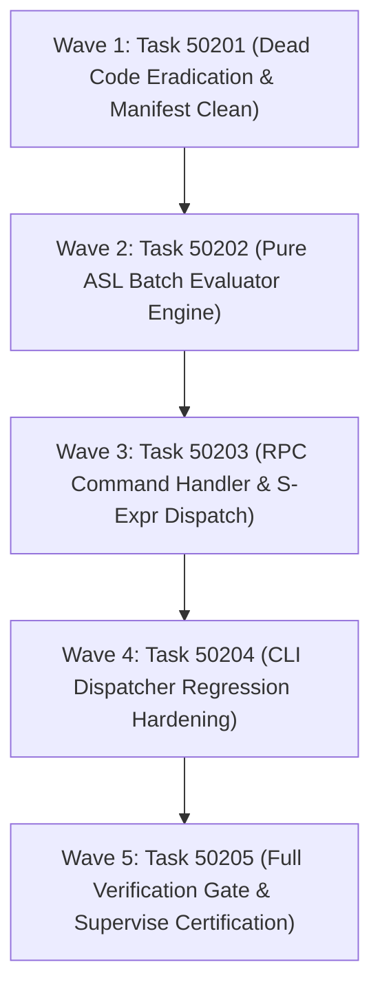

# Phase 502 Plan: Pure ASL CLI & RPC Dispatcher

## Executive Summary & Metadata
- **Phase ID**: `Phase502PureAslCliAndRpcDispatcher`
- **Shortcode**: `Phase 502`
- **Architecture Mandate**: `D81` (Language Ground Truth and Sovereign Portability Program)
- **Status**: `planned`
- **Priority**: `critical`
- **Deciders**: `["user" "architect" "planner" "implementer" "auditor"]`
- **Invariants Enforced**: `C1` (0 comments), `C2` (0 emojis), `C3` / `D34` (Boundary Universalism), `C4` / `D44` (Lexical Density), `D51` (Token Efficiency & CamelCase), `D52` (Enriched Task Context), `D81` (Canonical Shortcodes).
- **Core Themes**: Pure ASL CLI Sovereignty, AST-Native Batch Evaluation, Wire Protocol Conformance, Dead Code Elimination, and Non-Vacuous Verification.

---

## 1. Problem Statement & Baseline Evidence

The pure AgentScript native CLI (`asl/packages/asl-cli`) is currently a hollow facade:

1. **Missing RPC Command in Pure ASL Dispatcher**:
   In [cli.asl](file:///Users/purplelephant/projects/asex/asl/packages/asl-cli/src/cli.asl#L127-L261), `dispatchCmd` handles `version`, `help`, `gate`, `check`, `build`, `eval`, `run`, `test`, `parse`, `lint`, `tool`, and `launch`. The primary interface advertised in `formatHelp` ([cli.asl:13-19](file:///Users/purplelephant/projects/asex/asl/packages/asl-cli/src/cli.asl#L13-L19)) — `asl rpc '(:batch ...)'` and shorthand `asl '(:batch ...)'` — is completely missing. Invoking `(dispatchCmd "rpc" ...)` or `(dispatchCmd "(:batch ...)" ...)` falls through to line 260: `(err (str "Unknown command '" cmd "'. Run 'asl help' for usage."))`.

2. **Absence of Pure ASL Batch Evaluator**:
   While the C runtime host ([asl/tools/asl.c:4839](file:///Users/purplelephant/projects/asex/asl/tools/asl.c#L4839)) implements `handle_payload` and `execute_single_step`, the self-hosted pure ASL toolchain lacks an AST-native batch evaluator to execute compound batch S-expressions (`:echo`, `:eval`, `:read`, `:write`, `:chk`, `:where`) with standard envelope rendering (`:batch-res`).

3. **Orphaned Dead Code in `asnCmd.asl`**:
   The file [asl/packages/asl-cli/src/asn_cmd.asl](file:///Users/purplelephant/projects/asex/asl/packages/asl-cli/src/asn_cmd.asl#L1-L156) contains 156 lines implementing an unused `asl asn` subcommand (`dispatchAsn`, `runCheck`, `runToJson`, `runFromJson`, `asnToJsonValue`). It is not imported by `cli.asl` or `main.asl`, nor exposed by `formatHelp`. Furthermore, [asl/packages/asl-cli/grammar.asn](file:///Users/purplelephant/projects/asex/asl/packages/asl-cli/grammar.asn#L8-L28) tracks these phantom symbols, and [manifest.asn](file:///Users/purplelephant/projects/asex/asl/packages/asl-cli/manifest.asn#L11) imports `asl-codec` solely for this dead module.

4. **Vacuous RPC Testing**:
   Existing tests ([tests/cli_test.asl:37](file:///Users/purplelephant/projects/asex/asl/packages/asl-cli/tests/cli_test.asl#L37) and [tests/cli-test.asl](file:///Users/purplelephant/projects/asex/asl/packages/asl-cli/tests/cli-test.asl#L47-L90)) only assert that the help string contains the literal substring `"rpc '(:batch ...)'"`. Neither suite ever invokes `c/dispatchCmd "rpc"` or verifies batch evaluation semantics.

---

## 2. Work Item DAG & Execution Waves



---

## 3. Ordered Work Items

### Wave 1: Dead Code Removal & Manifest Hygiene

#### Task 50201: `Dead Code Removal & Package Hygiene (asnCmd Eradication)`
- **Lane**: `cleanup`
- **Owns**:
  - `asl/packages/asl-cli/src/asn_cmd.asl` (file deletion)
  - `asl/packages/asl-cli/manifest.asn`
  - `asl/packages/asl-cli/grammar.asn`
  - `tests/acceptance/d81/Task50201.asl`
- **Why**:
  Fulfills Phase 502 Criterion 3 ("Remove dead code like `asnCmd.asl`"). Deletes 156 lines of dead code in [asn_cmd.asl](file:///Users/purplelephant/projects/asex/asl/packages/asl-cli/src/asn_cmd.asl#L1-L156), removes unused `asl-codec` dependency from [manifest.asn:11](file:///Users/purplelephant/projects/asex/asl/packages/asl-cli/manifest.asn#L11), and purges unreferenced symbols (`dispatch-asn`, `run-check`, `asn-to-json-value`, `format-asn-help`, `run-from-json`, `run-to-json`) from [grammar.asn:8-28](file:///Users/purplelephant/projects/asex/asl/packages/asl-cli/grammar.asn#L8-L28).
- **Depends On**: `[]`
- **What Breaks If Run Out Of Order**:
  Leaves phantom symbols and unused dependencies in `asl-cli`, causing token counter misalignment in `grammar.asn` when new symbols are introduced.
- **Gate**:
  `bin/asl test tests/acceptance/d81/Task50201.asl`
- **Current Verbatim Output (Failing Baseline)**:
```
Error: test file not found: tests/acceptance/d81/Task50201.asl
```
*(Exit code: 1)*

---

### Wave 2: Pure ASL Batch Evaluator Engine

#### Task 50202: `Pure ASL Batch Evaluator Engine Implementation`
- **Lane**: `evaluator`
- **Owns**:
  - `asl/packages/asl-cli/src/batch.asl`
  - `asl/packages/asl-cli/tests/batch_test.asl`
  - `tests/acceptance/d81/Task50202.asl`
- **Why**:
  Fulfills Phase 502 Criterion 2 ("Connect it to the batch evaluator"). Implements pure ASL batch evaluator module `asl-cli/batch` with `evalBatch [(payload Str)] -> (Result Str Str)`. Supports parsing `(:batch ...)`, step dispatching for core operations (`:echo`, `:eval`, `:read`, `:write`, `:chk`, `:where`), fail-fast sequential mode (`:seq true`), ADR-0081 rejection contract (`:status "rejected" :error-code ":ERR_UNIMPLEMENTED"` for unknown operations per [asl/grammar/rpc.asn:3-4](file:///Users/purplelephant/projects/asex/asl/grammar/rpc.asn#L3-L4)), and canonical `:batch-res` envelope formatting per [tests/conformance/rpc/rpc_dispatcher_test.asl:46](file:///Users/purplelephant/projects/asex/tests/conformance/rpc/rpc_dispatcher_test.asl#L46).
- **Depends On**: `["Task50201"]`
- **What Breaks If Run Out Of Order**:
  If executed before `Task50201`, builds on a cluttered module structure with stale grammar declarations.
- **Gate**:
  `bin/asl test tests/acceptance/d81/Task50202.asl`
- **Current Verbatim Output (Failing Baseline)**:
```
Error: test file not found: tests/acceptance/d81/Task50202.asl
```
*(Exit code: 1)*

---

### Wave 3: Pure ASL CLI RPC Dispatcher Wiring

#### Task 50203: `RPC Command Handler & Direct S-Expression Dispatch in cli.asl`
- **Lane**: `cli`
- **Owns**:
  - `asl/packages/asl-cli/src/cli.asl`
  - `asl/packages/asl-cli/grammar.asn`
  - `tests/acceptance/d81/Task50203.asl`
- **Why**:
  Fulfills Phase 502 Criterion 1 ("Implement the `rpc` command handler in `cli.asl`"). Connects `dispatchCmd` in [cli.asl:127-260](file:///Users/purplelephant/projects/asex/asl/packages/asl-cli/src/cli.asl#L127-L260) to `evalBatch` for both `rpc` subcommand (`asl rpc '(:batch ...)'`) and direct S-expression invocation (`asl '(:batch ...)'`). Enforces argument validation (`Usage: asl rpc '(:batch ...)'` when args are empty) and registers new symbols `eval-batch` and `dispatch-rpc` in [grammar.asn](file:///Users/purplelephant/projects/asex/asl/packages/asl-cli/grammar.asn).
- **Depends On**: `["Task50202"]`
- **What Breaks If Run Out Of Order**:
  If run before `Task50202`, `cli.asl` cannot import or delegate to `asl-cli/batch`, causing unresolved symbol compilation errors.
- **Gate**:
  `bin/asl test tests/acceptance/d81/Task50203.asl`
- **Current Verbatim Output (Failing Baseline)**:
```
Error: test file not found: tests/acceptance/d81/Task50203.asl
```
*(Exit code: 1)*

---

### Wave 4: Conformance & Regression Test Hardening

#### Task 50204: `CLI Conformance Test Suite & Subcommand Regression Hardening`
- **Lane**: `test`
- **Owns**:
  - `asl/packages/asl-cli/tests/cli_test.asl`
  - `asl/packages/asl-cli/tests/cli-test.asl`
  - `tests/acceptance/d81/Task50204.asl`
- **Why**:
  Expands [cli_test.asl](file:///Users/purplelephant/projects/asex/asl/packages/asl-cli/tests/cli_test.asl) and [cli-test.asl](file:///Users/purplelephant/projects/asex/asl/packages/asl-cli/tests/cli-test.asl) to eliminate vacuous tests and ensure non-zero assertion coverage across:
  1. `rpc` subcommand dispatch with valid and empty arguments.
  2. Direct S-expression shorthand `(:batch ...)`.
  3. Multi-step batch execution and status aggregation.
  4. Regression verification of existing CLI commands (`version`, `help`, `gate`, `check`, `eval`, `test`).
- **Depends On**: `["Task50203"]`
- **What Breaks If Run Out Of Order**:
  Test suite will fail on missing `rpc` dispatching branches if run before `Task50203`.
- **Gate**:
  `bin/asl test tests/acceptance/d81/Task50204.asl`
- **Current Verbatim Output (Failing Baseline)**:
```
Error: test file not found: tests/acceptance/d81/Task50204.asl
```
*(Exit code: 1)*

---

### Wave 5: Monorepo Supervisor Certification

#### Task 50205: `Full Monorepo Supervisor Verification Gate & Task Registry`
- **Lane**: `governance`
- **Owns**:
  - `.asl/mem/tasks/Phase502PureAslCliAndRpcDispatcher.asn`
  - `tests/acceptance/d81/Task50205.asl`
- **Why**:
  Registers Phase 502 in `.asl/mem/tasks/` under D81 contract, satisfying [SuperviseGate.sh:25-39](file:///Users/purplelephant/projects/asex/tests/acceptance/d81/SuperviseGate.sh#L25-L39) task discovery and certifying clean execution across `bin/asl gate`, `bin/asl audit gates`, and `bin/asl audit consistency`.
- **Depends On**: `["Task50204"]`
- **What Breaks If Run Out Of Order**:
  Fails supervisor gate if any preceding task fixtures, receipts, or package verifications are red.
- **Gate**:
  `sh tests/acceptance/d81/SuperviseGate.sh Task50205`
- **Current Verbatim Output (Failing Baseline)**:
```
Error: task 'Task50205' is not registered in .asl/mem/tasks/Phase*.asn
```
*(Exit code: 2)*

---

## 4. Risks & Epistemic Uncertainties

1. **S-Expression Quoting and Shell Escaping in Stdio**:
   CLI arguments passed from shell to `asl rpc '(:batch ...)'` may strip outer single quotes, requiring robust parsing of whitespace-separated tokens via `(string-join args " ")`.
   - *Mitigation*: Unit tests in `batch_test.asl` and `cli_test.asl` test both pre-joined and fragmented argument lists.
2. **Grammar Token Counting Variance**:
   Removing `asn_cmd.asl` symbols and adding batch evaluator symbols alters `symbols` list in [grammar.asn](file:///Users/purplelephant/projects/asex/asl/packages/asl-cli/grammar.asn). If token counts do not match `tokensBaseline`, `asl audit gates` will flag a lexicon drift.
   - *Mitigation*: Accurately recount tokens for all new symbols (`eval-batch`, `dispatch-rpc`) and verify against `bin/asl audit gates`.
3. **Pure ASL vs Native C Evaluator Scope**:
   The native C binary ([asl/tools/asl.c](file:///Users/purplelephant/projects/asex/asl/tools/asl.c)) handles 40+ RPC operations including low-level process spawning and socket IO. The pure ASL batch evaluator in `asl-cli` must reject unimplemented operations cleanly with `:status "rejected" :error-code ":ERR_UNIMPLEMENTED"` rather than crashing.
   - *Mitigation*: Explicit test in `Task50202` verifying `:ERR_UNIMPLEMENTED` rejection conformance per ADR-0081.

---

## 5. Out of Scope

1. **Host C Binary Refactoring (`asl/tools/asl.c`)**:
   Phase 502 is strictly scoped to the self-hosted pure AgentScript CLI package (`asl/packages/asl-cli`). Rewriting the native C host binary is out of scope.
2. **Complete 40-Operation Implementation in Pure ASL**:
   Implementing full in-memory git topology, process daemon management, or deep AST refactoring engine in `asl-cli` belongs to downstream specialized packages (`asl-sh`, `asl-mesh`). Phase 502 implements the core batch dispatcher, common operations (`:echo`, `:eval`, `:read`, `:write`, `:chk`, `:where`), and wire conformance rejection.
3. **Cross-Platform Mach-O / ELF Standalone Binary Linking**:
   Compilation to native ARM64/ELF Mach-O binaries is owned by Phase 487 (Pure ASL Stage-2 Bootstrap).

---

## 6. Opportunities & Suggestions

1. **Shared Batch DAG Reducer**:
   Future phases can unify `asl/packages/asl-sh/src/batch_dag.asl` with `asl/packages/asl-cli/src/batch.asl` into a core monorepo batch substrate package, eliminating any duplication between shell and CLI dispatchers.
2. **Zero-Socket RPC Pipe via Stdin**:
   Enhancing `cli.asl` to automatically read streaming payloads from stdin when `! (isatty STDIN_FILENO)` allows piping compound JSON/ASN streams directly: `cat payload.asn | asl rpc`.
