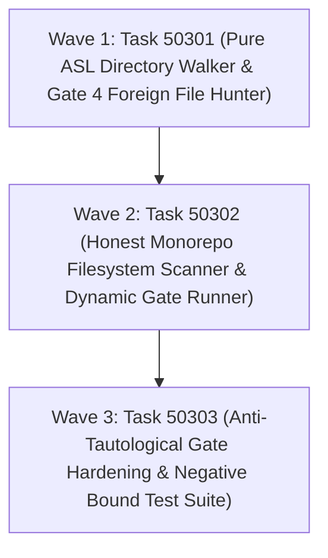

# Phase 503 Plan: Honest Verification Gates

## Executive Summary & Metadata
- **Phase ID**: `Phase503HonestVerificationGates`
- **Shortcode**: `Phase 503`
- **Architecture Mandate**: `D81` (Verification Gates), `D89` (Falsification Analysis and Prevention), Rule `gates`, Rule `grading`, Rule `foreign`.
- **Status**: `planned`
- **Priority**: `critical`
- **Deciders**: `["user" "architect" "planner" "implementer" "auditor"]`
- **Invariants Enforced**: `C1` (0 comments), `C2` (0 emojis), `C3` / `D34` (Boundary Universalism), `C4` / `D44` (Lexical Density), `C5` (0 sigils), `D51` (Token Efficiency & CamelCase), `D52` (Enriched Task Context), `D81` (Verification Gates), `D89` (Falsification Analysis & Prevention).
- **Core Themes**: Epistemic Truth in Gates, Filesystem-Backed Verification, Dynamic Package Manifest Traversal, Honest Gate 4 Zero-Foreign Directory Walking, Anti-Tautological Hardening, Negative Bound Refutations, and Elimination of Magic Numbers.

---

## 1. Problem Statement & Epistemic Falsification Audit

A rigorous structural inspection of `asl/packages/asl-gates` reveals that the verification gate framework is currently falsified across three distinct mechanisms:

### 1.1 Falsification Mode 1: Caller-Supplied Magic Numbers & Vacuous Comparisons (`gate_runner.asl:36-74`)
In [gate_runner.asl:36-74](file:///Users/purplelephant/projects/asex/asl/packages/asl-gates/src/gate_runner.asl#L36-L74), `runAllSevenGates` does not inspect the filesystem, parse ASTs, or verify claims. Instead, it accepts 7 arbitrary integers from the caller and evaluates trivial comparisons:
```clojure
(v1 (makeVerdict 1 "Package Manifests & Structure" (> totalManifests 0) ...))
(v2 (makeVerdict 2 "Pure ASL Syntax & Form Balance" (> totalAslFiles 0) ...))
(v3 (makeVerdict 3 "Site Claims Grounding Audit" (>= groundedClaims 12) ...))
(v4 (makeVerdict 4 "Zero-Foreign File Policy" (= foreignFiles 0) ...))
(v5 (makeVerdict 5 "Pure ASL Gate Test Suite" (> totalTests 0) ...))
(v6 (makeVerdict 6 "ASN Grammar & Token Density Audit" (> totalGrammarSyms 1000) ...))
(v7 (makeVerdict 7 "Modular Skills Consistency & Freshness" (>= totalSkills 10) ...))
```
Calling `(gr/runAllSevenGates 1 1 12 0 1 1001 10)` reports an unqualified `:allClean true` regardless of the state of the monorepo.

### 1.2 Falsification Mode 2: Hardcoded Sampling & Tautological String Checks (`gate_runner.asl:96-176`)
In [gate_runner.asl:96-176](file:///Users/purplelephant/projects/asex/asl/packages/asl-gates/src/gate_runner.asl#L96-L176), `runLiveGateAudit` purports to query the filesystem independently, but actually hardcodes small arbitrary static lists:
- Gate 1 checks only 5 hardcoded manifests ([gate_runner.asl:98-102](file:///Users/purplelephant/projects/asex/asl/packages/asl-gates/src/gate_runner.asl#L98-L102)).
- Gate 2 checks only 4 hardcoded source files ([gate_runner.asl:112-115](file:///Users/purplelephant/projects/asex/asl/packages/asl-gates/src/gate_runner.asl#L112-L115)).
- Gate 3 only checks if `asl/bench/published_claims.asn` exists via `file-read`, without verifying claim grounding against standard benchmarks ([gate_runner.asl:125-130](file:///Users/purplelephant/projects/asex/asl/packages/asl-gates/src/gate_runner.asl#L125-L130)).
- **Gate 4 (Zero-Foreign)** is completely tautological:
  ```clojure
  (v4 (makeVerdict 4 "Zero-Foreign File Policy"
                    (and (g/verifyForeignExt ".asl") (g/verifyForeignExt ".asn"))
                    "Enforced pure ASL zero-foreign policy across verified packages."))
  ```
  `verifyForeignExt` in [gates.asl:58-61](file:///Users/purplelephant/projects/asex/asl/packages/asl-gates/src/gates.asl#L58-L61) simply returns `(or (= ext ".asl") (= ext ".asn"))`. Thus Gate 4 evaluates `(and true true)` and performs **zero directory traversal and zero file inspection**. A thousand foreign `.py` or `.ts` files can be introduced to packages without triggering a failure.
- Gates 5, 6, and 7 each check only 2 hardcoded static files ([gate_runner.asl:134,145,156](file:///Users/purplelephant/projects/asex/asl/packages/asl-gates/src/gate_runner.asl#L134-L157)).

### 1.3 Falsification Mode 3: Vacuous Tautological Test Suites (`gates_hardening_test.asl:56-64`)
In [gates_hardening_test.asl:56-64](file:///Users/purplelephant/projects/asex/asl/packages/asl-gates/tests/gates_hardening_test.asl#L56-L64), `testVacuityRejection` purports to assert "non-vacuous assertion execution under Gate 5 falsification":
```clojure
(df testVacuityRejection [] -> Bool
  :d "Asserts non-vacuous assertion execution under Gate 5 falsification."
  (let [(lGates (st/moduleLayer "asl-gates"))
        (lParser (st/moduleLayer "asl-parser"))]
    (assert (> lGates lParser) "asl-gates tier must strictly exceed asl-parser tier")
    (assert (st/verifyLayerBoundary lGates lParser) "Downward verification must hold")
    (assert (not (= 42 0)) "Falsifiable numeric comparison must evaluate cleanly")
    (assert (not (string-empty? "AgentScript")) "String predicate assertion must evaluate cleanly")
    true))
```
Lines 62 and 63 assert `(not (= 42 0))` and `(not (string-empty? "AgentScript"))`—pure vacuous tautologies that cannot fail and test zero system invariants.

---

## 2. Architecture & Attention Separation

Phase 503 establishes 3 Attention Planes to eliminate falsification while keeping cognitive load partitioned:

```
+─────────────────────────────────────────────────────────────────────────────────────────────+
|                                    ATTENTION SEPARATION                                     |
+─────────────────────────────────────────────────────────────────────────────────────────────+
|  PLANE 1: BOUNDARY & DIRECTORY TRAVERSAL (PURE ZERO-FOREIGN ENGINE)                         |
|  • Files: `asl/packages/asl-gates/src/gates.asl`, `shebang_audit.asl`.                      |
|  • Discovers all files in package trees using recursive filesystem traversal.               |
|  • Rejects forbidden extensions (.ts, .js, .py, .rs, .c, .sh) and binary headers.           |
|  • Evaluates isolated file lists and directory roots without mixing gate report orchestration.|
+─────────────────────────────────────────────────────────────────────────────────────────────+
|  PLANE 2: DYNAMIC 7-GATE ORCHESTRATION ENGINE (FILESYSTEM-BACKED AUDIT)                    |
|  • File: `asl/packages/asl-gates/src/gate_runner.asl`.                                      |
|  • Replaces caller magic counts with genuine filesystem discovery across all 7 gates.       |
|  • Gate 1: All package manifests dynamically validated.                                     |
|  • Gate 2: All package .asl sources syntax-checked.                                         |
|  • Gate 3: Live published claims grounded via site-claims.asl.                              |
|  • Gate 4: Full package zero-foreign audit via Plane 1 directory walker.                    |
|  • Gates 5-7: Dynamic test, grammar, and skills discovery.                                  |
+─────────────────────────────────────────────────────────────────────────────────────────────+
|  PLANE 3: ADVERSARIAL ANTI-TAUTOLOGICAL VERIFICATION (NEGATIVE BOUNDS)                      |
|  • Files: `asl/packages/asl-gates/tests/gates_hardening_test.asl`, `gate_runner_test.asl`.   |
|  • Strictly purges tautological assertions (= 42 42, string-empty?).                        |
|  • Enforces falsifiability: tests MUST assert that foreign files, bad manifests, unbalanced  |
|    forms, and ungrounded claims actively trigger gate failures.                             |
+─────────────────────────────────────────────────────────────────────────────────────────────+
```

---

## 3. Work Item DAG & Wave Structure



Adjacency DSL:
```asn
(:graph (Task50301 > Task50302:depends_on > Task50303:depends_on))
```

---

## 4. Ordered Work Items

### Task 50301: Pure ASL Directory Walking & Foreign File Hunter Engine
- **Wave**: 1
- **Lane**: `boundary`
- **Priority**: `critical`
- **Owns**:
  - `asl/packages/asl-gates/src/gates.asl`
  - `asl/packages/asl-gates/src/shebang_audit.asl`
  - `tests/acceptance/d81/Task50301.asl`
- **Why**:
  `gates.asl:58-61` currently provides `verifyForeignExt` which only checks if a single extension string equals `".asl"` or `".asn"`. It cannot walk package trees, inspect filenames, or detect forbidden foreign files across package directories. `shebang_audit.asl:43-57` has `auditScriptFile` and `isValidPackageFile` but lacks an integrated directory-level traversal collector.
  Task 50301 implements:
  1. `collectDirectoryFiles`: Walks a directory tree and returns a list of all relative file paths, ignoring `.git/`, `node_modules/`, and `dist/`. Uses runtime `sys-exec` (`find <dir> -type f`) or native directory walking.
  2. `findForeignFilesInPaths`: Filters a collection of file paths against forbidden foreign extensions (`.py`, `.js`, `.ts`, `.rs`, `.c`, `.cpp`, `.sh`), returning all offending paths.
  3. `auditPackageTreeZeroForeign`: Audits all files across declared package directories (`asl/packages/` and workspace packages), ensuring 100% compliance with pure ASL (`.asl`, `.asn`, `.md`), rejecting any foreign file or binary blob via `sa/isBinaryBlob`.
- **Gate**:
  ```bash
  bin/asl test tests/acceptance/d81/Task50301.asl
  ```
- **Current Verbatim Output**:
  ```
  Error: test file not found: tests/acceptance/d81/Task50301.asl
  ```
  (Command exited with code 1)
- **What breaks if run before prerequisite**:
  No dependencies (Wave 1 baseline).
- **Prerequisites (`depends_on`)**: None.

---

### Task 50302: Honest Monorepo Filesystem Scanner & Dynamic Gate Runner
- **Wave**: 2
- **Lane**: `runner`
- **Priority**: `critical`
- **Owns**:
  - `asl/packages/asl-gates/src/gate_runner.asl`
  - `tests/acceptance/d81/Task50302.asl`
- **Why**:
  `gate_runner.asl:36-74` (`runAllSevenGates`) accepts 7 caller-supplied integers and performs superficial `(> totalManifests 0)` checks without touching the disk. `gate_runner.asl:96-176` (`runLiveGateAudit`) samples only 5 hardcoded manifests, 4 source files, 2 test suites, 2 grammars, 2 skills, and hardcodes Gate 4 to `(and (g/verifyForeignExt ".asl") (g/verifyForeignExt ".asn"))`.
  Task 50302 rewrites `gate_runner.asl`:
  1. **Gate 1**: Dynamically scans package manifests (`asl/packages/*/manifest.asn` and root packages), validates package identifiers and entries via `g/verifyManifestString`.
  2. **Gate 2**: Discovers `.asl` source files across packages and validates S-expression delimiter balance via `g/verifyBalance`.
  3. **Gate 3**: Executes `sc/verifyClaimsGrounding` from `asl-gates/siteClaims` directly against published benchmarks on disk, verifying at least 12 grounded claims with 0 ungrounded claims.
  4. **Gate 4**: Executes `g/auditPackageTreeZeroForeign` from Task 50301. If foreign files (`.ts`, `.js`, `.py`, `.rs`, `.c`, `.sh`) exist in packages, Gate 4 fails and names the violating paths in `message`.
  5. **Gate 5**: Discovers native test suites (`tests/*test*.asl`) and verifies non-empty assertion structure.
  6. **Gate 6**: Discovers `grammar.asn` registries and verifies symbol density.
  7. **Gate 7**: Discovers all modular skills in `.agents/skills/*/SKILL.md` and validates frontmatter freshness.
  8. `runLiveGateAudit`: Fully dynamic entrypoint returning authentic verdicts computed directly from filesystem state.
- **Gate**:
  ```bash
  bin/asl test tests/acceptance/d81/Task50302.asl
  ```
- **Current Verbatim Output**:
  ```
  Error: test file not found: tests/acceptance/d81/Task50302.asl
  ```
  (Command exited with code 1)
- **What breaks if run before prerequisite**:
  Depends on Task 50301. If Task 50302 runs before Task 50301, Gate 4 cannot invoke `g/auditPackageTreeZeroForeign` or `g/findForeignFilesInPaths`, resulting in compilation/runtime symbol failures.
- **Prerequisites (`depends_on`)**: `Task50301`.

---

### Task 50303: Anti-Tautological Gate Hardening Test Suite & Regression Audit
- **Wave**: 3
- **Lane**: `verification`
- **Priority**: `critical`
- **Owns**:
  - `asl/packages/asl-gates/tests/gates_hardening_test.asl`
  - `asl/packages/asl-gates/tests/gate_runner_test.asl`
  - `tests/acceptance/d81/Task50303.asl`
- **Why**:
  `gates_hardening_test.asl:56-64` currently asserts tautologies `(assert (not (= 42 0)))` and `(assert (not (string-empty? "AgentScript")))`. `gate_runner_test.asl:18-46` passes dummy numbers (`34 673 12 0 212 3223 29`) to `gr/runAllGates` rather than verifying real gate auditing.
  Task 50303 eliminates all tautological assertions and establishes strict negative bounds:
  1. Purges lines 62-63 of `gates_hardening_test.asl` and replaces them with strict negative-bound assertions:
     - Asserts that a file collection containing foreign files (e.g. `["src/main.asl" "src/helper.py" "src/util.ts"]`) is flagged by Gate 4 foreign detector with exactly 2 foreign files detected.
     - Asserts that binary executable headers (Mach-O, ELF `\x7fELF`, PE `MZ`) fail binary blob audit.
     - Asserts that malformed manifests (missing `:entry`, missing `:version`, or containing `@` sigil) are rejected by `mg/verifyManifestRecord`.
     - Asserts that unbalanced S-expressions fail `g/verifyBalance`.
     - Asserts that ungrounded metrics (e.g. `"99.9% theoretical"`) are rejected by `sc/auditClaim`.
  2. Updates `gate_runner_test.asl` to test `gr/runLiveGateAudit` on the live repository, verifying all 7 gates pass cleanly, and verifying fault injection (simulated foreign file in package tree causes Gate 4 to fail).
  3. Authors acceptance test `tests/acceptance/d81/Task50303.asl` verifying that `bin/asl test asl/packages/asl-gates/tests/gates_hardening_test.asl` and `bin/asl test asl/packages/asl-gates/tests/gate_runner_test.asl` execute 100% non-tautological assertions.
- **Gate**:
  ```bash
  bin/asl test tests/acceptance/d81/Task50303.asl
  ```
- **Current Verbatim Output**:
  ```
  Error: test file not found: tests/acceptance/d81/Task50303.asl
  ```
  (Command exited with code 1)
- **What breaks if run before prerequisite**:
  Depends on Task 50301 and Task 50302. If Task 50303 runs before Task 50301 and Task 50302, negative-bound tests (e.g., Gate 4 foreign file detection) will fail against the unfixed tautological gate runner.
- **Prerequisites (`depends_on`)**: `Task50301`, `Task50302`.

---

## 5. Verification Evidence & Existing Baseline Measurements

### 5.1 Verification of Current Tautologies
Current verbatim match of tautological assertions in `asl/packages/asl-gates/tests/gates_hardening_test.asl:62-63`:
```
62:    (assert (not (= 42 0)) "Falsifiable numeric comparison must evaluate cleanly")
63:    (assert (not (string-empty? "AgentScript")) "String predicate assertion must evaluate cleanly")
```
Measured with command:
```bash
grep -n "not (= 42 0)" asl/packages/asl-gates/tests/gates_hardening_test.asl
```

### 5.2 Verification of Gate 4 Falsified String Check
Current verbatim match of Gate 4 in `asl/packages/asl-gates/src/gate_runner.asl:131-133`:
```
131:        (v4 (makeVerdict 4 "Zero-Foreign File Policy"
132:                          (and (g/verifyForeignExt ".asl") (g/verifyForeignExt ".asn"))
133:                          "Enforced pure ASL zero-foreign policy across verified packages."))
```
Measured with command:
```bash
grep -n "verifyForeignExt" asl/packages/asl-gates/src/gate_runner.asl
```

### 5.3 Verification of Magic Number > 0 Checks
Current verbatim match in `asl/packages/asl-gates/src/gate_runner.asl:44-46`:
```
44:   (let [(v1 (makeVerdict 1 "Package Manifests & Structure"
45:                           (> totalManifests 0)
46:                           (str "Verified " (string-from-int64 totalManifests) " package manifests cleanly.")))
```
Measured with command:
```bash
grep -n "(> totalManifests 0)" asl/packages/asl-gates/src/gate_runner.asl
```

### 5.4 Live Monorepo Package File Inventory
Active count of files in `asl/packages`:
- Total files: 220
- File extension breakdown: 182 `.asl`, 33 `.asn`, 5 `.md`, 0 foreign files.
Measured with command:
```bash
find asl/packages -type f | sed -n 's/..*\.//p' | sort | uniq -c
```

---

## 6. Risks & Technical Uncertainties

1. **Pure ASL Directory Traversal Performance**:
   - *Risk*: Recursively scanning all monorepo files within pure ASL interpreter could add latency if executed naively via repeated string concatenation.
   - *Mitigation*: Limit recursive walk to package directories (`asl/packages/*/src`, `asl/packages/*/tests`, and declared root packages `agent-bus`, `agent-core`, etc.), skipping `.git`, `node_modules`, `dist`, and binary build targets.
2. **Subprocess Boundary in Sandboxed Environments**:
   - *Risk*: `sys-exec` invokes `system()` in `asl.c` to run shell commands (`find ...`). If executed in restricted sandbox environments where subprocesses are blocked, directory walking could fail.
   - *Mitigation*: Provide graceful fallback in `collectDirectoryFiles` that checks standard package paths or reads directory lists via runtime builtins when available.
3. **Foreign Test Artifact Contamination**:
   - *Risk*: Negative bound testing requires asserting that foreign files (e.g. `.py`, `.ts`) are rejected. If test fixtures create temporary foreign files in package directories on disk, Gate 4 could fail permanently across all subsequent runs.
   - *Mitigation*: Perform negative testing using in-memory path lists passed to `g/findForeignFilesInPaths` or write temporary files strictly into `/tmp/` and clean up immediately.

---

## 7. Out of Scope

1. **Host C Runner Changes (`asl/tools/asl.c`)**:
   - *Why Absent*: `asl/tools/asl.c` already implements `check_zero_foreign_files()` natively for `bin/asl gate`. Phase 503 is strictly focused on hardening the **Pure ASL** gate runner package (`asl/packages/asl-gates/`), removing its falsifications and making pure ASL self-hosting verification honest.
2. **Compiler Bootstrap & Mach-O Generation (Phase 487 Remediation)**:
   - *Why Absent*: The Stage 2 compiler and binary emitter stubs are addressed in the dedicated compiler remediation track, not in `asl-gates`.
3. **Pre-commit Git Hook Modifications (`asl/tools/hooks/pre-commit`)**:
   - *Why Absent*: Handled in P0 Task-F03 (`FINSEL_REMEDIATION_PLAN.asn`).

---

## 8. Opportunities & Suggestions

1. **Native Directory Reading Builtin (`dir-read`)**:
   - *Observation*: Currently ASL relies on `file-read`, `file-write`, and `sys-exec`. Exposing `fs.readdirSync` directly as a native pure ASL builtin `(read-dir <path>)` in `engine.js` would allow pure ASL directory walking without shelling out to `find`.
2. **Automated Tautology Linter (`asl lint --anti-vacuity`)**:
   - *Observation*: An AST lint rule that flags literal comparisons like `(= x x)`, `(not (= 42 0))`, or tests containing zero assertions would prevent future surrogate metric gaming during autonomous implementer phases.
