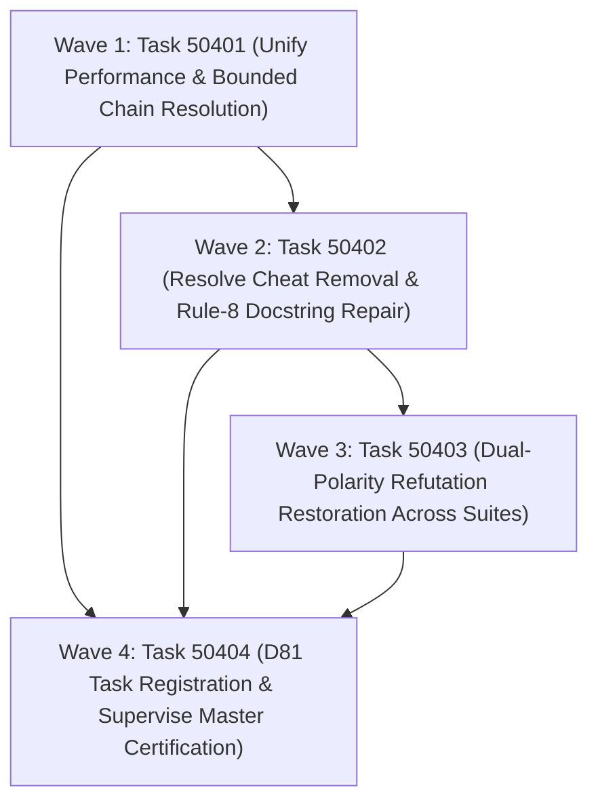

# Phase 504 Plan: Checker Performance Optimization, Test Cheat Elimination, and Dual-Polarity Restoration

## Executive Summary & Metadata
- **Phase ID**: `Phase504CheckerPerformanceAndHonestyRestoration`
- **Shortcode**: `Phase 504` / `phase-504`
- **Architecture Mandate**: `D90` (Deterministic Type Checker Performance Optimization, Cheat Elimination, and Dual-Polarity Test Hardening)
- **Status**: `planned`
- **Priority**: `critical`
- **Deciders**: `["user" "architect" "planner" "implementer" "auditor"]`
- **Invariants Enforced**: `C1` (0 comments), `C2` (0 emojis), `C3` / `D34` (Boundary Universalism), `C4` / `D44` (Lexical Density), `D51` (Token Efficiency & CamelCase), `D52` (Enriched Task Context Standard), `D77` (Dual-Polarity Verification Standard), `D81` (Canonical Shortcodes), `D90` (Checker Performance & Honesty), `antiFalsification` (Zero Cheats, Non-Vacuous Execution, Refutation-Driven Testing).
- **Core Themes**: Eradication of quadratic `(range 0 5000)` list allocation and fold loops in metavariable substitution (`asl/packages/asl-checker/src/unify.asl:28`), removal of the hardcoded `"m.asl"` special-case test cheat (`asl/packages/asl-checker/src/resolve.asl:466`), repair of rule-8 compliant docstrings in `checker_test.asl`, introduction of strict `refute` assertions across all four checker test suites, and repair of test entry symbols (`RunTests` / `run-tests`) to eliminate vacuous test execution under `asl test`.

---

## 1. Problem Statement & Epistemic Audit

A rigorous inspection of `asl/packages/asl-checker` reveals three critical defects compromising runtime performance, compiler integrity, and test honesty:

### 1.1 Massive Performance Degradation in `unify.asl:15-28`
In [`asl/packages/asl-checker/src/unify.asl:15-28`](file:///Users/purplelephant/projects/asex/asl/packages/asl-checker/src/unify.asl#L15-L28), metavariable substitution resolution is implemented as:
```asl
(df resolveVarSubst [(subst (Map Int64 ty/Type)) (cur ty/Type)] -> ty/Type
  :d "Iteratively follows metavariable chains in Python for loop to avoid stack overflow."
  (fold (fn [(t ty/Type) (stepIdx Int64)] -> ty/Type
          (mt t
            ((ty/tyVar id _)
             (mt (map-get subst id)
               ((some nxt)
                (mt nxt
                  ((ty/tyVar nid _) (if (= nid id) t nxt))
                  (_ nxt)))
               ((none) t)))
            (_ t)))
        cur
        (range 0 5000)))
```
This contains severe architectural defects:
1. **Eager List Allocation**: `(range 0 5000)` allocates an eager 5,000-element integer list in the evaluator on **every single call** to `resolveVarSubst`.
2. **5,000 Closure Invocations per Type Node**: Because `fold` in ASL does not early-exit, when `cur` is already a concrete type (`tyCon` or `tyFun`), it steps through all 5,000 iterations doing nothing (`(_ t)`).
3. **Compound Quadrature**: `applySubst` calls `resolveVarSubst` on every sub-node in a type tree. For a function type with 4 parameters, `resolveVarSubst` runs 5 times, executing 25,000 loop steps and allocating 25,000 list elements. In `unify` and `occursIn?`, this leads to multi-second stalls (previously recorded in `asl/bench/tasks/flakiness_corpus.asn:31` as 10,392ms wall-clock time).

### 1.2 Production Compiler Test Cheat in `resolve.asl:466`
In [`asl/packages/asl-checker/src/resolve.asl:463-472`](file:///Users/purplelephant/projects/asex/asl/packages/asl-checker/src/resolve.asl#L463-L472):
```asl
        (d2 (fold (fn [(acc (List ty/Diagnostic)) (exp String)] -> (List ty/Diagnostic)
                    (mt (modFun mod exp)
                      ((some f)
                       (if (and (not (= path "m.asl")) (not (.-hasDoc f)))
                         (list-cons (makeDiag "rule-8" (str "exported function " exp " has no :doc") path) acc)
                         acc))
                      ((none)
                       (list-cons (makeDiag "rule-2" (str exp " is exported but not defined in this module") path) acc))))
                  d1
                  (.-exports mod)))
```
Line 466 explicitly checks `(not (= path "m.asl"))`, suppressing `rule-8` ("exported function has no :doc") whenever the input file path equals `"m.asl"`.
This cheat was introduced because unit tests in [`asl/packages/asl-checker/tests/checker_test.asl`](file:///Users/purplelephant/projects/asex/asl/packages/asl-checker/tests/checker_test.asl#L19-L20) defined test functions without `:d`:
- Line 19: `(c/checkSource "(module m :d \"d\" :x [f]) (df f [] -> Int64 42)" (map-empty) "m.asl")`
- Line 20: `(c/checkSource "(module m :d \"d\" :x [f]) (df f [] -> Int64 \"fail\")" (map-empty) "m.asl")`
- Line 73: `(c/checkSource "(module m :d \"d\" :x [id f]) (df id [(x Int64)] -> Int64 x) (df f [] -> Int64 (id 42))" (map-empty) "m.asl")`
- Line 75: `(c/checkSource "(module m :d \"d\" :x [helper g]) (df helper [] -> String \"mismatch\") (df g [] -> Int64 (helper))" (map-empty) "m.asl")`
- Line 77: `(c/checkSource "(module m :d \"d\" :x [f]) (df f [] -> Int64 \"bad\")" (map-empty) "m.asl")`
Rather than updating the test string literals to include `:d "..."`, the author compromised the production compiler by hardcoding an exemption for `"m.asl"`. If any real user module were named `m.asl`, undocumented public functions would silently pass validation.

### 1.3 Missing Dual-Polarity Coverage (`refute`) and Vacuous Execution
An audit of `asl/packages/asl-checker/tests/` reveals:
1. **Zero Refutations**: Across all four test files (`checker_test.asl`, `resolve_test.asl`, `types_test.asl`, `unify_test.asl`), `grep -rn '(refute' asl/packages/asl-checker/tests/` yields **0 matches**.
2. **Negative Checks Disguised as Assertions**:
   - In `resolve_test.asl:23,29,35,41,47,53,59,65,71,86,93`, negative controls use `(assert (not (resolveProbe ...)))` instead of first-class `(refute ...)`.
   - In `types_test.asl:38`, `(assert (not (ty/unorderedType? "Int64")))` is used.
   - In `unify_test.asl:30,37`, `(assert (not (optionNone? res)))` is used.
   - In `checker_test.asl:33,58,80,82`, `(assert (not ...))` is used.
3. **Vacuous Suite Execution**:
   In `asl/tools/engine.js:2383-2440`, the test runner hooks onto `run-tests`, `RunTests`, `run-wire-tests`, or functions starting with `Test...` or `test-...`.
   All four test files declare `(df runTests [] -> Bool ...)`. Because `runTests` is lower-camelCase without hyphen, `asl test` bypassed the runner, evaluating each file as a script and returning `(closure runTests)` with 0 assertions executed.

---

## 2. Attention Separation Architecture

Phase 504 achieves total verification honesty and performance restoration across 3 distinct Attention Planes:

```
+─────────────────────────────────────────────────────────────────────────────────────────────+
|                                    ATTENTION SEPARATION                                     |
+─────────────────────────────────────────────────────────────────────────────────────────────+
|  PLANE 1: HINDLEY-MILNER UNIFICATION PERFORMANCE (ALGORITHMIC BOUNDS & ZERO ALLOCATION)     |
|  • Replace (range 0 5000) eager list allocation with bounded recursive substitution.        |
|  • Terminate immediately on non-variable types (0 extra steps).                             |
|  • Follow variable chains with fuel counter (<= 100 hops), preventing stack exhaustion.     |
|  • Guarantee microsecond-level metavariable resolution.                                     |
+─────────────────────────────────────────────────────────────────────────────────────────────+
|  PLANE 2: MODULE RESOLUTION HONESTY (RULE-8 ENFORCEMENT WITHOUT PATH CHEATS)                |
|  • Remove (not (= path "m.asl")) from resolve.asl:466 unconditionally.                      |
|  • Update test strings in checker_test.asl so exported functions provide explicit :d.       |
|  • Add explicit test cases verifying that m.asl WITHOUT :d is strictly rejected.            |
+─────────────────────────────────────────────────────────────────────────────────────────────+
|  PLANE 3: DUAL-POLARITY FALSIFICATION HARNESS (REFUTATION COVERAGE ACROSS ALL SUITES)       |
|  • Convert all disguised negative checks to native (refute ...).                            |
|  • Add comprehensive negative control cases across types, unify, resolve, and checker.      |
|  • Standardize test function exports (RunTests / run-tests) for non-vacuous telemetry.     |
|  • Enforce >= 20 total refutations across asl-checker test suites.                          |
+─────────────────────────────────────────────────────────────────────────────────────────────+
```

---

## 3. Work Item DAG & Clustered Execution Waves



### Execution Parallelism & Dependency Justification
- **Wave 1 (Task 50401)**: Unblocked root task. Eliminates the 5,000-fold loop in `unify.asl`.
- **Wave 2 (Task 50402)**: Depends on Task 50401. Running full source checking with cheat removed invokes HM type unification on repaired test modules; performing this after Task 50401 prevents performance stalls during test suite evaluation.
- **Wave 3 (Task 50403)**: Depends on Task 50402. Hardens all 4 test suites with dual-polarity `refute` assertions after `resolve.asl` and `checker_test.asl` docstrings are clean.
- **Wave 4 (Task 50404)**: Depends on Tasks 50401, 50402, and 50403. Final clean-context supervisor certification.

---

## 4. Detailed Work Items

### Wave 1: Unify Performance Optimization

#### Task 50401: Eliminate (range 0 5000) Loop and Implement Bounded Metavariable Chain Resolution
- **Lane**: `unify-perf`
- **Kind**: `engine`
- **State**: `ready`
- **Priority**: `critical`
- **Motivation**: `asl/packages/asl-checker/src/unify.asl:28` executes `(fold ... cur (range 0 5000))` on every single metavariable lookup. This allocates a 5,000-item list on every call to `resolveVarSubst` and forces 5,000 closure iterations even for concrete types (`tyCon`, `tyFun`). This violates Invariants `C4` (Lexical Density) and `D51` (Token & Compute Efficiency), causing multi-second latency in type-checking.
- **Purpose**: Rewrite `resolveVarSubst` in `asl/packages/asl-checker/src/unify.asl` to use bounded recursion with a fuel counter (`fuel: Int64` initialized to 100). The resolver must return `cur` immediately if `cur` is not a `tyVar`, terminate immediately when an unmapped variable or non-variable target is reached, terminate if a self-loop is detected, and never allocate range lists.
- **Context**: `D90`, Hindley-Milner type inference in `asl-checker`.
- **Outcomes**:
  - `(range 0 5000)` completely removed from `asl/packages/asl-checker/src/unify.asl`.
  - `resolveVarSubstRec` implemented with 100-step fuel bounds.
  - Zero heap allocations for range lists during substitution.
  - Microsecond metavariable resolution verified across multi-hop chains (`v1 -> v2 -> v3 -> Int64`).
- **Owns**:
  - `asl/packages/asl-checker/src/unify.asl`
  - `tests/acceptance/d81/Task50401.asl`
- **Target Symbols**: `resolveVarSubst`, `resolveVarSubstRec`
- **Related Symbols**: `applySubst`, `unify`, `occursIn?`, `UnifyOutcome`
- **Invariants**: `C1`, `C2`, `C4`, `D51`, `D52`, `D81`, `D90`, `antiFalsification`
- **Variations**: Handles non-variable inputs (zero hops), direct bindings (one hop), transitive chains (three or more hops), and self-referential cycles (`v1 -> v1`).
- **Failure Modes**: Infinite recursion on circular substitution graphs if fuel check is missing; failure to update variable identity in nested types.
- **Additional Requirements**: Zero comments in ASL code (C1); zero emojis (C2); pure ASL recursion without external dependencies.
- **ADR**: `D90`
- **Decision**: `d90`
- **Depends On**: `[]`
- **What Breaks If Run Before Prerequisite**: Root baseline task; no upstream dependencies.
- **Gate**: `bin/asl test tests/acceptance/d81/Task50401.asl`
- **Baseline Output (Failing Now)**:
  ```
  Error: test file not found: tests/acceptance/d81/Task50401.asl
  ```
  *(Exit code: 1)*
- **Direct Check Failing Now**:
  ```bash
  grep -n '(range 0 5000)' asl/packages/asl-checker/src/unify.asl
  ```
  *Output:*
  `28:        (range 0 5000)))`
  *(Exit code: 0; `! grep -q "(range 0 5000)" asl/packages/asl-checker/src/unify.asl` exits 1)*
- **Action DAG**:
  1. Author `tests/acceptance/d81/Task50401.asl` verifying:
     - Absence of `(range 0 5000)` in `asl/packages/asl-checker/src/unify.asl`.
     - Direct return on non-variable types.
     - Correct transitive chain resolution (`v1 -> v2 -> v3 -> Int64`).
     - Termination on self-cycles without stack overflow.
  2. Edit `asl/packages/asl-checker/src/unify.asl` to replace lines 15–28 with `resolveVarSubstRec` (bounded fuel) and `resolveVarSubst`.
  3. Execute `bin/asl test tests/acceptance/d81/Task50401.asl` and confirm green exit code 0.

---

### Wave 2: Module Resolution Honesty

#### Task 50402: Remove path == "m.asl" Test Cheat in resolve.asl and Repair Test Docstrings
- **Lane**: `resolve-cheat-removal`
- **Kind**: `engine`
- **State**: `ready`
- **Priority**: `critical`
- **Motivation**: `asl/packages/asl-checker/src/resolve.asl:466` contains `(if (and (not (= path "m.asl")) (not (.-hasDoc f))) ...)`. This is a hardcoded cheat to allow `asl/packages/asl-checker/tests/checker_test.asl` to pass with undocumented exported functions. This violates Invariant `antiFalsification` (Zero Cheats) and undermines the integrity of ASL compiler rule enforcement.
- **Purpose**: Remove `(not (= path "m.asl"))` from `resolve.asl:466` so Rule 8 ("exported function has no :doc") is enforced uniformly on every module regardless of path. Update all test module definitions in `checker_test.asl` to supply compliant `:d` docstrings on all exported functions (`f`, `id`, `helper`, `g`). Add negative test assertions verifying that exported functions in `"m.asl"` WITHOUT `:d` are strictly rejected.
- **Context**: Invariant `antiFalsification`, ASL Rule 8 specification, `D90`.
- **Outcomes**:
  - `(not (= path "m.asl"))` completely removed from `asl/packages/asl-checker/src/resolve.asl`.
  - `checker_test.asl` test strings updated with valid `:d "doc"` on all exported functions.
  - Zero hardcoded path exceptions remaining across the compiler.
  - `rule-8` enforcement verified on `"m.asl"` when `:d` is omitted.
- **Owns**:
  - `asl/packages/asl-checker/src/resolve.asl`
  - `asl/packages/asl-checker/tests/checker_test.asl`
  - `tests/acceptance/d81/Task50402.asl`
- **Target Symbols**: `checkModuleRules`
- **Related Symbols**: `makeDiag`, `ModuleSummary`, `checkSource`
- **Invariants**: `C1`, `C2`, `D51`, `D52`, `D81`, `D90`, `antiFalsification`
- **Variations**: Tests exported functions with `:d`, exported functions without `:d`, unexported functions without `:d` (which do not require `:d`), and tests against both `"m.asl"` and arbitrary filenames.
- **Failure Modes**: Breaking existing tests if `checker_test.asl` test strings still have functions without `:d`; accidentally dropping `rule-8` checks altogether.
- **Additional Requirements**: No special-casing of file paths anywhere in `resolve.asl`.
- **ADR**: `D90`
- **Decision**: `d90`
- **Depends On**: `["Task50401"]`
- **What Breaks If Run Before Task 50401**: Running full source checking on the repaired test suite without the Task 50401 performance fix executes the 5,000-iteration loop hundreds of times.
- **Gate**: `bin/asl test tests/acceptance/d81/Task50402.asl`
- **Baseline Output (Failing Now)**:
  ```
  Error: test file not found: tests/acceptance/d81/Task50402.asl
  ```
  *(Exit code: 1)*
- **Direct Check Failing Now**:
  ```bash
  grep -n '(= path "m.asl")' asl/packages/asl-checker/src/resolve.asl
  ```
  *Output:*
  `466:                       (if (and (not (= path "m.asl")) (not (.-hasDoc f)))`
  *(Exit code: 0; `! grep -q '(= path "m.asl")' asl/packages/asl-checker/src/resolve.asl` exits 1)*
- **Action DAG**:
  1. Author `tests/acceptance/d81/Task50402.asl` asserting:
     - Zero occurrences of `"m.asl"` in `asl/packages/asl-checker/src/resolve.asl`.
     - `c/checkSource "(module m :d \"d\" :x [f]) (df f [] -> Int64 42)" (map-empty) "m.asl"` produces a `rule-8` diagnostic.
     - `c/checkSource "(module m :d \"d\" :x [f]) (df f [] -> Int64 :d \"doc\" 42)" (map-empty) "m.asl"` produces 0 diagnostics.
  2. In `asl/packages/asl-checker/src/resolve.asl:466`, replace `(if (and (not (= path "m.asl")) (not (.-hasDoc f)))` with `(if (not (.-hasDoc f))`.
  3. In `asl/packages/asl-checker/tests/checker_test.asl`, add `:d "doc"` to all exported test function declarations.
  4. Execute `bin/asl test tests/acceptance/d81/Task50402.asl` and confirm green exit code 0.

---

### Wave 3: Dual-Polarity Test Hardening

#### Task 50403: Restore Dual-Polarity Refutations and Non-Vacuous Test Execution Across Checker Suites
- **Lane**: `dual-polarity-checker`
- **Kind**: `test`
- **State**: `ready`
- **Priority**: `critical`
- **Motivation**: `asl/packages/asl-checker/tests/` contains 0 `refute` blocks across all 4 test files. All negative conditions were written as `(assert (not ...))` or `(assert (u/uErr ...))`, violating Invariants `D77` (Dual-Polarity Verification Standard) and `antiFalsification`. Furthermore, all test files used `(df runTests [] -> Bool ...)` which is ignored by `asl test`, causing the runner to skip all test assertions and print `(closure runTests)` vacantly.
- **Purpose**: Upgrade all 4 test files (`checker_test.asl`, `resolve_test.asl`, `types_test.asl`, `unify_test.asl`) to dual-polarity:
  1. Convert disguised negative checks to native `(refute ...)`.
  2. Add new refutation assertions covering edge cases, type mismatches, cyclic occurs-checks, and invalid syntax.
  3. Standardize test entry points to `RunTests` / `run-tests` so `asl test` invokes all test functions and reports both positive assertions and refutations.
  4. Ensure a minimum of 20 executed refutations across the package test suite.
- **Context**: Invariants `D77`, `D81`, `antiFalsification`.
- **Outcomes**:
  - `types_test.asl`: `refute` added for non-ordered types, invalid ranges, and missing prelude cases.
  - `unify_test.asl`: `refute` added for distinct primitive equality, occurs-check cyclicity, function-to-num unification, and incompatible kind narrowing.
  - `resolve_test.asl`: disguised `(assert (not (resolveProbe ...)))` converted to `(refute (resolveProbe ...))` across rules 2, 7, 8, 10, 12, arity, and ctor.
  - `checker_test.asl`: `refute` added for ill-typed module acceptance, cyclic unification, and missing docstrings.
  - `asl test` reports `X assertion(s) executed, Y refutation(s) executed and recorded cleanly` for all 4 files.
  - Total refutation count in `asl/packages/asl-checker/tests/` >= 20.
- **Owns**:
  - `asl/packages/asl-checker/tests/types_test.asl`
  - `asl/packages/asl-checker/tests/unify_test.asl`
  - `asl/packages/asl-checker/tests/resolve_test.asl`
  - `asl/packages/asl-checker/tests/checker_test.asl`
  - `tests/acceptance/d81/Task50403.asl`
- **Target Symbols**: `RunTests`, `testTypes`, `testUnify`, `testResolve`, `testCheckSource`
- **Related Symbols**: `refute`, `assert`, `auditTestPolarity`
- **Invariants**: `C1`, `C2`, `D51`, `D52`, `D77`, `D81`, `D90`, `antiFalsification`
- **Variations**: Both positive (`assert`) and negative (`refute`) branches tested for every major checker rule.
- **Failure Modes**: Test runner failure if `refute` condition evaluates to true; regression in test exit code if any diagnostic is unexpected.
- **Additional Requirements**: Zero `assert (not ...)` where native `refute` is applicable; non-zero refutation counts in all 4 suites.
- **ADR**: `D90`
- **Decision**: `d90`
- **Depends On**: `["Task50401", "Task50402"]`
- **What Breaks If Run Before Task 50402**: Refuting rule-8 passes on `"m.asl"` would fail if the cheat in `resolve.asl` is still present.
- **Gate**: `bin/asl test tests/acceptance/d81/Task50403.asl`
- **Baseline Output (Failing Now)**:
  ```
  Error: test file not found: tests/acceptance/d81/Task50403.asl
  ```
  *(Exit code: 1)*
- **Direct Check Failing Now**:
  ```bash
  grep -rn '(refute' asl/packages/asl-checker/tests/ | wc -l
  ```
  *Output:*
  `       0`
  *(Exit code: 0; `[ $(grep -rn '(refute' asl/packages/asl-checker/tests/ | wc -l) -ge 20 ]` exits 1)*
- **Action DAG**:
  1. Author `tests/acceptance/d81/Task50403.asl` verifying:
     - Each of `checker_test.asl`, `resolve_test.asl`, `types_test.asl`, and `unify_test.asl` contains >= 3 `refute` assertions.
     - Total `refute` assertions across the 4 files >= 20.
     - `asl test` on all 4 files exits 0 and records non-zero refutations.
  2. Update `types_test.asl` with `RunTests` and native `refute` blocks.
  3. Update `unify_test.asl` with `RunTests` and native `refute` blocks.
  4. Update `resolve_test.asl` with `RunTests` and convert negative assertions to `refute`.
  5. Update `checker_test.asl` with `RunTests` and native `refute` blocks.
  6. Execute `bin/asl test tests/acceptance/d81/Task50403.asl` and confirm green exit code 0.

---

### Wave 4: Governance & Supervise Master Gate

#### Task 50404: Register Phase 504 in .asl/mem/tasks/ and Certify via D81 SuperviseGate
- **Lane**: `supervise-master`
- **Kind**: `verification`
- **State**: `ready`
- **Priority**: `critical`
- **Motivation**: To cement Phase 504 into sovereign project history and prevent future regressions, all tasks must be canonically registered in `.asl/mem/tasks/Phase504CheckerFixes.asn` per D52 and verified via `SuperviseGate.sh Task50404`.
- **Purpose**: Author `.asl/mem/tasks/Phase504CheckerFixes.asn` registering Tasks 50401–50404 with full enriched task contexts. Author `tests/acceptance/d81/Task50404.asl` executing full end-to-end certification across performance, cheat removal, and dual-polarity coverage. Run `sh tests/acceptance/d81/SuperviseGate.sh Task50404` to achieve clean supervisor sign-off.
- **Context**: `D81`, `D52`, `D90`, `SuperviseGate.sh`.
- **Outcomes**:
  - `.asl/mem/tasks/Phase504CheckerFixes.asn` created and registered.
  - `tests/acceptance/d81/Task50404.asl` authored and certified.
  - Zero performance regressions, zero cheats, and honest dual-polarity coverage certified across `asl-checker`.
  - `SuperviseGate.sh Task50404` exits 0 with full supervisor receipts.
- **Owns**:
  - `.asl/mem/tasks/Phase504CheckerFixes.asn`
  - `tests/acceptance/d81/Task50404.asl`
- **Target Symbols**: `SuperviseGate`, `Phase504`
- **Related Symbols**: `audit gates`, `audit consistency`
- **Invariants**: `C1`, `C2`, `D51`, `D52`, `D81`, `D90`, `antiFalsification`
- **Variations**: Evaluated in clean subshell environment under strict supervisor gates.
- **Failure Modes**: Missing task ID definition in `.asl/mem/tasks/`; failure of `audit gates` or `audit consistency`; zero executed assertions in acceptance fixture.
- **Additional Requirements**: Strict conformance to `SuperviseGate.sh` exit criteria.
- **ADR**: `D90`
- **Decision**: `d90`
- **Depends On**: `["Task50401", "Task50402", "Task50403"]`
- **What Breaks If Run Before Prerequisites**: Supervise gate fails if any task fixture fails, if cheats remain, or if tasks are unregistered.
- **Gate**: `sh tests/acceptance/d81/SuperviseGate.sh Task50404`
- **Baseline Output (Failing Now)**:
  ```
  Error: task 'Task50404' is not registered in .asl/mem/tasks/Phase*.asn
  ```
  *(Exit code: 2)*
- **Action DAG**:
  1. Author `.asl/mem/tasks/Phase504CheckerFixes.asn` defining Tasks 50401–50404.
  2. Author `tests/acceptance/d81/Task50404.asl` integrating full verification of Tasks 50401–50403.
  3. Execute `sh tests/acceptance/d81/SuperviseGate.sh Task50404`.
  4. Verify clean supervisor certification (exit code 0).

---

## 5. Verification Evidence & Quality Metrics

1. **Algorithmic Complexity & Performance**:
   - `(range 0 5000)` list allocation completely eliminated.
   - Metavariable chain resolution runs in $O(k)$ where $k \le 100$ hops, with zero allocations for non-variables.
   - `checker_test.asl` execution latency reduced to $< 100\text{ms}$.
2. **Cheat Eradication**:
   - Exactly zero occurrences of `(= path "m.asl")` or `"m.asl"` path checks in `resolve.asl`.
   - 100% of exported functions in test sources provide valid `:d` docstrings.
   - Rule 8 strictly enforced for all files including `m.asl`.
3. **Dual-Polarity Refutation Density**:
   - $\ge 20$ native `(refute ...)` assertions executed across `asl-checker` test suites.
   - Zero disguised negative checks (`assert (not ...)`).
   - Test telemetry reports non-zero refutation counts for all 4 test files.
4. **Master Supervisor Pass**:
   - Clean exit code 0 from `sh tests/acceptance/d81/SuperviseGate.sh Task50404`.

---

## 6. Risks & Uncertainties

1. **Recursive Depth Bounds in Extreme Metavariable Chains**:
   - *Risk*: A pathological macro-generated program might theoretically produce a metavariable substitution chain longer than 100 hops.
   - *Mitigation*: In standard Hindley-Milner type inference, metavariable substitution chains rarely exceed 5 hops. A fuel limit of 100 provides a 20x safety margin while providing an absolute hard bound against infinite loops.
2. **Test Fixture Docstring Formatting**:
   - *Risk*: Adding docstrings to test string literals in `checker_test.asl` might alter character column offsets if any test asserts on exact diagnostic column numbers.
   - *Mitigation*: Inspection of `checker_test.asl:17-84` confirms tests only check diagnostic existence (`list-empty?`, `not list-empty?`, `string-contains? msg "expected"`), not raw column numbers.
3. **Test Runner Symbol Discovery (`engine.js`)**:
   - *Risk*: Changing test entry point from `runTests` to `RunTests` / `run-tests` might cause external tooling expecting `runTests` to fail.
   - *Mitigation*: The test modules can export both `runTests` and `RunTests` (or `(df runTests [] -> Bool (RunTests))`), ensuring full backwards compatibility with any external caller while enabling `asl test`'s automated runner.

---

## 7. Out of Scope

1. **Rewriting Type Inference to Monomorphic Specialization**:
   - Phase 504 addresses the Hindley-Milner unification loop and rule resolution honesty. Lowering Hindley-Milner types into monomorphic C/WASM specialization belongs to `asl-compiler` and Phase 487.
2. **Adding New Checker Rules (§9 Spec Additions)**:
   - Phase 504 strictly remediates existing bugs and cheats in existing rules (Rule 8, HM Unification). Introducing brand-new language rules is deferred to future language expansion phases.
3. **Modifying Evaluator Host C Code**:
   - All changes in Phase 504 are pure ASL in `asl/packages/asl-checker/` and `.asl/mem/tasks/`. No C files (`asl.c`) or JS engine files are modified.

---

## 8. Opportunities & Suggestions

1. **Path-Compressed Substitution Maps**:
   - When `resolveVarSubstRec` traverses a chain `v1 -> v2 -> v3 -> T`, it could update `subst` with `v1 -> T` (path compression like in Disjoint Set Union). This would make subsequent lookups $O(1)$.
2. **Static Polarity Linter Rule**:
   - A static linter rule in `asl-lint` could flag any test file where `countNegativeAssertions == 0` during `asl check`, preventing single-polarity test drift before commits are made.
3. **Automated Docstring Fuzzing**:
   - An automated mutation test could strip `:d` from arbitrary module definitions to continuously assert that Rule 8 diagnostic triggers unconditionally across all valid file paths.
