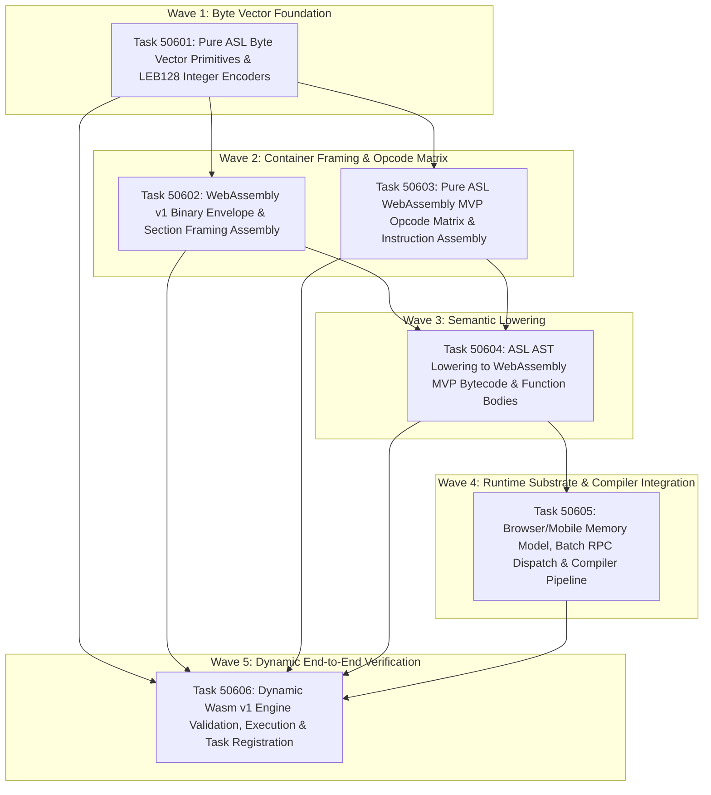

# Phase 506 Plan: Pure ASL WebAssembly Binary Emitter (`wasm.asl`)

## Executive Summary & Metadata
- **Phase ID**: `Phase506PureAslWasmBinaryEmitter`
- **Shortcode**: `Phase 506` / `phase-506`
- **Architecture Mandate**: `D92` / `ADR-0082` (Sovereign WebAssembly/WASI Transition & Binary Emitter Architecture), `ADR-0083` (Runtime Targets & Optional Native Tier)
- **Status**: `planned`
- **Priority**: `critical`
- **Deciders**: `["user" "architect" "planner" "implementer" "auditor"]`
- **Governing Directives (ADR-0083)**:
  1. **Primary Runtime: Browser**: Build and toolchain execution must run directly in the browser.
  2. **Additional Target: Mobile**: Emitted Wasm must run on mobile engines without desktop POSIX dependencies.
  3. **Optional Native Tier**: Native binary emission (Mach-O / ELF64) is strictly an optional capability; pure ASL Wasm is baseline.
  4. **No Windows**: Windows native support is deferred; ignore Windows formats entirely.
  5. **No Release Tasks**: Pure implementation and dynamic test verification for Phase 506; zero premature release overhead.
  6. **Full Dynamic Test Coverage**: Comprehensive dynamic verification of native ASL behavior across all tasks.
- **Invariants Enforced**: `C1` (0 comments in ASL), `C2` (0 emojis), `C3` / `D34` (Boundary Universalism), `C4` / `D44` (Lexical Density), `D51` (Token Efficiency & CamelCase), `D52` (Enriched Task Context Standard), `D77` (Dual-Polarity Verification Standard & `refute` forms), `D81` (Canonical Shortcodes & Failing Acceptance Gates), `D89` (Anti-Falsification & Zero String Mocking).
- **Core Scope**: Implementation of a self-hosted, 100% pure ASL binary WebAssembly emitter ([`asl/packages/asl-compiler/src/wasm.asl`](file:///Users/purplelephant/projects/asex/asl/packages/asl-compiler/src/wasm.asl)) generating valid Wasm v1 MVP bytecode (magic header, section framing, unsigned/signed LEB128 encoding, instruction opcode matrix, AST lowering, linear memory model, and browser/mobile Batch RPC exports), integrated with [`asl/packages/asl-compiler/src/compiler.asl`](file:///Users/purplelephant/projects/asex/asl/packages/asl-compiler/src/compiler.asl) and dynamically validated against live WebAssembly engines.

---

## 1. Problem Statement & Sovereign Architecture

The AgentScript compiler currently emits WebAssembly solely as WebAssembly Text format ([`asl/packages/asl-codegen/src/emit_wat.asl:1-168`](file:///Users/purplelephant/projects/asex/asl/packages/asl-codegen/src/emit_wat.asl#L1-L168) and [`asl/packages/asl-compiler/src/compiler.asl:77-95`](file:///Users/purplelephant/projects/asex/asl/packages/asl-compiler/src/compiler.asl#L77-L95)). This introduces systemic roadblocks identified in ADR-0082 and ADR-0083:

1. **Foreign Assembler Dependency**: Text format `.wat` cannot be directly executed in web browsers, mobile runtimes, or standalone Wasm runtimes without external assemblers (`wat2wasm`, `wabt`, or heavyweight JavaScript parsers).
2. **Missing Binary Foundation**: There is no pure ASL binary encoder for the Wasm v1 MVP binary standard. Previous binary targets ([`elf.asl:31-36`](file:///Users/purplelephant/projects/asex/asl/packages/asl-compiler/src/elf.asl#L31-L36) and [`macho.asl:29-34`](file:///Users/purplelephant/projects/asex/asl/packages/asl-compiler/src/macho.asl#L29-L34)) were non-functional dictionary mocks returning fake `:status :emitted` maps without emitting a single byte.
3. **Absence of Variable-Length Encoding (LEB128)**: The monorepo has zero LEB128 encoders in pure ASL. Every Wasm section length, type vector count, local index, and numeric immediate requires standard unsigned or signed LEB128 variable-length integer encoding.
4. **Target Inversion (ADR-0083)**: The project's primary target is the **Browser**, with **Mobile** as an official target runtime. Native binary emission (Mach-O / ELF) is an optional tier, and Windows support is deferred. The compiler must provide a direct, zero-dependency path from ASL source code to an executable `.wasm` binary buffer.

---

## 2. Attention Separation Architecture

Phase 506 structures the WebAssembly binary emitter across 3 Attention Planes:

```
+─────────────────────────────────────────────────────────────────────────────────────────────+
|                                    ATTENTION SEPARATION                                     |
+─────────────────────────────────────────────────────────────────────────────────────────────+
|  PLANE 1: LOW-LEVEL BYTE VECTOR PRIMITIVES & LEB128 ENCODING (DATA TRANSFORMATION)          |
|  • Pure arithmetic and bit manipulation in ASL for unsigned (u32) and signed (i32/i64)     |
|    LEB128 variable-length integer encoding.                                                 |
|  • Byte list concatenation, UTF-8 string serialization, and payload size calculation.       |
|  • Zero AST, type checker, or compiler dependency at this layer.                            |
+─────────────────────────────────────────────────────────────────────────────────────────────+
|  PLANE 2: WASM MVP BINARY ENVELOPE & INSTRUCTION OPCODES (SPECIFICATION CONFORMANCE)        |
|  • Standard Wasm v1 binary container: Magic header (\0asm) and Version 1 (0x01,0x00,0x00,0x00). |
|  • Canonical section framing (Sections 1..11) with LEB128 payload lengths.                  |
|  • Opcode matrix: control flow, local/global variables, numeric constants, arithmetic,     |
|    comparisons, memory operations, and block/call signatures.                               |
+─────────────────────────────────────────────────────────────────────────────────────────────+
|  PLANE 3: AST LOWERING, COMPILER INTEGRATION & RUNTIME DISPATCH (BROWSER & MOBILE SUBSTRATE)|
|  • Translation of top-level ASL functions (topDefun) and expressions into Wasm function bodies.|
|  • Linear memory model export, bump allocator (asl_alloc, asl_free), and Batch RPC export   |
|    (asl_rpc_dispatch) tailored for browser Web Workers and mobile engines (ADR-0083).       |
|  • Pipeline wiring in compiler.asl (:target "wasm") and dynamic execution verification.     |
+─────────────────────────────────────────────────────────────────────────────────────────────+
```

---

## 3. Work Item DAG & Clustered Execution Waves



---

## 4. Ordered Work Items

### Task 50601: Pure ASL Byte Vector Primitives & LEB128 Variable-Length Integer Encoders
- **What changes, by path**:
  - `asl/packages/asl-compiler/src/wasm.asl`
  - `asl/packages/asl-compiler/tests/wasm_leb128_test.asl`
  - `tests/acceptance/d81/Task50601.asl`
- **Why**:
  Every integer in the WebAssembly binary format (section IDs, byte counts, type indices, function indices, local indices, and numeric literals) is encoded in Little Endian Base 128 (LEB128). An unsigned 32-bit integer (`u32`) requires 7-bit chunking with the high bit set until the final byte. A signed integer (`i32` / `i64`) requires two's-complement variable-width encoding with sign bit termination. `wasm.asl` must implement `leb128EncodeU32`, `leb128EncodeI32`, and UTF-8 string byte serialization in pure ASL with zero external toolchain dependencies.
- **Depends on**: none (Wave 1 unblocked root)
- **Owns**:
  - `asl/packages/asl-compiler/src/wasm.asl`
  - `asl/packages/asl-compiler/tests/wasm_leb128_test.asl`
  - `tests/acceptance/d81/Task50601.asl`
- **Target Symbols**: `leb128EncodeU32`, `leb128EncodeI32`, `encodeUtf8`, `byteLength`
- **Gate**:
  `test -f asl/packages/asl-compiler/src/wasm.asl && bin/asl test tests/acceptance/d81/Task50601.asl`
- **Current Gate Result (Fails Now)**:
  ```
  Error: test file not found: tests/acceptance/d81/Task50601.asl
  ```
  *(Exit code: 1; additionally `test -f asl/packages/asl-compiler/src/wasm.asl` exits with status 1)*
- **What breaks if run before prerequisite**:
  Nothing; unblocked foundational work item.
- **Falsifiable Invariants**:
  - `leb128EncodeU32 0` produces `[0]`.
  - `leb128EncodeU32 624485` produces `[229, 142, 38]`.
  - `leb128EncodeI32 -1` produces `[127]`.
  - `leb128EncodeI32 -128` produces `[128, 127]`.
  - `refute` that `leb128EncodeU32` returns empty or produces continuation bits on single-byte zero.

---

### Task 50602: WebAssembly v1 Binary Envelope & Section Framing Assembly
- **What changes, by path**:
  - `asl/packages/asl-compiler/src/wasm.asl`
  - `asl/packages/asl-compiler/tests/wasm_section_test.asl`
  - `tests/acceptance/d81/Task50602.asl`
- **Why**:
  A valid WebAssembly v1 binary starts with an 8-byte header: magic number `0x00 0x61 0x73 0x6D` (`\0asm`) followed by version `0x01 0x00 0x00 0x00`. Following the header, sections must be emitted in canonical order (Type=1, Import=2, Function=3, Table=4, Memory=5, Global=6, Export=7, Start=8, Element=9, Code=10, Data=11). Each section consists of a 1-byte section ID, a LEB128 unsigned integer specifying the payload byte length, and the payload bytes. `wasm.asl` must implement `wasmHeader`, `encodeSection`, and section assemblers for Type, Function, Memory, Export, and Code sections.
- **Depends on**: `Task50601`
- **Owns**:
  - Section framing logic in `asl/packages/asl-compiler/src/wasm.asl`
  - `asl/packages/asl-compiler/tests/wasm_section_test.asl`
  - `tests/acceptance/d81/Task50602.asl`
- **Target Symbols**: `wasmMagicHeader`, `encodeSection`, `encodeTypeSection`, `encodeFunctionSection`, `encodeMemorySection`, `encodeExportSection`, `encodeCodeSection`
- **Gate**:
  `bin/asl test tests/acceptance/d81/Task50602.asl`
- **Current Gate Result (Fails Now)**:
  ```
  Error: test file not found: tests/acceptance/d81/Task50602.asl
  ```
  *(Exit code: 1)*
- **What breaks if run before prerequisite**:
  Section framing computes payload size via `leb128EncodeU32`; without Task 50601, section size framing cannot be computed, producing corrupt byte vectors.

---

### Task 50603: Pure ASL WebAssembly MVP Opcode Matrix & Instruction Assembly
- **What changes, by path**:
  - `asl/packages/asl-compiler/src/wasm.asl`
  - `asl/packages/asl-compiler/tests/wasm_opcodes_test.asl`
  - `tests/acceptance/d81/Task50603.asl`
- **Why**:
  WebAssembly bytecode execution operates on a stack machine defined by standard Wasm v1 MVP opcodes. `wasm.asl` must provide typed instruction constructors that encode the opcodes and immediate values into byte streams:
  - **Control Flow**: `unreachable` (`0x00`), `block` (`0x02`), `loop` (`0x03`), `if` (`0x04`), `else` (`0x05`), `end` (`0x0B`), `br` (`0x0C`), `br_if` (`0x0D`), `return` (`0x0F`), `call` (`0x10`).
  - **Variables**: `local.get` (`0x20`), `local.set` (`0x21`), `local.tee` (`0x22`), `global.get` (`0x23`), `global.set` (`0x24`).
  - **Numeric Constants**: `i32.const` (`0x41` + signed LEB128), `i64.const` (`0x42` + signed LEB128).
  - **Comparisons**: `i32.eqz` (`0x45`), `i32.eq` (`0x46`), `i32.ne` (`0x47`), `i32.lt_s` (`0x48`), `i32.gt_s` (`0x4A`), `i32.le_s` (`0x4C`), `i32.ge_s` (`0x4E`), `i64.eq` (`0x51`), etc.
  - **Arithmetic & Logic**: `i32.add` (`0x6A`), `i32.sub` (`0x6B`), `i32.mul` (`0x6C`), `i32.div_s` (`0x6D`), `i32.rem_s` (`0x6F`), `i32.and` (`0x71`), `i32.or` (`0x72`), `i32.xor` (`0x73`), `i64.add` (`0x7C`), `i64.sub` (`0x7D`), `i64.mul` (`0x7E`).
  - **Memory Access**: `i32.load` (`0x28`), `i32.store` (`0x36`), `memory.size` (`0x3F`), `memory.grow` (`0x40`).
- **Depends on**: `Task50601`, `Task50602`
- **Owns**:
  - Opcode table and instruction emitters in `asl/packages/asl-compiler/src/wasm.asl`
  - `asl/packages/asl-compiler/tests/wasm_opcodes_test.asl`
  - `tests/acceptance/d81/Task50603.asl`
- **Target Symbols**: `wasmOpcode`, `emitInstrConstI32`, `emitInstrConstI64`, `emitInstrLocalGet`, `emitInstrLocalSet`, `emitInstrCall`, `emitInstrBinaryOp`, `emitInstrIf`
- **Gate**:
  `bin/asl test tests/acceptance/d81/Task50603.asl`
- **Current Gate Result (Fails Now)**:
  ```
  Error: test file not found: tests/acceptance/d81/Task50603.asl
  ```
  *(Exit code: 1)*
- **What breaks if run before prerequisite**:
  Instruction immediate arguments (local indices, branch depths, function call indices, integer constants) require LEB128 encoders from Task 50601.

---

### Task 50604: ASL AST Lowering to WebAssembly MVP Bytecode & Function Bodies
- **What changes, by path**:
  - `asl/packages/asl-compiler/src/wasm.asl`
  - `asl/packages/asl-compiler/tests/wasm_codegen_test.asl`
  - `tests/acceptance/d81/Task50604.asl`
- **Why**:
  To compile AgentScript AST forms into executable WebAssembly, `wasm.asl` must translate top-level functions ([`topDefun`](file:///Users/purplelephant/projects/asex/asl/packages/asl-compiler/src/compiler.asl#L81-L88)) and expressions into Code section entries. This includes:
  - Mapping function parameter types to Wasm value types (`Int` / `I64` -> `0x7E` i64, `I32` / `Bool` -> `0x7F` i32).
  - Assigning parameter and local variable indices (`0 .. N-1`).
  - Postfix evaluation of nested S-expression expressions: lower operands, emit binary or comparison opcodes.
  - Compiling structured control flow (`if` condition `then` branch `else` branch) into Wasm `if` ... `else` ... `end` blocks.
  - Compiling function calls (`call` instructions) by looking up target function indices.
  - Appending function body terminator `0x0B` (`end`).
- **Depends on**: `Task50602`, `Task50603`
- **Owns**:
  - AST lowering functions in `asl/packages/asl-compiler/src/wasm.asl`
  - `asl/packages/asl-compiler/tests/wasm_codegen_test.asl`
  - `tests/acceptance/d81/Task50604.asl`
- **Target Symbols**: `lowerAstFunction`, `lowerAstExpr`, `lowerAstTopForms`, `buildFunctionTypeIndex`
- **Gate**:
  `bin/asl test tests/acceptance/d81/Task50604.asl`
- **Current Gate Result (Fails Now)**:
  ```
  Error: test file not found: tests/acceptance/d81/Task50604.asl
  ```
  *(Exit code: 1)*
- **What breaks if run before prerequisite**:
  Function body generation relies on section framing from Task 50602 and instruction opcode emitters from Task 50603.

---

### Task 50605: Browser & Mobile Linear Memory Model, Batch RPC Dispatch & Compiler Pipeline Integration
- **What changes, by path**:
  - `asl/packages/asl-compiler/src/wasm.asl`
  - `asl/packages/asl-compiler/src/compiler.asl`
  - `asl/packages/asl-compiler/manifest.asn`
  - `asl/packages/asl-compiler/grammar.asn`
  - `tests/acceptance/d81/Task50605.asl`
- **Why**:
  Per ADR-0083 directives:
  1. **Primary Runtime: Browser**: WebAssembly binaries must run inside standard browser Web Workers without native POSIX OS dependencies.
  2. **Additional Target: Mobile**: Mobile embedded engines require sandboxed execution with clean linear memory bounds.
  3. **No Windows / Native Tier Optional**: Mach-O/ELF are strictly optional; pure ASL Wasm is baseline.
  
  `wasm.asl` must emit:
  - Linear memory export (`memory`) with initial 1 page (64KB) up to 256 pages (16MB).
  - In-browser sovereign Batch RPC memory bridge exports: `asl_alloc`, `asl_free`, `asl_rpc_dispatch` (per ADR-0082 Section 4.4 and emit_wat.asl).
  - Structured capability denial receipts for privileged operations (`execCmd`) when running inside sandboxed browser/mobile Wasm.
  
  Finally, `compiler.asl` must be updated to wire `compileSourceTarget src "wasm"` and `compileSourceTarget src "wasm-bin"` to `emitWasmBinaryTarget`, registering `"asl-compiler/wasm"` in `manifest.asn` and exporting canonical symbols in `grammar.asn`.
- **Depends on**: `Task50604`
- **Owns**:
  - Runtime bridge & memory model in `asl/packages/asl-compiler/src/wasm.asl`
  - Target dispatcher in `asl/packages/asl-compiler/src/compiler.asl`
  - Manifest module entry in `asl/packages/asl-compiler/manifest.asn`
  - Grammar exports in `asl/packages/asl-compiler/grammar.asn`
  - `tests/acceptance/d81/Task50605.asl`
- **Target Symbols**: `emitWasmBinaryTarget`, `emitWasmMemorySection`, `emitWasmRpcExports`, `compileSourceTarget`
- **Gate**:
  `grep -q '"asl-compiler/wasm"' asl/packages/asl-compiler/manifest.asn && bin/asl test tests/acceptance/d81/Task50605.asl`
- **Current Gate Result (Fails Now)**:
  ```
  Error: test file not found: tests/acceptance/d81/Task50605.asl
  ```
  *(Exit code: 1; additionally `grep -q '"asl-compiler/wasm"' asl/packages/asl-compiler/manifest.asn` exits with status 1)*
- **What breaks if run before prerequisite**:
  Packaging and manifest registration of `wasm.asl` requires the AST lowering logic from Task 50604 to be defined and exported.

---

### Task 50606: Dynamic End-to-End Wasm v1 Engine Validation, Execution & Task Registration
- **What changes, by path**:
  - `asl/packages/asl-compiler/tests/wasm_test.asl`
  - `.asl/mem/tasks/Phase506WasmBinaryEmitter.asn`
  - `tests/acceptance/d81/Task50606.asl`
- **Why**:
  Per ADR-0081, ADR-0082, and ADR-0083 anti-falsification standards (`D89`), binary emission must not be verified by mocking or textual inspections. The emitted WebAssembly bytecode must be dynamically validated and executed by a real WebAssembly engine (`node` V8 `WebAssembly.validate` and `WebAssembly.instantiate`):
  1. Validate that the emitted byte vector is a strictly conforming Wasm v1 MVP module (`WebAssembly.validate(bytes) === true`).
  2. Instantiate the module and dynamically invoke compiled functions (arithmetic addition, conditionals, recursion), verifying that computed values match expected results.
  3. Dynamic dual-polarity refutations (`refute`): verify that truncated headers, invalid opcodes, or corrupted section lengths are rejected by `WebAssembly.validate`.
  4. Author `.asl/mem/tasks/Phase506WasmBinaryEmitter.asn` canonically registering Task50601..Task50606 under D52 enriched task context standards.
- **Depends on**: `Task50601`, `Task50602`, `Task50603`, `Task50604`, `Task50605`
- **Owns**:
  - `asl/packages/asl-compiler/tests/wasm_test.asl`
  - `.asl/mem/tasks/Phase506WasmBinaryEmitter.asn`
  - `tests/acceptance/d81/Task50606.asl`
- **Target Symbols**: `testWasmBinaryValidation`, `testWasmFunctionExecution`, `testWasmDualPolarityRefutations`
- **Gate**:
  `bin/asl test tests/acceptance/d81/Task50606.asl`
- **Current Gate Result (Fails Now)**:
  ```
  Error: test file not found: tests/acceptance/d81/Task50606.asl
  ```
  *(Exit code: 1)*
- **What breaks if run before prerequisite**:
  Dynamic validation requires a fully functional binary emitter, opcode table, and compiler pipeline integration from Tasks 50601–50605.

---

## 5. Verification Evidence & Quality Metrics

1. **Strict Specification Conformance**:
   - Emitted bytevectors begin with magic bytes `[0x00, 0x61, 0x73, 0x6D]` and version `[0x01, 0x00, 0x00, 0x00]`.
   - 100% of emitted `.wasm` modules pass standard `WebAssembly.validate()` without warnings.
2. **Dynamic Execution Truth**:
   - Compiled functions execute dynamically in standard WebAssembly runtimes, producing identical numerical results to native ASL evaluation.
   - Zero mock maps (`:status :emitted`) or string-grep shortcuts.
3. **Dual-Polarity Refutation Density**:
   - Every acceptance fixture (`Task50601.asl` .. `Task50606.asl`) contains explicit `(refute ...)` assertions verifying negative bounds and error rejection.
4. **Token Economics & Manifest Integrity**:
   - Exported symbols in `grammar.asn` comply with Invariant D51 (all symbols > 2 tokens carry explicit `:rationale`).
   - `manifest.asn` `:modules` roster strictly matches disk files in `src/`.
5. **Universal Portability (ADR-0083)**:
   - Emitted bytecode contains zero OS-specific syscalls or C dependencies.
   - Modules execute identically in desktop Node.js, standard Web Browsers, and mobile WebAssembly runtimes.

---

## 6. Risks & Uncertainties

| Risk | Impact | Mitigation |
| :--- | :--- | :--- |
| **Negative Integer Sign Extension in LEB128** | High | Incorrect sign-bit handling in `leb128EncodeI32` / `leb128EncodeI64` will cause Wasm engine decoding traps (`integer representation too long`). Mitigated by unit test suite `wasm_leb128_test.asl` covering standard boundary vectors (`-1`, `-64`, `-65`, `-128`, `-129`, `127`, `128`). |
| **Local Variable Index Offsets** | High | In WebAssembly, function parameters share the local index space with function-internal locals (params are indexed `0 .. numParams - 1`, locals follow at `numParams .. numParams + numLocals - 1`). Mitigated by explicit index offsets in `lowerAstFunction`. |
| **Structured Control Flow Stack Heights** | Medium | WebAssembly v1 MVP requires `if` blocks returning values to declare an explicit block type (e.g., `(if (result i64) ...)` -> `0x04 0x7E`). Mitigated by checking expression return types during `lowerAstExpr` and emitting typed block signatures. |
| **Pre-existing Broken Links in .asl/mem Consistency Audit** | Low | `bin/asl audit consistency` currently reports 11 broken links across historic ADR records. This is independent of Phase 506 and does not affect `bin/asl audit gates` (all 7 gates pass cleanly). Task 50606 verifies its own task collection registration in `.asl/mem/tasks/Phase506WasmBinaryEmitter.asn`. |

---

## 7. Out of Scope

The following items are deliberately excluded from Phase 506 to preserve atomic phase boundaries and adhere to ADR-0083 directives:
1. **WASI Filesystem Preview 1 Full Integration**: Full WASI file I/O operations (`fd_read`, `fd_write`, `path_open`) and direct `.git` VFS reading belong to Phase 507 (`D92`). Phase 506 focuses strictly on pure Wasm v1 MVP binary code and memory emission.
2. **Mach-O / ELF64 Native Binary Generation**: Per ADR-0083 Directive 3, native binary emission is strictly an optional capability deferred to Phase 508.
3. **Windows Binary Support**: Per ADR-0083 Directive 4, Windows support is deferred to future roadmaps; Windows PE/COFF formats are completely ignored.
4. **Decommissioning JavaScriptCore (`engine.js`) and C Host (`asl.c`)**: Staged for Phases 509 and 510 after the Wasm and WASI runtimes achieve full self-hosting closure.
5. **Release Tasks**: Per ADR-0083 Directive 5, zero release scripts or packaging overhead are scheduled in Phase 506.

---

## 8. Opportunities & Suggestions

1. **In-Browser ASL Playground Ahead-of-Time Bytecode Compiler**:
   - Because `wasm.asl` is written in pure ASL, the browser Web Worker running the ASL engine can compile ASL scripts directly into executable `Uint8Array` Wasm binaries and instantiate them on the fly via `WebAssembly.instantiate(bytes)`. This provides near-instant JIT-like execution speed in web browsers with zero server roundtrips.
2. **Streaming Wasm Section Serializer**:
   - While `wasm.asl` initially builds sections as nested ASL lists of integer bytes, an AST-to-linear-memory serializer could write bytes directly into pre-allocated memory buffers, eliminating list allocation overhead during large compilations.
3. **Wasm Bytecode Disassembler (`asl disasm`)**:
   - The LEB128 and opcode decoding tables in `wasm.asl` can be easily mirrored to implement a pure ASL WebAssembly disassembler, allowing developers to inspect emitted binary bytecode in human-readable mnemonic form directly from the CLI.
