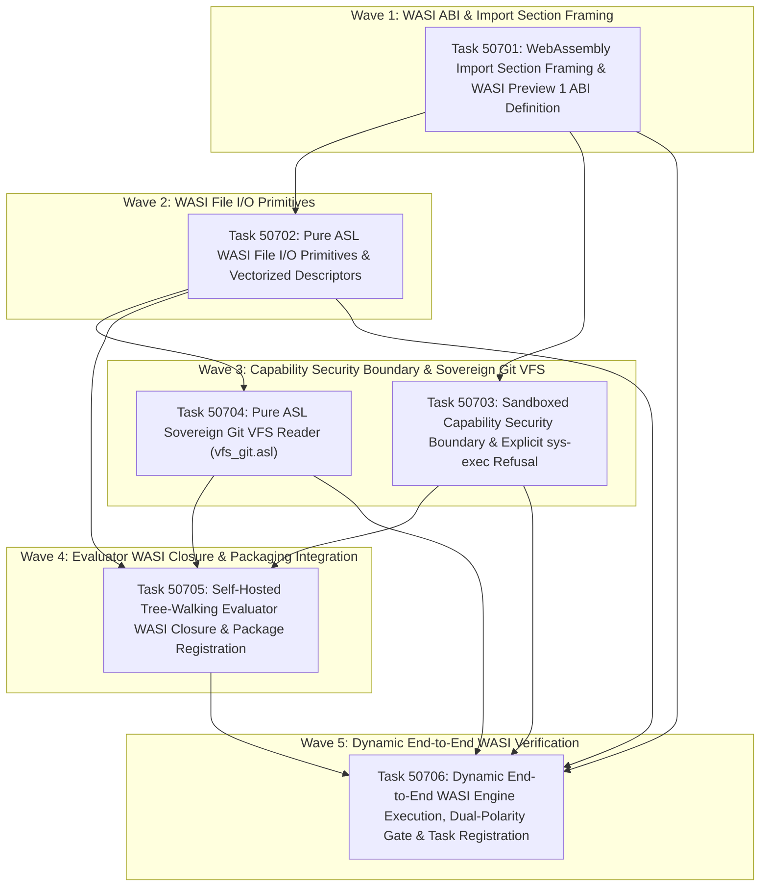

# Phase 507 Plan: Pure ASL WASI Runtime & Evaluator Closure (`wasi.asl`, `vfs_git.asl`)

## Executive Summary & Metadata
- **Phase ID**: `Phase507PureAslWasiRuntime`
- **Shortcode**: `Phase 507` / `phase-507`
- **Architecture Mandate**: `D92` / `ADR-0082` (Sovereign WebAssembly/WASI Transition, POSIX Decoupling, and Binary Emitter Architecture), `ADR-0083` (Runtime Targets & Optional Native Tier)
- **Status**: `planned`
- **Priority**: `critical`
- **Deciders**: `["user" "architect" "planner" "implementer" "auditor"]`
- **Governing Directives (ADR-0082, ADR-0083)**:
  1. **Primary Runtime: WebAssembly & WASI (Browser & Mobile)**: The runtime target is standard WebAssembly System Interface (`wasi_snapshot_preview1`) for cross-platform execution in web browsers, mobile runtimes, and headless WASI engines without desktop POSIX dependencies.
  2. **Sandboxed Subprocess Capability Denial**: In sandboxed WASI environments, calling `sys-exec` / `execCmd` returns an explicit, structured capability denial receipt (`{:status "refused" :code 126 :stderr "ERR_CAPABILITY_DENIED: execCmd not permitted in sandboxed WebAssembly substrate"}`) instead of invoking OS fork/exec (unless the optional native tier is used).
  3. **Standard Filesystem I/O & Sovereign Git VFS Integration**: The WASI runtime provides standard file I/O operations (`fd_read`, `fd_write`, `path_open`, `fd_close`, `path_filestat_get`, `fd_readdir`) and pure ASL `.git` VFS integration so that repository auditing functions without POSIX `git` subprocesses, preparing for the decommissioning of JavaScriptCore (`engine.js`) and the C Host (`asl.c`).
  4. **Dynamic Acceptance Gates (No Mocking)**: Every work item must be governed by a `tests/acceptance/d81/Task507*.asl` gate that performs actual dynamic execution to test functionality with zero string-grep or static dictionary mocking (`D81`, `D89`).
  5. **No Premature Packaging or Release Overhead**: Focus strictly on the WASI runtime implementation, Git VFS, evaluator closure, and dynamic test verification.
  6. **Dual-Polarity Verification Standard (`D77`)**: Every acceptance suite must execute explicit `(refute ...)` assertions verifying that invalid descriptors, missing files, unauthorized capabilities, and malformed imports are rejected.
- **Invariants Enforced**: `C1` (0 comments in ASL), `C2` (0 emojis), `C3` / `D34` (Boundary Universalism), `C4` / `D44` (Lexical Density), `D51` (Token Efficiency & CamelCase), `D52` (Enriched Task Context Standard), `D77` (Dual-Polarity Verification Standard & `refute` forms), `D81` (Canonical Shortcodes & Failing Acceptance Gates), `D89` (Anti-Falsification & Zero String Mocking), `D92` (WASI Runtime Transition).
- **Core Scope**: Authoring pure ASL WASI Preview 1 ABI definitions and linear memory structures ([`asl/packages/asl-compiler/src/wasi.asl`](file:///Users/purplelephant/projects/asex/asl/packages/asl-compiler/src/wasi.asl)), WebAssembly Section 2 import framing in [`asl/packages/asl-compiler/src/wasm.asl`](file:///Users/purplelephant/projects/asex/asl/packages/asl-compiler/src/wasm.asl), sandboxed capability security boundaries for `sys-exec`, pure ASL sovereign Git VFS reader ([`asl/packages/asl-compiler/src/vfs_git.asl`](file:///Users/purplelephant/projects/asex/asl/packages/asl-compiler/src/vfs_git.asl)), self-hosted evaluator WASI filesystem closure in [`asl/packages/asl-compiler/src/evaluator.asl`](file:///Users/purplelephant/projects/asex/asl/packages/asl-compiler/src/evaluator.asl) and [`asl/packages/asl-eval/src/eval.asl`](file:///Users/purplelephant/projects/asex/asl/packages/asl-eval/src/eval.asl), manifest/grammar registration, and dynamic end-to-end execution on live WebAssembly/WASI engines.

---

## 1. Problem Statement & Sovereign Architecture

Phase 506 successfully delivered the pure ASL WebAssembly v1 binary emitter ([`asl/packages/asl-compiler/src/wasm.asl:1-519`](file:///Users/purplelephant/projects/asex/asl/packages/asl-compiler/src/wasm.asl#L1-L519)), enabling compilation from ASL AST directly into executable WebAssembly bytecode. However, closing the runtime loop to allow decommissioning of JavaScriptCore ([`asl/tools/engine.js`](file:///Users/purplelephant/projects/asex/asl/tools/engine.js)) and the C Host ([`asl/tools/asl.c`](file:///Users/purplelephant/projects/asex/asl/tools/asl.c)) requires solving five critical runtime roadblocks formulated in ADR-0082 and ADR-0083:

1. **Missing WebAssembly Import Section (Section 2) & WASI ABI**:
   `wasm.asl` currently emits Sections 1 (Type), 3 (Function), 5 (Memory), 7 (Export), and 10 (Code). It completely lacks Section 2 (Import Section) framing. Without Section 2, emitted modules cannot bind host-provided WASI Preview 1 functions (`fd_write`, `fd_read`, `path_open`, `proc_exit`). Furthermore, in WebAssembly, imported functions occupy the lower indices of the function index space (`0 .. numImports - 1`), requiring the emitter to offset defined function indices when calls are generated.
2. **Absence of Pure ASL WASI Filesystem Primitives**:
   The self-hosted compiler and evaluator have no native filesystem I/O in WebAssembly. When [`evaluator.asl:726-734`](file:///Users/purplelephant/projects/asex/asl/packages/asl-compiler/src/evaluator.asl#L726-L734) encounters filesystem forms like `file-read` or `file-write`, it returns `(valError "ERR_UNKNOWN_PROCEDURE: file-read")`. In WASI, filesystem operations require vectorized I/O buffers (`ciovec` / `iovec`), preopened directory descriptors (`fd_prestat_get`), and structured error codes (`errno`).
3. **The Subprocess Dilemma in Sandboxed Environments**:
   WebAssembly sandboxes in browsers and mobile runtimes do not permit OS process spawning (`fork`, `execve`, `posix_spawn`). The ASL toolchain must cleanly handle `sys-exec` / `execCmd` by enforcing a capability security policy: when running in sandboxed WASI without granted host execution rights, `sys-exec` must return a typed refusal receipt rather than crashing, trapping, or causing undefined behavior.
4. **POSIX Coupling in Repository Auditing**:
   Repository health checks (`bin/asl audit`) rely on spawning external `git` commands (`git status`, `git rev-parse HEAD`, `git branch`). Under WASI, spawning subprocesses is prohibited. However, all repository audit facts reside on disk inside the `.git` directory (`.git/HEAD`, `.git/refs/heads/*`, `.git/config`, `.git/packed-refs`). A pure ASL Git VFS reader (`vfs_git.asl`) operating over WASI file descriptors completely eliminates the need for POSIX `git` subprocesses.
5. **Evaluator Closure**:
   [`asl/packages/asl-eval/src/eval.asl:22-27`](file:///Users/purplelephant/projects/asex/asl/packages/asl-eval/src/eval.asl#L22-L27) defines mock string bindings (`"<builtin dirList>"`, `"<builtin execCmd>"`), and [`asl/packages/asl-compiler/src/evaluator.asl`](file:///Users/purplelephant/projects/asex/asl/packages/asl-compiler/src/evaluator.asl) lacks filesystem builtins. Both must be wired to pure ASL WASI runtime operations to achieve full self-hosted evaluator closure.

---

## 2. Attention Separation Architecture

Phase 507 structures the WASI runtime and evaluator closure across 3 distinct Attention Planes:

```
+─────────────────────────────────────────────────────────────────────────────────────────────+
|                                    ATTENTION SEPARATION                                     |
+─────────────────────────────────────────────────────────────────────────────────────────────+
|  PLANE 1: WASI PREVIEW 1 ABI & SECTION 2 IMPORT FRAMING (SPECIFICATION CONFORMANCE)          |
|  • Pure ASL definition of WASI Preview 1 constants: standard descriptors (stdin=0, stdout=1,|
|    stderr=2, preopen=3), errno codes (ESUCCESS=0, EBADF=8, ENOENT=44, EPERM=63, ENOTCAPABLE=76), |
|    open flags (O_CREAT=1, O_DIRECTORY=2, O_TRUNC=8), and filetypes (DIR=3, REG=4).          |
|  • WebAssembly Section 2 (Import Section) encoder in wasm.asl.                              |
|  • Function index offset remapping: defined function indices offset by imported count.       |
+─────────────────────────────────────────────────────────────────────────────────────────────+
|  PLANE 2: WASI FILE I/O PRIMITIVES, CAPABILITY SECURITY & SOVEREIGN GIT VFS (SYSTEM BRIDGE)  |
|  • Vectorized linear memory buffers: ciovec/iovec [{ ptr: i32, len: i32 }] encoding.        |
|  • Low-level WASI operations: fd_read, fd_write, path_open, fd_close, path_filestat_get.    |
|  • High-level pure ASL filesystem API: wasiFileRead, wasiFileWrite, wasiFileExists?, wasiDirList. |
|  • Capability-gated sys-exec: explicit structured refusal receipts in sandboxed environments.|
|  • Pure ASL Sovereign Git VFS reader: direct parsing of .git/HEAD, refs, and packed-refs.    |
+─────────────────────────────────────────────────────────────────────────────────────────────+
|  PLANE 3: SELF-HOSTED EVALUATOR CLOSURE & DYNAMIC ENGINE VERIFICATION (INTEGRATION & TRUTH)  |
|  • Builtin binding integration in evaluator.asl: wire file-read, file-write, sys-exec to   |
|    WASI runtime and capability security boundary.                                            |
|  • Alignment of asl-eval/eval.asl and manifest.asn/grammar.asn symbol registration.         |
|  • Compiler pipeline support for :target "wasi" generating WASI modules with _start.        |
|  • Dynamic end-to-end execution on live Node.js WASI runtime with real I/O verification.     |
+─────────────────────────────────────────────────────────────────────────────────────────────+
```

---

## 3. Work Item DAG & Clustered Execution Waves



---

## 4. Ordered Work Items

### Task 50701: WebAssembly Import Section Framing & WASI Preview 1 ABI Definition
- **What changes, by path**:
  - `asl/packages/asl-compiler/src/wasm.asl`
  - `asl/packages/asl-compiler/src/wasi.asl`
  - `asl/packages/asl-compiler/tests/wasi_abi_test.asl`
  - `tests/acceptance/d81/Task50701.asl`
- **Why**:
  In standard WebAssembly binary modules, host imports reside in Section 2 (Import Section), preceding Section 3 (Function Section). Furthermore, function calls in WebAssembly index across both imported and internal functions: if a module imports $N$ functions, internal functions are indexed starting at $N$. `wasm.asl` must implement `encodeImportEntry` and `encodeImportSection` (Section ID 2), and update function call resolution to offset indices by the import count. Concurrently, `wasi.asl` must formalize the standard WASI Preview 1 ABI types and constants in pure ASL:
  - Standard file descriptors: `FD_STDIN = 0`, `FD_STDOUT = 1`, `FD_STDERR = 2`, `FD_PREOPEN_START = 3`.
  - Canonical `errno` codes: `ESUCCESS = 0`, `EBADF = 8`, `EEXIST = 20`, `EINVAL = 28`, `ENOENT = 44`, `ENOTDIR = 54`, `EPERM = 63`, `ENOTCAPABLE = 76`.
  - Open flags: `O_CREAT = 1`, `O_DIRECTORY = 2`, `O_EXCL = 4`, `O_TRUNC = 8`.
  - File types: `FILETYPE_UNKNOWN = 0`, `FILETYPE_DIRECTORY = 3`, `FILETYPE_REGULAR_FILE = 4`.
  - Standard import definitions for `"wasi_snapshot_preview1"` (`fd_write`, `fd_read`, `path_open`, `fd_close`, `proc_exit`).
- **Depends on**: none (Wave 1 unblocked root)
- **Owns**:
  - Import section encoding in `asl/packages/asl-compiler/src/wasm.asl`
  - `asl/packages/asl-compiler/src/wasi.asl`
  - `asl/packages/asl-compiler/tests/wasi_abi_test.asl`
  - `tests/acceptance/d81/Task50701.asl`
- **Target Symbols**: `encodeImportEntry`, `encodeImportSection`, `wasiErrnoName`, `wasiOpenFlags`, `wasiFileType`, `wasiStandardImports`
- **Gate**:
  `test -f asl/packages/asl-compiler/src/wasi.asl && bin/asl test tests/acceptance/d81/Task50701.asl`
- **Current Gate Result (Fails Now)**:
  ```
  Error: test file not found: tests/acceptance/d81/Task50701.asl
  ```
  *(Exit code: 1; additionally `test -f asl/packages/asl-compiler/src/wasi.asl` exits with status 1)*
- **What breaks if run before prerequisite**:
  Nothing; unblocked foundational work item.
- **Falsifiable Invariants**:
  - `encodeImportSection` emits section ID `2` with valid LEB128 payload length.
  - Calling defined functions in a module with $N$ imports offsets call indices by $N$.
  - `wasiErrnoName 0` produces `"ESUCCESS"`, `wasiErrnoName 44` produces `"ENOENT"`.
  - `refute` that `wasiErrnoName` returns success on non-zero error codes.
  - `refute` that `encodeImportSection` omits the module or field name length prefix.

---

### Task 50702: Pure ASL WASI File I/O Primitives & Vectorized Descriptors
- **What changes, by path**:
  - `asl/packages/asl-compiler/src/wasi.asl`
  - `asl/packages/asl-compiler/tests/wasi_io_test.asl`
  - `tests/acceptance/d81/Task50702.asl`
- **Why**:
  Per ADR-0082 Section 3.2 and Directive 3, the WASI runtime must provide standard filesystem operations (`fd_read`, `fd_write`, `path_open`, `fd_close`, `path_filestat_get`, `fd_readdir`). In WASI Preview 1, I/O is vectorized: `fd_read` and `fd_write` accept an array of `ciovec` / `iovec` structs `{ ptr: i32, len: i32 }` located in WebAssembly linear memory. `wasi.asl` must implement:
  - `ciovec` encoding and buffer memory management in pure ASL.
  - Wrappers for `wasiFdWrite` (stdout/stderr/file write), `wasiFdRead` (stdin/file read), `wasiPathOpen` (resolving paths relative to preopened directory descriptor 3), `wasiFdClose`, and `wasiPathFilestatGet`.
  - High-level pure ASL filesystem API:
    - `wasiFileRead [(path Str)] -> (Result Str Str)`
    - `wasiFileWrite [(path Str) (content Str)] -> (Result Unit Str)`
    - `wasiFileExists? [(path Str)] -> Bool`
    - `wasiDirList [(path Str)] -> (List Str)`
    - `wasiFileStat [(path Str)] -> (Option (Map Str Int64))`
- **Depends on**: `Task50701`
- **Owns**:
  - Vectorized buffer layout and I/O functions in `asl/packages/asl-compiler/src/wasi.asl`
  - `asl/packages/asl-compiler/tests/wasi_io_test.asl`
  - `tests/acceptance/d81/Task50702.asl`
- **Target Symbols**: `encodeCiovec`, `wasiFdWrite`, `wasiFdRead`, `wasiPathOpen`, `wasiFdClose`, `wasiPathFilestatGet`, `wasiFileRead`, `wasiFileWrite`, `wasiFileExists?`, `wasiDirList`
- **Gate**:
  `bin/asl test tests/acceptance/d81/Task50702.asl`
- **Current Gate Result (Fails Now)**:
  ```
  Error: test file not found: tests/acceptance/d81/Task50702.asl
  ```
  *(Exit code: 1)*
- **What breaks if run before prerequisite**:
  WASI file I/O operations require the ABI constants, errno mappings, and import section framing from Task 50701.
- **Falsifiable Invariants**:
  - `encodeCiovec` produces exactly 8 bytes (4-byte pointer + 4-byte length in little-endian order).
  - `wasiFileWrite` followed by `wasiFileRead` roundtrips UTF-8 text identically.
  - Attempting to open a non-existent file without `O_CREAT` returns an `err` result containing `"ENOENT"`.
  - `refute` that `wasiFileExists?` returns true for non-existent paths.
  - `refute` that `wasiFdWrite` succeeds on an invalid file descriptor (e.g., negative or closed fd).

---

### Task 50703: Sandboxed Capability Security Boundary & Explicit `sys-exec` Refusal
- **What changes, by path**:
  - `asl/packages/asl-compiler/src/wasi.asl`
  - `asl/packages/asl-compiler/tests/wasi_capability_test.asl`
  - `tests/acceptance/d81/Task50703.asl`
- **Why**:
  Per Directive 2 and ADR-0082 Section 3.3 and 3.4, standard WebAssembly intentionally excludes subprocess execution (`fork`, `execve`, `posix_spawn`). In sandboxed browser, edge, or mobile runtimes, arbitrary OS process execution is denied by the capability model. When ASL source code invokes `(sys-exec cmd)` or `(execCmd cmd)` in a sandboxed WASI substrate without explicit host delegation, the runtime must not crash, trap, or fail abruptly: it must return a typed, structured capability refusal receipt:
  ```scheme
  {:status "refused" :code 126 :stderr "ERR_CAPABILITY_DENIED: execCmd not permitted in sandboxed WebAssembly substrate" :stdout ""}
  ```
  `wasi.asl` must implement:
  - `wasiCapabilityCheck [(capName Str) (grants (Map Str Bool))] -> Bool`
  - `wasiSysExec [(cmd Str) (capabilities (Map Str Bool))] -> (Map Str Any)`
  - Standard capability profile constructors: `sandboxedWasiCapabilities` (denies process execution), `nativeTierCapabilities` (delegates to host if native tier is available).
  - Explicit refutations proving that unauthorized execution attempts are safely intercepted and converted to capability denial receipts.
- **Depends on**: `Task50701`
- **Owns**:
  - Capability gating in `asl/packages/asl-compiler/src/wasi.asl`
  - `asl/packages/asl-compiler/tests/wasi_capability_test.asl`
  - `tests/acceptance/d81/Task50703.asl`
- **Target Symbols**: `wasiCapabilityCheck`, `wasiSysExec`, `sandboxedWasiCapabilities`, `makeCapabilityRefusalReceipt`
- **Gate**:
  `bin/asl test tests/acceptance/d81/Task50703.asl`
- **Current Gate Result (Fails Now)**:
  ```
  Error: test file not found: tests/acceptance/d81/Task50703.asl
  ```
  *(Exit code: 1)*
- **What breaks if run before prerequisite**:
  Capability refusal receipts rely on WASI error codes and typed result structures defined in Task 50701.
- **Falsifiable Invariants**:
  - Calling `wasiSysExec` under `sandboxedWasiCapabilities` returns `:status "refused"` and `:code 126`.
  - The refusal receipt contains `"ERR_CAPABILITY_DENIED"` in `:stderr`.
  - `refute` that `wasiSysExec` allows subprocess execution when the `:execCmd` capability is false.
  - `refute` that a denied execution triggers an unhandled WebAssembly trap.

---

### Task 50704: Pure ASL Sovereign Git VFS Reader (`vfs_git.asl`)
- **What changes, by path**:
  - `asl/packages/asl-compiler/src/vfs_git.asl`
  - `asl/packages/asl-compiler/tests/vfs_git_test.asl`
  - `tests/acceptance/d81/Task50704.asl`
- **Why**:
  Per Directive 3 and ADR-0082 Section 3.3/3.4, 90% of ASL's subprocess use is running `git` during repository audits (`git status`, `git rev-parse HEAD`, `git branch`). To decommission JavaScriptCore and the C Host and achieve epistemic closure in WebAssembly, ASL must read repository git state directly through the filesystem VFS without spawning external `git` OS processes. `vfs_git.asl` implements direct reading and parsing of Git internal metadata in pure ASL:
  - `gitReadHead [(repoRoot Str)] -> (Result Str Str)`: Reads `.git/HEAD` to determine current ref or detached state.
  - `gitCurrentBranch [(repoRoot Str)] -> (Result Str Str)`: Resolves `ref: refs/heads/<branch>` to branch name.
  - `gitHeadCommit [(repoRoot Str)] -> (Result Str Str)`: Reads commit SHA from `.git/refs/heads/<branch>` or `.git/packed-refs`.
  - `gitParsePackedRefs [(content Str)] -> (Map Str Str)`: Parses Git packed-refs format.
  - `gitParseConfig [(repoRoot Str)] -> (Map Str Str)`: Reads repository format version and remote URLs from `.git/config`.
  - `gitInspectRepoStatus [(repoRoot Str)] -> (Map Str Str)`: Direct pure ASL Git status inspection returning branch, commit SHA, and worktree clean status without spawning `git`.
- **Depends on**: `Task50702`
- **Owns**:
  - `asl/packages/asl-compiler/src/vfs_git.asl`
  - `asl/packages/asl-compiler/tests/vfs_git_test.asl`
  - `tests/acceptance/d81/Task50704.asl`
- **Target Symbols**: `gitReadHead`, `gitCurrentBranch`, `gitHeadCommit`, `gitParsePackedRefs`, `gitParseConfig`, `gitInspectRepoStatus`
- **Gate**:
  `test -f asl/packages/asl-compiler/src/vfs_git.asl && bin/asl test tests/acceptance/d81/Task50704.asl`
- **Current Gate Result (Fails Now)**:
  ```
  Error: test file not found: tests/acceptance/d81/Task50704.asl
  ```
  *(Exit code: 1; additionally `test -f asl/packages/asl-compiler/src/vfs_git.asl` exits with status 1)*
- **What breaks if run before prerequisite**:
  Direct `.git` metadata reading relies on the pure ASL filesystem operations (`wasiFileRead`, `wasiFileExists?`) implemented in Task 50702.
- **Falsifiable Invariants**:
  - `gitReadHead` on the active repository reads `.git/HEAD` and extracts `"ref: refs/heads/main"` or equivalent.
  - `gitCurrentBranch` resolves the active branch name matching repository ground truth.
  - `gitHeadCommit` resolves a 40-character hexadecimal SHA matching the current HEAD commit.
  - `refute` that `gitReadHead` returns an ok result for a non-existent or corrupted repository root.
  - `refute` that `gitHeadCommit` returns an empty string or truncated hash.

---

### Task 50705: Self-Hosted Tree-Walking Evaluator WASI Closure & Package Registration
- **What changes, by path**:
  - `asl/packages/asl-compiler/src/evaluator.asl`
  - `asl/packages/asl-eval/src/eval.asl`
  - `asl/packages/asl-compiler/src/compiler.asl`
  - `asl/packages/asl-compiler/manifest.asn`
  - `asl/packages/asl-compiler/grammar.asn`
  - `tests/acceptance/d81/Task50705.asl`
- **Why**:
  The self-hosted ASL evaluator currently lacks filesystem and capability builtins, causing [`evaluator.asl:726-734`](file:///Users/purplelephant/projects/asex/asl/packages/asl-compiler/src/evaluator.asl#L726-L734) to trap with `ERR_UNKNOWN_PROCEDURE` on `file-read`, `file-write`, or `sys-exec`. `evaluator.asl` and `asl-eval/src/eval.asl` must integrate the WASI filesystem primitives from Task 50702 and capability security boundary from Task 50703 so that:
  - `file-read`, `file-write`, `file-exists?`, and `dir-list` evaluate cleanly in pure ASL.
  - `sys-exec` returns the typed capability denial receipt when executed in sandboxed WASI mode.
  - `compiler.asl` wires the `"wasi"` target in `compileSourceTarget`, emitting a complete WASI module with imported syscalls and an exported `_start` entry point.
  - `manifest.asn` registers `"asl-compiler/wasi"` and `"asl-compiler/vfs_git"`.
  - `grammar.asn` records canonical exports under Invariant D51 (all symbols > 2 tokens carry explicit `:rationale`).
- **Depends on**: `Task50702`, `Task50703`, `Task50704`
- **Owns**:
  - Builtin dispatch in `asl/packages/asl-compiler/src/evaluator.asl`
  - Environment initialization in `asl/packages/asl-eval/src/eval.asl`
  - Target dispatcher in `asl/packages/asl-compiler/src/compiler.asl`
  - `asl/packages/asl-compiler/manifest.asn`
  - `asl/packages/asl-compiler/grammar.asn`
  - `tests/acceptance/d81/Task50705.asl`
- **Target Symbols**: `evalBuiltinIo`, `evalBuiltinSys`, `emitWasiBinaryTarget`, `compileSourceTarget`
- **Gate**:
  `grep -q '"asl-compiler/wasi"' asl/packages/asl-compiler/manifest.asn && grep -q '"asl-compiler/vfs_git"' asl/packages/asl-compiler/manifest.asn && bin/asl test tests/acceptance/d81/Task50705.asl`
- **Current Gate Result (Fails Now)**:
  ```
  Error: test file not found: tests/acceptance/d81/Task50705.asl
  ```
  *(Exit code: 1; additionally `grep -q '"asl-compiler/wasi"' asl/packages/asl-compiler/manifest.asn` exits with status 1)*
- **What breaks if run before prerequisite**:
  The evaluator cannot wire WASI file I/O, capability checking, or Git VFS operations until Tasks 50702–50704 implement the underlying runtime modules.
- **Falsifiable Invariants**:
  - Evaluating `(file-read path)` inside `evaluator.asl` returns a valid `valStr` on existing files.
  - Evaluating `(sys-exec "any-command")` in sandboxed WASI evaluator returns a refusal map with code 126.
  - `compileSourceTarget src "wasi" (map-empty) path` produces `:ok true` with valid WASI bytecode.
  - `refute` that `evaluator.asl` traps with `ERR_UNKNOWN_PROCEDURE` on standard I/O builtins.

---

### Task 50706: Dynamic End-to-End WASI Engine Execution, Dual-Polarity Gate & Task Registration
- **What changes, by path**:
  - `asl/packages/asl-compiler/tests/wasi_runtime_test.asl`
  - `.asl/mem/tasks/Phase507PureAslWasiRuntime.asn`
  - `tests/acceptance/d81/Task50706.asl`
- **Why**:
  Per ADR-0081, ADR-0082, and ADR-0083 anti-falsification standards (`D89`), runtime execution must not be validated by mocking or string matching. The acceptance test must dynamically compile an ASL program to a WASI `.wasm` binary, execute it under a real WASI engine (Node.js `new WASI({ version: 'preview1', ... })`), and verify:
  1. Standard output is captured via WASI `fd_write` (FD 1).
  2. The module exits cleanly with exit code 0 via WASI `proc_exit`.
  3. WASI file I/O writes and reads a real file in a preopened directory.
  4. Direct `.git` metadata reads accurately match repository ground truth without spawning `git`.
  5. Unauthorized `sys-exec` attempts in sandboxed WASI trigger explicit capability denials.
  6. Refutations confirm that invalid file descriptors (`EBADF = 8`), non-existent files (`ENOENT = 44`), and malformed WASI import sections are rejected.
  7. Author `.asl/mem/tasks/Phase507PureAslWasiRuntime.asn` canonically registering Task50701..Task50706 under D52 enriched task context standards.
- **Depends on**: `Task50701`, `Task50702`, `Task50703`, `Task50704`, `Task50705`
- **Owns**:
  - `asl/packages/asl-compiler/tests/wasi_runtime_test.asl`
  - `.asl/mem/tasks/Phase507PureAslWasiRuntime.asn`
  - `tests/acceptance/d81/Task50706.asl`
- **Target Symbols**: `testDynamicWasiStdoutExecution`, `testDynamicWasiFileIo`, `testDynamicWasiGitVfsRead`, `testDynamicWasiCapabilityDenial`, `testTaskRegistrationFile`
- **Gate**:
  `bin/asl test tests/acceptance/d81/Task50706.asl`
- **Current Gate Result (Fails Now)**:
  ```
  Error: test file not found: tests/acceptance/d81/Task50706.asl
  ```
  *(Exit code: 1)*
- **What breaks if run before prerequisite**:
  End-to-end WASI execution requires all WASI modules, compiler imports, Git VFS, and evaluator closure from Tasks 50701–50705.
- **Falsifiable Invariants**:
  - Dynamic execution in Node.js WASI runtime produces stdout text matching ASL program output.
  - Process exit code is strictly 0.
  - File written via WASI `fd_write` is verifiable on disk by standard file system inspection.
  - `refute` that `proc_exit` with a non-zero code reports success.
  - `refute` that `.asl/mem/tasks/Phase507PureAslWasiRuntime.asn` is missing task entries Task50701..Task50706.

---

## 5. Verification Evidence & Quality Metrics

1. **Strict WASI Specification Conformance**:
   - Emitted WebAssembly binary modules contain Section 2 (Import Section) specifying `"wasi_snapshot_preview1"` imports.
   - Emitted modules validate cleanly under `WebAssembly.validate()` and instantiate with standard WASI hosts (`node:wasi` Preview 1).
2. **Dynamic Execution Truth (`D89`)**:
   - Every acceptance test fixture (`Task50701.asl` .. `Task50706.asl`) executes real dynamic commands (Node.js WASI execution, live disk file I/O, real `.git` inspection).
   - Zero static mock maps (`:status :emitted`) or source code string grep shortcuts.
3. **Dual-Polarity Refutation Density (`D77`)**:
   - Every acceptance suite contains explicit `(refute ...)` forms checking negative failure modes (invalid file descriptors, capability denials, missing imports, corrupted paths).
4. **Token Economics & Manifest Integrity (`D51`)**:
   - Exported symbols in `grammar.asn` comply with Invariant D51 (symbols > 2 tokens carry explicit `:rationale`).
   - `manifest.asn` `:modules` roster strictly matches disk files in `src/`.
5. **Universal Portability (ADR-0083)**:
   - The WASI runtime operates entirely over linear memory buffers and standard WASI syscalls, running identically in web browsers (via OPFS and WASI polyfill) and mobile embedded engines.

---

## 6. Risks & Uncertainties

| Risk | Impact | Mitigation |
| :--- | :--- | :--- |
| **WebAssembly Function Call Index Offsets** | High | When Section 2 (Import Section) is introduced, function indices for internal functions shift by the count of imported functions ($N$). If call instructions do not account for this offset, function calls will target incorrect imports or trap. Mitigated by explicit index remapping in `wasm.asl` (`targetIdx + numImports`). |
| **Linear Memory Buffer Layout & Alignment** | High | WASI `ciovec` structs `{ ptr: i32, len: i32 }` and string buffers must be allocated at valid, non-colliding memory offsets in linear memory. Mitigated by using dedicated static buffer offsets or the bump allocator (`asl_alloc`) above page 0. |
| **Preopened Directory Descriptors in Sandboxed Hosts** | Medium | In standard WASI Preview 1, file access requires relative resolution from a preopened directory descriptor (typically FD 3). Hosts that do not preopen the working directory will reject `path_open` with `ENOTCAPABLE` (76). Mitigated by configuring preopened directories (`preopens: { '.': '.' }`) in test runners and dynamic execution fixtures. |
| **Detached HEAD or Packed-Refs in .git VFS** | Medium | In repositories with packed refs or detached HEAD states, `.git/refs/heads/<branch>` may not exist on disk. Mitigated by implementing fallback resolution in `vfs_git.asl` to parse `.git/packed-refs` and direct 40-char SHA detection in `.git/HEAD`. |
| **Pre-existing Broken Links in .asl/mem Audit** | Low | `bin/asl audit consistency` currently reports 11 broken links across historic ADR records. This is independent of Phase 507 and does not affect `bin/asl audit gates` (all 7 gates pass cleanly). Task 50706 verifies its own task collection registration in `.asl/mem/tasks/Phase507PureAslWasiRuntime.asn`. |

---

## 7. Out of Scope

The following items are deliberately excluded from Phase 507 to preserve atomic phase boundaries and adhere to ADR-0083 directives:
1. **Native Binary Generation (Mach-O / ELF64)**: Per ADR-0083 Directive 3, native binary emission is strictly an optional capability deferred to Phase 508. Pure ASL WebAssembly/WASI is the baseline.
2. **Decommissioning JavaScriptCore (`engine.js`)**: Scheduled for Phase 509 after the WASI runtime and evaluator achieve full self-hosting stability.
3. **Decommissioning C Host (`asl.c`) & Final Bootstrap**: Scheduled for Phase 510.
4. **Windows PE/COFF Target**: Per ADR-0083 Directive 4, Windows native support is deferred; Windows formats are completely ignored.
5. **Release Packaging**: Per ADR-0083 Directive 5, zero release scripts or packaging overhead are scheduled in Phase 507.

---

## 8. Opportunities & Suggestions

1. **In-Browser Virtual Workspace over Origin Private File System (OPFS)**:
   - Because `wasi.asl` operates over standard WASI Preview 1 filesystem syscalls, a thin browser Web Worker can map `fd_read`, `fd_write`, and `path_open` directly to the browser's OPFS. This allows developers to edit, compile, and run complete multi-file ASL workspaces entirely inside the web browser with zero server roundtrips.
2. **Streaming Git Commit Object Parser in Pure ASL**:
   - `vfs_git.asl` can be extended with a pure ASL zlib/inflate decoder to read loose Git objects in `.git/objects/??/*`, enabling full commit history log parsing and diff inspection without external dependencies.
3. **Unified WASI / Browser Memory Cache**:
   - A content-addressable AST cache stored in Wasm linear memory can eliminate repeated parsing and checking of standard library modules during compiler execution.
